# Vigília: O Portador da Chama — documentação única

Versão do documento: 2026-10-22
Jogo: **Vigília: O Portador da Chama**, RPG idle de um herói só, em 3D, com uma vila que cresce com o que ele traz do abismo.
Stack: TypeScript, Vite, Preact e Three.js.
Arte: família **KayKit** (Kay Lousberg), CC0 1.0. O registro de cada pack está em [`LICENSES.md`](../LICENSES.md).
Parentesco: segue a estrutura do **Vigília**: núcleo puro e determinístico, estado em JSON, ticks, save com migração, progresso offline e restos de quem caiu. A diferença é que aqui há um herói só, e o jogador o acompanha.

Este arquivo reúne o GDD, o estado do projeto e a direção de arte. O README da raiz é só a porta de entrada.

## Índice

1. [Estado, como jogar e arquitetura](#1-estado-como-jogar-e-arquitetura)
2. [Game Design Document](#2-game-design-document)
3. [Arte: família, pipeline e licenças](#3-arte-família-pipeline-e-licenças)
4. [Histórico de decisões](#4-histórico-de-decisões)

---

## 1. Estado, como jogar e arquitetura

**Estado atual: M3 (os Atos II e III) concluído** (seção 14.4), com a M3.4, o polimento dos três atos. Ele vem sobre a vila viva do M2 (14.3), o Ato I do M1 (14.2) e o protótipo do M0 (2.14).

**M3.4 (o polimento), em 2026-10-22:**

- **HUD no celular:** com o ferro-negro e os esporos, a linha de cima estourava, e os botões Vila e ☰ sumiam em 375 px de largura. Agora:
  - os números do HUD são curtos (1,2 mi, 12,3 mil), com o valor inteiro na dica;
  - cada material fica inteiro numa peça só;
  - os botões descem para a linha de baixo quando não cabem.
- **Veneno à vista:** o herói envenenado solta bolhas verdes, mais bolhas a cada dose (`venom.ts`).
- **A vila comemora cada ato:** a festa de um dia vem também com a primeira vitória sobre a Couraça e sobre a Mãe-Bolor.
- **A crônica anuncia os atos:** ela registra a descida às Minas Inundadas e a chegada ao Jardim de Fungos.
- **Custos da vila:** apareciam com o nome interno do material ("ferro_negro"). Agora sai o nome do jogo.
- 92 testes. O balanceador passa as 34 metas nas duas faixas de sementes.

**M3.3 (o Jardim de Fungos, o Ato III), em 2026-10-22:**

- **Andares 21 a 30:**
  - inimigos: esporentos, brotados, aranhas-de-micélio e bolores cuspidores;
  - no andar 25, o Guardião de Micélio, que cura os outros;
  - no 30, a Mãe-Bolor, que na fase 2 faz brotar brotados e acelera o veneno.
- **O veneno:** cada dose tira vida por 6 s, e as doses se somam até 5. A resposta é preparada na vila:
  - Purificar e Sangue Amargo, do treinador nível 3;
  - o afixo Imune;
  - o alquimista nível 5, que faz a poção também tirar o veneno.

  A Força da tela de equipamento conta o veneno.
- **Esporos,** o material do ato. Os níveis novos dos prédios pedem esporos:
  - ferreiro até o 8 (tier 16);
  - treinador 3, alquimista 5 e Salão de Táticas 5 e 6 (10 regras).

  A primeira vitória sobre a Couraça traz os primeiros 30.
- **O cenário:**
  - pedra violeta;
  - cogumelos gigantes com pintas que brilham (feitos em código);
  - névoa no chão e esporos no ar.

  Na vila, a horta de cogumelos do alquimista aparece depois do ato.
- **Os monstros** são do Quaternius (Ultimate Monsters, CC0), com as animações deles:
  - cogumelos andantes (esporento);
  - bolhas verdes (brotado e aranha);
  - bolhas rosas (cuspidor);
  - o cogumelo grande de chapéu com espinhos (Guardião);
  - o rei-cogumelo (Mãe-Bolor).
- **Save v4,** com migração. 92 testes, e o balanceador passa as 34 metas nas duas faixas de sementes.

**M3.2 (a cara do Ato II), em 2026-10-22:**

- **As salas das Minas Inundadas** (andares 11 a 20) têm cara própria:
  - pedra azul-petróleo;
  - paredes escoradas com madeira, chão de terra e pedra;
  - lanternas no lugar das tochas;
  - trilhos com carrinho de minério;
  - pilhas de ferro-negro e poças com luz fria.

  Na sala da Couraça Submersa, a poça é grande.
- **A arma muda de cara com o tier:** do tier 6 em diante, espada, espadão, machado, adaga e os escudos usam as malhas do Fantasy Weapons Bits. A cor do metal segue o ato: ferro, aço e bronze no Ato I; ferro-negro no Ato II; ouro a partir do tier 11.
- **O carrinho de mina** com ferro-negro aparece na rua do ferreiro depois da vitória sobre a Couraça.
- 72 testes passavam (na M3.2), e o build saía sem erro. As salas, o carrinho e as armas foram conferidos no navegador embutido.

**M3.1 (o núcleo do Ato II), em 2026-10-22:**

- **As Minas Inundadas, andares 11 a 20:** mineiros, afogados, golens de ferro-negro e lanterneiros. No andar 15 fica o Capataz, e no 20, a Couraça Submersa, em duas fases.
- **Couraça e perfuração:** os inimigos das minas têm armadura própria. O martelo, a lança, a alabarda, o afixo Perfurante, Quebra-Couraça e Mão Pesada furam essa couraça.
- **Ferro-negro,** o material do ato: cai dos golens, dos chefes e dos baús. O treinador nível 2 e o afixo Perfurante pedem ferro-negro.
- **Treinador nível 2:** Golpe de Escudo, Quebra-Couraça, Mão Pesada e Pele Úmida. As regras ganham a condição "alvo com couraça".
- **Buscar os restos** só desce até a pilha se a Força daquele andar chegar a 0,8. Antes, quem morria no chefe voltava direto para ele e morria de novo.
- **Save v3,** com migração.

**Verificado em 2026-10-22 (M3.1):**

- 69 testes passam.
- O balanceador passa as 26 metas nas duas faixas de sementes (14.4).
- O build sai sem erro.
- Os inimigos, os chefes e o martelo apareceram no navegador embutido.

**M2.1 (a cena da vila), em 2026-10-22:**

- **A vila é um diorama:** um quadrado de terra flutuando na névoa, com a floresta lá embaixo. Ao fundo há dois platôs e a escada de pedra até a capela da Cripta, onde o herói descansa sentado na fogueira de vigília.
- **Quatro estágios,** como nas imagens de referência: destruída, reconstruída, melhorada e melhorada de novo. Eles mudam o chão, os telhados e os enfeites, e cada prédio continua com o próprio estado (ruína, obra, pronto ou ampliado).
- **Dia e noite.**
- **Câmera de observar:** arrastar, setas ou WASD movem; roda, pinça ou + e - dão zoom.
- **Bichos, janelas e passarinhos (M2.3):** o cachorro, o gato e o pintinho (no máximo 3, só bichos de casa), as janelas que acendem à noite e os passarinhos de dia.
- **Moradores (M2.2):** cada um tem nome, rosto, roupa e ofício, e segue uma rotina por hora (ferreiro, feirante, lenhador, carregador, crianças, músico e avô). Os marcos de vida trazem a feira, a lenha, a música e a festa do Senhor com as bandeirolas. Tocar num morador mostra o nome e o ofício.
- **Botão Vila/Herói** no HUD, para olhar a vila com o herói lá embaixo.
- **Toque num prédio** abre a tela da vila.

O M1 acrescentou:

- **Novo jogo:** escolha de nome e rosto, com o herói 3D trocando de rosto na hora, e um menu com Novo jogo e Créditos.
- **Forja completa:** rara e épica com o afixo escolhido pelo material, e reforja.
- **O Senhor da Cripta,** chefe do andar 10, em duas fases: na segunda, ergue os mortos.
- **Relatório "Enquanto você estava fora"** com peças, níveis, obras, restos e crônica.
- **Cabelo sob o elmo:** ajuste por cabeça.
- **Save v2,** com migração.
- **Balanceador** com 18 metas.

O M0 já trazia:

- um herói montado por partes com os modelos KayKit, com as animações parado, correr, golpe, acerto e morte, e transição suave entre elas;
- troca de arma, escudo, elmo, peitoral, perneiras e capa ao vivo pela tela de equipamento;
- uma sala de masmorra montada com o KayKit Dungeon, com esqueletos;
- combate automático decidido pela simulação;
- telas de equipamento, habilidades, regras e vila;
- a regra de morte funcionando, com rolagem, restos, recuperação e ferimento.

Os andares vão de 1 a 30, com chefes a cada 5 andares. Os Atos IV a VI e o resto do GDD ainda são proposta.

**Verificado em 2026-10-22 (M1):**

- 29 testes da simulação passam.
- O balanceador passa as 18 metas em duas faixas de sementes (20 sementes a partir de 1000 e 30 a partir de 7000).
- O build sai sem erro.
- O jogo rodou no navegador embutido e, na rede local, num celular a 133–136 fps (2.14).

#### Capturas

| | |
|---|---|
| 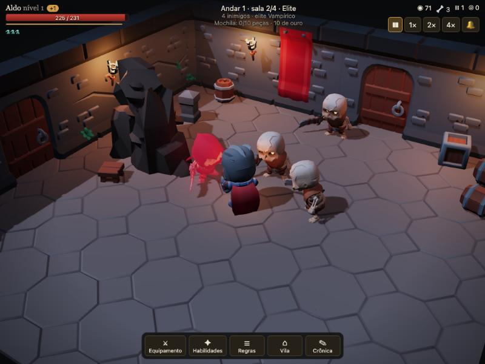 | 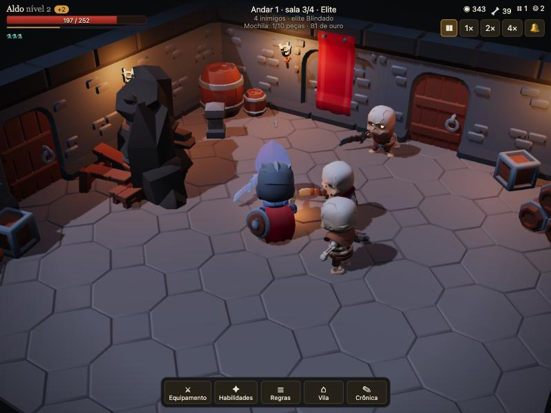 |
| Elite Vampírica (brilho vermelho), dois lacaios no anel e um esperando na porta | Anel girado: o herói luta de três quartos |
| 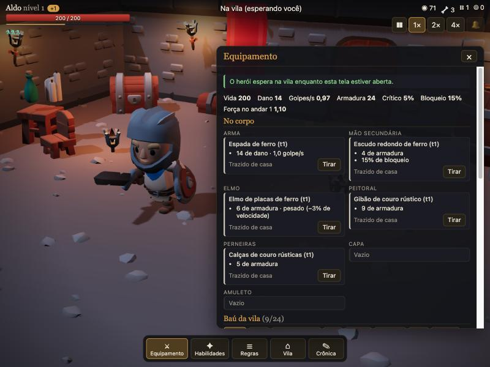 | 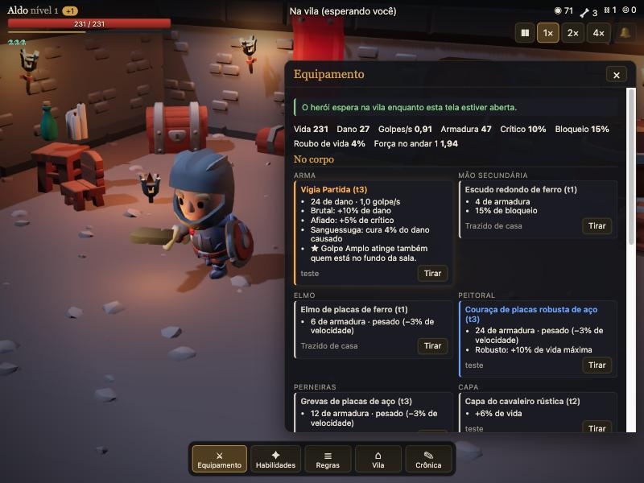 |
| Tela de equipamento: gibão e calças de couro, elmo de placas e escudo | Couraça e grevas de aço (tier 3, metal azulado), capa e a Vigia Partida brilhando |
| 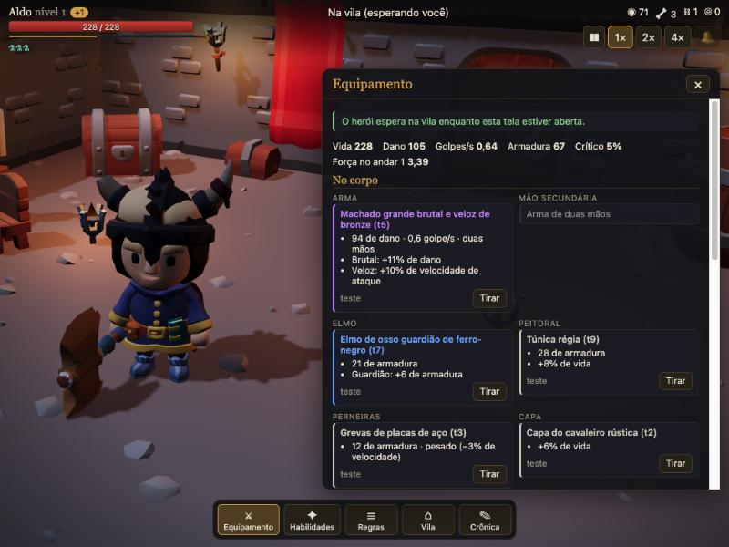 | 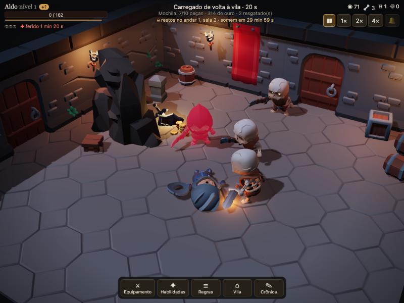 |
| Machado de duas mãos (tira o escudo), elmo de osso em ferro-negro (peça rígida) e túnica tier 9 (detalhes em ouro) | O herói caído; os restos já brilham no chão da sala |
| 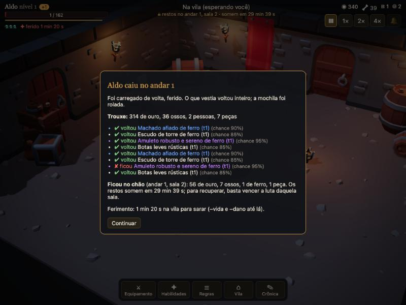 | 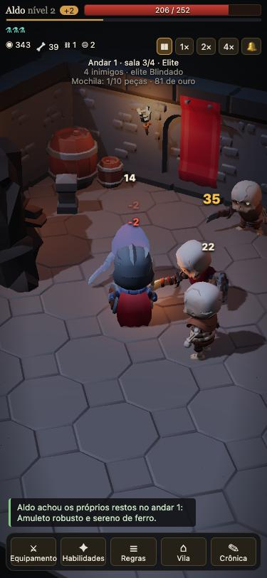 |
| Relatório da volta: cada peça com a chance e o resultado, o que ficou no chão e o ferimento | Celular (375 × 812): HUD compacto e aviso de restos recuperados |
| 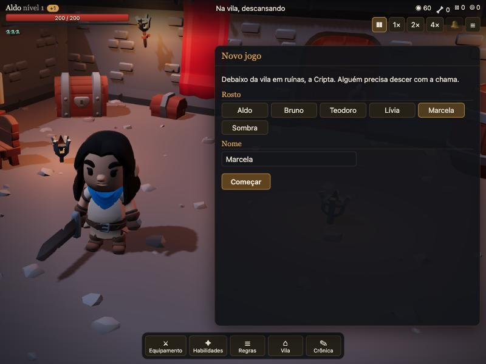 | 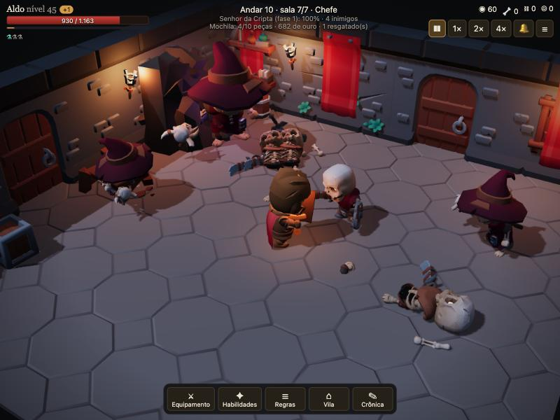 |
| M1: novo jogo; ao escolher Marcela, o herói troca de rosto atrás da folha | M1: Senhor da Cripta na fase 1, conjurando ao fundo atrás da escolta |
| 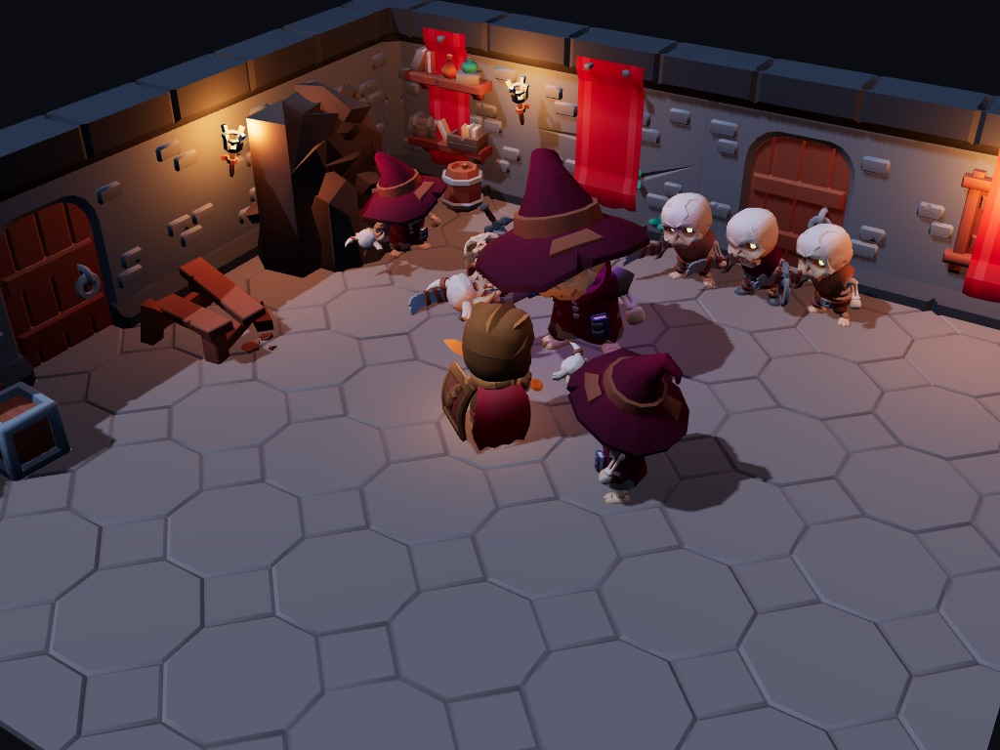 | 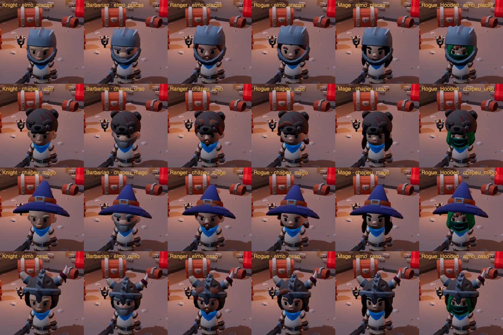 |
| M1: fase 2; o Senhor vem para o anel e três esqueletos erguidos esperam na porta | M1: as 6 cabeças com os 4 elmos, já com o ajuste por cabeça ([antes](img/cabelo-elmo-antes.jpg)) |

### Jogar

```bash
npm install
npm run art                 # copia do pack baixado (fora do repositório) as peças do manifesto para public/assets/kaykit
npm run dev                 # abre em http://localhost:5173
npm run dev -- --host       # idem, acessível pelo celular na mesma rede
```

- **Herói:** desce, luta e volta sozinho. Você não controla o combate.
- **Vila (botão ⌂ ou V):** obras, forja, poções e o botão "Descer agora".
- **Equipamento (E) e Habilidades (H):** só mudam com o herói na vila. Enquanto uma dessas telas está aberta, ele espera em vez de descer sozinho. Na de equipamento, a câmera chega perto dele.
- **Regras (R):** a lista de regras de combate (o que ele faz e quando) e as regras da descida (andar alvo, até onde ir, quando voltar).
- **Sino:** chama o herói de volta. Ele atende assim que termina a luta da sala em que está.
- **Tempo:** Espaço pausa; 1, 2 e 3 escolhem 1×, 2× e 4×.
- **Save:** automático no `localStorage`. Ao reabrir, o tempo fora roda pela mesma simulação (até 8 h).

### Ferramentas

```bash
npm test                    # testes da simulação (determinismo, combate, morte, restos, forja, save)
npm run balance             # balanceador: herói automático em várias sementes; confere as metas da seção 2.12
npm run typecheck
npm run build
```

Node 22+ roda os `.ts` das ferramentas direto (type stripping). Para outra faixa de sementes: `npm run balance -- --seeds 30 --from 7000`.

**Atalhos de depuração** (só em `npm run dev`, no console do navegador):

- `portador.frames(n)` roda n quadros na mão. Serve com o painel do navegador oculto, quando o `requestAnimationFrame` para.
- `portador.advance(ticks)` avança a simulação.
- `portador.reset()` começa do zero, sem salvar o mundo atual.
- `?perf` ou `?perf=rótulo` na URL liga o medidor de desempenho; `?q=low` liga o modo econômico (sem sombras, `devicePixelRatio` 1).

### Arquitetura

```
index.html, src/main.tsx   monta a sessão, a cena 3D e a interface (Preact); atalhos e autosave
src/sim/    regras: puro, determinístico, estado 100% JSON, sem DOM nem Three
  config.ts      todos os números de balanceamento (BALANCE)
  data.ts        bases de itens, afixos, inimigos, habilidades, prédios, nomes de lendárias
  rng.ts         mulberry32 dentro do estado
  hero.ts        atributos derivados do nível, do equipamento, das habilidades e do ferimento
  items.ts       geração de itens, nome, valor e o teto da forja
  combat.ts      sala: anel de contato, golpes com preparação e impacto, habilidades, poções e alvo
  rules.ts       avaliação das regras de combate e das regras da descida
  expedition.ts  descida, salas, saque, volta, morte, rolagem do que volta e restos
  village.ts     obras, forja, poções, treinador e moradores
  world.ts       cria o mundo; loop.ts: step() e catchUp(); save.ts: serializar e migrar
  bot.ts         jogador automático (o "jogador médio" do balanceador)
  commands.ts    ações do jogador (vestir, aprender, regras, sino, obras, forja)
src/game/   sessão: acumulador de tick fixo, velocidade, eventos para a tela, save local (storage.ts)
src/render/ Three.js: só lê o estado e os eventos
  assets.ts      carrega o glTF, compartilha materiais por textura, recolore o atlas por tier e faz a lendária pulsar
  visuals.ts     tabela base de item → partes do aventureiro ou peça rígida e osso
  heroRig.ts     herói montado por partes num esqueleto só; arma e escudo no osso da mão; troca em fila
  animator.ts    laço de base mais golpes de uma vez, com crossfade; a morte segura o último quadro
  actors.ts      esqueletos inimigos (modelo, arma, brilho da elite)
  dungeon.ts     sala montada com as peças do KayKit Dungeon, juntadas numa malha por material
  stage.ts       cena, câmera, luzes, posições a partir do estado, números de dano
  perf.ts        medidor de desempenho (?perf), que envia o resumo ao servidor de desenvolvimento
src/ui/     Preact: HUD, equipamento, habilidades, regras, vila e relatório da volta
tools/      import-art.ts + art-manifest.ts (importador da arte com validação) e balance.ts (balanceador)
tests/      vitest
```

A tela fala com o núcleo só por `src/sim/index.ts`. O 3D nunca decide nada: ele lê o estado (onde cada um está, em que fase do golpe) e os eventos do tick (golpe, acerto, morte, poção) e anima. Se o 3D cair, o jogo continua igual.

---

## 2. Game Design Document

> Status: proposta v0.1. A regra de morte (2.10) ainda precisa ser validada pelo usuário, e o mesmo vale para a proposta de armadura no visual (3.3).

### 0. Resumo em uma tela

**Fantasia:** debaixo de uma vila em ruínas há um abismo, e um herói desce sozinho. Lá embaixo, ele decide por conta própria quando bater, quando beber poção e quando fugir, sempre seguindo as regras que você escreveu. Seu papel é prepará-lo: você escolhe o que ele veste, o que aprende, as regras que segue e até onde desce. Cada volta para casa traz ouro, materiais e gente resgatada, e a vila cresce com isso. Quando ele morre, também volta, só que ferido, e parte do que carregava fica no chão lá embaixo.

**O nome:** *Vigília: O Portador da Chama*, escolhido pelo usuário. A regra central continua sendo o regresso: o herói sempre volta, seja vitorioso, ferido ou carregado; o que muda é o que ele traz.

**Do Vigília ficam:**

- atos e andares, corrupção (para depois) e chefes;
- itens com afixos, tiers, lendárias e forja;
- dificuldade;
- crônica;
- save com migração e progresso offline;
- restos de quem caiu.

**O que muda:** em vez de um elenco que o prefeito só influencia, há um herói só, que o jogador equipa e programa por regras. A vila deixa de ser o centro da tela e vira a outra metade da progressão: ela cresce com o que o herói traz e libera o que ele precisa.

**Metas de duração:**

- Ato I: 1 a 1,5 h de jogo ativo, mais o tempo idle.
- Campanha de 6 atos: 20 a 30 h.
- Depois da campanha: profundezas infinitas.

### 1. Pilares

| # | Pilar | Teste de design: toda feature nova precisa… |
|---|---|---|
| 1 | **Você prepara, ele age** | …ser decidida fora do combate: equipamento, habilidade, regra ou andar. Nunca um clique no meio da luta. |
| 2 | **Tudo que ele veste aparece** | …ter um visual no personagem ou um efeito que se vê na luta. |
| 3 | **A vila e o herói crescem juntos** | …depender do outro lado: nada na vila sobe sem o que vem de baixo, e nada lá embaixo fica fácil sem a vila. |
| 4 | **Morrer custa, mas não apaga** | …ter perda parcial e recuperável. O que ele veste nunca se perde. |
| 5 | **Idle honesto** | …continuar valendo com o jogo fechado. O progresso offline é a mesma simulação, sem atalho. |

### 2. Ciclo de jogo

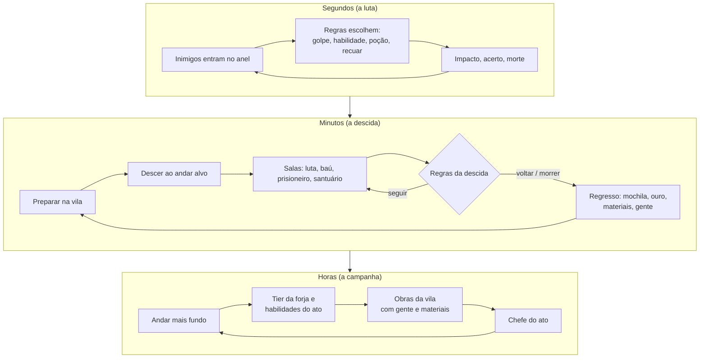

**Regra de ouro do ritmo:** em qualquer momento, o jogador tem pelo menos três objetivos abertos, cada um num horizonte diferente:

- **minutos:** a próxima peça, ou a poção extra do alquimista;
- **uma descida:** o próximo andar, ou buscar os restos;
- **uma hora:** o chefe do ato, ou o próximo nível do ferreiro.

#### 2.1 A descida, passo a passo

1. **Na vila** o jogador ajusta tudo: equipamento (trocado com o baú), habilidades, regras e andar alvo. Enquanto isso, o tempo corre: o herói descansa, a vida enche e o ferimento sara.
2. **Descer.** O herói vai direto ao andar escolhido, desde que já tenha chegado a ele uma vez. A escadaria não tem luta e a viagem leva `5 s + 2 s × andar`.
3. **Salas.** Cada andar é uma fila de `4 + ⌊andar/3⌋` salas. Ele entra numa sala, luta até limpá-la, recolhe o saque (1 s) e segue para a próxima.
4. **Seguir ou voltar.** Ao limpar um andar, ele desce ao seguinte enquanto as regras da descida mandarem.
5. **Voltar.** A volta acontece por uma regra, pelo sino do jogador (ele atende no fim da luta atual) ou carregado, quando morre. Na volta não há luta, e ela leva `10 s + 4 s × andar`.
6. **Chegada.** A mochila esvazia no baú, o ouro e os materiais vão para o tesouro e a gente resgatada vira moradora. Se a regra "descer de novo" estiver ligada, ele descansa e desce outra vez. O descanso dura até a vida encher e, se a regra pedir, até o ferimento sarar.

**Na tela** (`src/game/travel.ts`):

- **Saída:** o herói corre até a porta (a da Cripta, na vila; a da esquerda, na sala) e a empurra (`Interact`). Carregado, ele fica caído 2 s.
- **Viagem:** a tela escurece por baixo do HUD. Um cartão mostra para onde ele vai, o motivo da volta, a barra e o tempo que falta.
- **Chegada:** o cartão some e o herói entra pela porta do lugar novo.
- **Entre duas salas:** a simulação dá 1,8 s a mais depois do saque (`roomExitTicks`). Nesse tempo, ele corre até a porta do fundo, por onde vieram os esqueletos. A tela escurece por um instante, com "Andar N" quando o andar muda, e ele entra na sala seguinte pela porta da esquerda. Se ele vai voltar para a vila depois daquela sala, não atravessa até o fundo: sai pela porta de onde veio. A decisão de seguir ou voltar é tomada ao limpar a sala (`leaveReason`), e é ela que diz ao 3D para qual porta ir.

Enquanto o cartão cobre a tela, o 3D não é desenhado, o que poupa bateria no celular. Tudo anda em ticks, então 2× e 4× aceleram junto. Antes (2026-10-22), o herói ficava correndo contra a porta enquanto o tempo contava, e o usuário apontou o problema.

#### 2.2 O que o jogador decide

| Decisão | Onde | Quando vale |
|---|---|---|
| Equipamento | Tela de equipamento (baú ↔ corpo) | Só com o herói na vila |
| Habilidades | Treinador (aprender) e barra de 3 ativas | Aprender só na vila; a barra vale a partir da próxima luta |
| Regras de combate | Tela de regras | A qualquer momento |
| Regras da descida | Tela de regras (andar alvo, até onde ir, quando voltar, repetir) | A qualquer momento |
| Chamar de volta | Sino no HUD | Durante a descida |
| Obras, forja e poções | Prédios da vila | A qualquer momento (as obras levam tempo) |

O equipamento só muda na vila por dois motivos. O primeiro é a fantasia: é na vila que você prepara o herói. O segundo é a regra de morte: se desse para vestir na hora uma peça achada lá embaixo, ela ficaria protegida da rolagem.

### 3. O herói

| Atributo | De onde vem |
|---|---|
| Vida máxima | `200 + 18 × (nível − 1)`, × (1 + Robusto) |
| Dano do golpe | dano da arma × (1 + 3% × (nível − 1)) × (1 + Brutal) |
| Ataques por segundo | base da arma × (1 + Veloz) × (1 − 3% por peça pesada) |
| Armadura | soma das peças × (1 + Pele de Ferro) |
| Crítico | 5% + Afiado + base da arma (adaga +5%); o crítico dá 1,6× |
| Bloqueio | só com escudo: chance de anular 70% do golpe |
| Roubo de vida | Sanguessuga + Sede de Sangue (cura % do dano causado) |
| Sorte | Afortunado; entra no saque e na rolagem da morte |

- **Nível:** cada abate dá experiência. Para passar do nível `n`, são precisos `40 × n^1,6` pontos. Cada nível dá +18 de vida, +3% de dano e 1 ponto de habilidade.
- **Poções:** ele leva 3, mais 1 por nível do alquimista. Cada uma cura 40% da vida máxima e há 3 s de recarga entre elas. Na volta à vila, o estoque é reposto automaticamente a 15 de ouro cada, enquanto houver ouro.
- **Ferido:** é o estado depois de uma morte (2.10).

### 4. Combate: um contra vários

Cada sala tem um grupo de inimigos. São `3 + ⌊andar/2⌋` (no máximo 8), mais as elites e o chefe. O herói luta com todos, mas nunca todos de uma vez.

**O anel de contato.**

- Em volta do herói há **3 vagas de corpo a corpo**. O chefe ocupa 2 delas.
- Os inimigos de corpo a corpo esperam na porta e entram quando abre uma vaga. A aproximação leva 1 s.
- Os inimigos de longe (o mago) ficam no fundo da sala e atiram.
- O herói só alcança quem está no fundo quando a frente cai, ou com Investida.

Isso dá peso às escolhas:

- dano em área vale mais com o anel cheio;
- escudo e armadura valem mais quando muitos batem ao mesmo tempo;
- Investida resolve o mago que fica atirando lá atrás.

**O golpe.** Cada golpe tem três fases: preparação (40% do intervalo), impacto e recuperação. O dano entra no tick do impacto, e é nesse momento que o 3D mostra o acerto. As habilidades seguem o mesmo esquema, cada uma com sua preparação.

**O alvo.** A regra "alvo" escolhe entre: elite primeiro, o mais fraco, o mais forte ou o mais ferido. O padrão é elite primeiro e, depois, o mais fraco: derrubar alguém abre uma vaga e reduz quem bate.

**Fórmulas** (valores iniciais; o balanceador calibra):

| Conta | Fórmula |
|---|---|
| Poder do andar | `P(andar) = 1,16^(andar − 1)` |
| Vida e dano do inimigo | base × P(andar) × (elite: 2,5 de vida e 1,4 de dano) |
| Redução por armadura | `A / (A + 25 × P(andar))` |
| Crítico | 1,6× o dano |
| Bloqueio (escudo) | anula 70% do golpe |
| Atordoado | não ataca nem se move |

**Inimigos do Ato I: a Cripta.** Todos vêm do KayKit Skeletons.

| Inimigo | Modelo | Vida | Dano | Intervalo | Papel |
|---|---|---|---|---|---|
| Lacaio | Skeleton_Minion | 34 | 5 | 1,6 s | Corpo a corpo, vem em bando |
| Guerreiro | Skeleton_Warrior + Skeleton_Blade e escudo | 70 | 8 | 2,0 s | Corpo a corpo; bloqueia 20% dos golpes; 30% de chance de deixar 1 de ferro velho |
| Ladino | Skeleton_Rogue + adaga | 40 | 5 | 1,0 s | Corpo a corpo, rápido |
| Mago | Skeleton_Mage + Skeleton_Staff | 32 | 9 | 2,4 s | De longe, fica no fundo |
| Capitão da Cripta (chefe do andar 5) | Skeleton_Warrior em 1,5× com Skeleton_Axe, escudo grande e o elmo | 1050 | 16 | 2,2 s | Ocupa 2 vagas. A cada 12 s dá um golpe especial (2× o dano) e, se sobram menos de 3 da escolta, chama 2 lacaios |
| Senhor da Cripta (chefe do andar 10, M1) | Skeleton_Mage em 1,6× com Skeleton_Staff e aura roxa | 1500 | 14 → 18 | 2,6 → 2,0 s | Duas fases (14.2). Na 1, conjura do fundo e chama reforço a cada 15 s. Abaixo de 50%, vem para o anel, bate mais forte e ergue até 3 mortos |

Afixos de elite: **Blindado** (+60% de armadura própria, ou seja, −35% do dano recebido), **Vampírico** (cura 30% do dano que causa), **Furioso** (+50% de dano abaixo de metade da vida) e **Veloz** (intervalo −30%). A elite ganha um brilho na cor do afixo.

### 5. Regras (táticas)

As regras são o coração do idle: o jogador escreve como o herói pensa. Funcionam como uma lista **SE condição ENTÃO ação**, lida de cima para baixo sempre que o herói fica livre (fora de golpe, habilidade ou poção). A primeira regra cuja condição vale e cuja ação está disponível é executada. Se nenhuma servir, ele dá um golpe básico no alvo.

| Condição | Parâmetro |
|---|---|
| Vida abaixo de | % (10–90) |
| Inimigos no anel, pelo menos | 1–3 |
| Inimigos no fundo, pelo menos | 1–4 |
| Alvo é elite ou chefe | — |
| Poções restantes, no máximo | 0–6 |
| Sempre | — |

| Ação | O que faz |
|---|---|
| Beber poção | Se houver poção e a recarga deixar |
| Usar habilidade | Uma das 3 da barra, se estiver pronta |
| Recuar | Foge na hora: são 1,5 s em que os inimigos ainda batem. Se sobreviver, volta à vila com a mochila inteira. O sino, ao contrário, espera a luta acabar |

**Regras de fábrica** (o jogador começa com estas):

1. SE vida abaixo de 35% ENTÃO beber poção
2. SE vida abaixo de 16% E poções no máximo 0 ENTÃO recuar
3. SE inimigos no anel pelo menos 2 ENTÃO Golpe Amplo (quando aprender)
4. SE inimigos no fundo pelo menos 1 ENTÃO Investida (quando aprender)
5. SE vida abaixo de 50% ENTÃO Segundo Fôlego (vale com o Salão de Táticas nível 1)
6. SE inimigos no anel pelo menos 3 ENTÃO Grito de Guerra (vale com o Salão de Táticas nível 2)

Os limiares 16% (fuga) e 30% (voltar sem poções) saíram do balanceador. Com 20% e 50%, o herói fugia demais e morria 0,3 vez por hora; com 12%, morria 2 vezes por hora e empacava.

**Regras da descida.** São separadas das de combate:

| Regra | Opções |
|---|---|
| Andar inicial | 1 até o mais fundo já alcançado |
| Até onde descer | Ficar no andar inicial, descer até o andar N ou descer sem limite |
| Voltar quando | Mochila cheia; poções acabarem com vida abaixo de X% (padrão 30%); terminar o último andar planejado |
| Ao voltar | Descer de novo depois de descansar (liga e desliga); esperar o ferimento sarar (liga e desliga) |

Começam 4 linhas de regra de combate, mais 1 por nível do Salão de Táticas, até 8. A segunda condição (E) vale desde o começo: o Salão só acrescenta linhas.

### 6. Habilidades

O **treinador** ensina as habilidades do ato. No nível `n`, ele libera as do ato `n`. Aprender uma custa 1 ponto de habilidade e ouro. A **barra** tem 3 ativas; as passivas valem sempre depois de aprendidas.

**Ato I (treinador nível 1):**

| Habilidade | Tipo | Efeito | Recarga |
|---|---|---|---|
| Golpe Amplo | Ativa | 80% do dano em todos do anel | 6 s |
| Investida | Ativa | Vai até o inimigo do fundo mais próximo, que entra no anel; dá 130% do dano e atordoa por 1,5 s | 10 s |
| Segundo Fôlego | Ativa | Cura 30% da vida | 40 s |
| Grito de Guerra | Ativa | Quem está no anel causa −35% de dano por 6 s | 20 s |
| Pele de Ferro | Passiva | +20% de armadura | — |
| Sede de Sangue | Passiva | Cura 4% do dano causado | — |

**Atos II a VI** (rascunho): cada ato traz 2 ativas e 2 passivas que conversam com o inimigo novo. Exemplos:

- **Ato II, as Minas:** Golpe de Escudo (atordoa em área).
- **Ato III, os Fungos:** Purificar (tira veneno).
- **Ato IV:** Redemoinho (golpe amplo contínuo).
- **Ato V:** Ira (dano por vida perdida).
- **Ato VI:** Último Bastião (fica com 1 de vida por 5 s, uma vez por sala).

Depois do protótipo vêm os níveis de habilidade: o ponto extra numa habilidade que já sabe.

### 7. Itens

#### 7.1 Encaixes e o que aparece

| Encaixe | Aparece no personagem como |
|---|---|
| Arma | Malha presa ao osso `handslot.r` |
| Mão secundária (escudo; nada com arma de duas mãos) | Malha presa ao osso `handslot.l` |
| Elmo | Peça da cabeça: elmo, chapéu ou capuz (3.3) |
| Peitoral | Tronco e braços de um dos aventureiros (3.3) |
| Perneiras | Pernas e botas de um dos aventureiros (3.3) |
| Capa | Capa de um dos aventureiros |
| Amuleto | Sem malha; só os afixos. Na lendária, um brilho no peito |

Em todos os encaixes, o tier muda a cor do metal (3.3) e a lendária ganha brilho.

#### 7.2 Bases (Ato I)

| Base | Encaixe | Peso | Números no tier 1 | Malha |
|---|---|---|---|---|
| Espada | Arma, 1 mão | — | 14 de dano, 1,0 golpe/s | `sword_1handed` |
| Machado | Arma, 1 mão | — | 18 de dano, 0,8 golpe/s | `axe_1handed` |
| Adaga | Arma, 1 mão | — | 9 de dano, 1,5 golpe/s, +5% de crítico | `dagger` |
| Espadão | Arma, 2 mãos | — | 27 de dano, 0,7 golpe/s | `sword_2handed` |
| Machado grande | Arma, 2 mãos | — | 31 de dano, 0,6 golpe/s | `axe_2handed` |
| Escudo redondo | Mão secundária | Médio | 4 de armadura, 15% de bloqueio | `shield_round` |
| Escudo de torre | Mão secundária | Pesado | 7 de armadura, 22% de bloqueio | `shield_square` |
| Escudo de espinhos | Mão secundária | Médio | 3 de armadura, 12% de bloqueio; devolve 20% do bloqueado | `shield_spikes` |
| Elmo de placas | Elmo | Pesado | 6 de armadura | `Knight_Helmet` |
| Chapéu de urso | Elmo | Médio | 4 de armadura e +3% de dano | `Barbarian_BearHat` |
| Elmo de osso | Elmo | Médio | 4 de armadura; cai do Capitão da Cripta | `Skeleton_Warrior_Helmet` (peça rígida) |
| Chapéu de mago | Elmo | Leve | 2 de armadura e +10% de cura das poções | `Mage_Hat` |
| Couraça de placas | Peitoral | Pesado | 14 de armadura | tronco e braços do `Knight` |
| Gibão de couro | Peitoral | Médio | 9 de armadura | tronco e braços do `Ranger` |
| Colete de ladino | Peitoral | Leve | 5 de armadura e +4% de crítico | tronco e braços do `Rogue` |
| Túnica | Peitoral | Leve | 3 de armadura e +8% de vida | tronco e braços do `Mage` |
| Grevas de placas | Perneiras | Pesado | 7 de armadura | pernas do `Knight` |
| Calças de couro | Perneiras | Médio | 5 de armadura | pernas do `Ranger` |
| Botas leves | Perneiras | Leve | 3 de armadura e +4% de velocidade de ataque | pernas do `Rogue` |
| Capa do cavaleiro | Capa | — | +6% de vida | `Knight_Cape` |
| Capa do patrulheiro | Capa | — | +3% de crítico | `Ranger_Cape` |
| Manto | Capa | — | +12% de cura das poções | `Mage_Cape` |

As armas da KayKit Fantasy Weapons Bits usam o mesmo encaixe na mão. O martelo, a lança e a alabarda são bases do Ato II (14.4). Espadas, machados, adagas e escudos viram a malha das bases do Ato I a partir do tier 6 (7.6).

#### 7.3 Tier, raridade e afixos

- **Tier:** é a qualidade base. Cada tier multiplica os números da base por `1,32^(tier − 1)`. O tier de um andar é `⌈andar/2⌉ + 5 × (ato − 1)`: o Ato I vai do tier 1 ao 5, e o Ato II, do 6 ao 10.
- **Raridade:** define quantos afixos a peça tem:
  - comum: 0;
  - rara: 1;
  - épica: 2;
  - lendária: 3, mais nome próprio e um efeito único.

  O nome segue o modelo do Vigília: "Espada de aço (tier 3)", "Machado brutal de osso", "Vigia Partida".

| Afixo | Efeito (por afixo, no tier 1; cresce 10% por tier) |
|---|---|
| Afiado | +4% de crítico |
| Brutal | +8% de dano |
| Veloz | +7% de velocidade de ataque |
| Robusto | +8% de vida máxima |
| Guardião | +4 de armadura |
| Sanguessuga | Cura 3% do dano causado (soma no máximo 12%) |
| Afortunado | +5 de sorte |
| Sereno | +15% de cura das poções |

**Lendárias do Ato I.** A primeira vitória sobre o Capitão, no andar 5, deixa a Coroa do Capitão, que é o elmo dele. A primeira sobre o Senhor da Cripta, no andar 10, deixa a Vigia Partida. O Juramento de Ferro tem 3% de chance em cada baú a partir do andar 6, uma vez só.

| Lendária | Efeito único |
|---|---|
| Vigia Partida (espada) | Golpe Amplo atinge também quem está no fundo |
| Coroa do Capitão (elmo de osso) | Ao entrar na sala, os lacaios tremem: −20% de dano por 5 s |
| Juramento de Ferro (couraça) | Abaixo de 30% de vida, +40% de armadura |

#### 7.4 De onde vêm

| Origem | Chance e raridade |
|---|---|
| Inimigo comum | 6% de peça; 80% comum, 20% rara |
| Elite | 40%; rara ou épica |
| Baú (sala de baú) | 1 peça garantida, rara ou melhor, mais ouro |
| Chefe | Épica garantida; o primeiro de cada ato deixa a lendária do ato |
| Restos | As peças que ficaram no chão (2.10) |

- **Tier da peça:** é o do andar, com 20% de chance de vir um abaixo.
- **Destino:** tudo cai na **mochila**, que leva 10 peças. O ouro e os materiais não ocupam espaço.
- **Sorte:** cada ponto dá +1% de chance de peça e +0,5% de chance de subir a raridade.

#### 7.5 Forja (ferreiro)

**O teto:** o ferreiro forja até `min(2 × nível do ferreiro, tier do andar mais fundo alcançado)`. Ele nunca passa do que o herói já viu lá embaixo.

| Ação | Exige | Custo (t = tier) | Prazo |
|---|---|---|---|
| Forjar comum | Ferreiro 1 | `40 + 30t` de ouro e `4t` ossos | 20 s |
| Forjar rara | Ferreiro 2 | Escolhe o afixo; 2× o ouro, `4t` ossos e `5t` do material do afixo | 40 s |
| Forjar épica | Ferreiro 4 | Escolhe o primeiro afixo e o segundo é sorteado; 3× o ouro, `4t` ossos e `10t` do material | 60 s |
| Aprimorar | Ferreiro 1 | Sobe +1 tier e mantém os afixos; custa o mesmo que forjar comum no tier novo | 30 s |
| Reforjar | Ferreiro 3 | Troca o afixo escolhido por outro sorteado; `40 + 30t` de ouro e `6t` de ossos e de ferro | 30 s |

O material de cada afixo está na seção 14.2. O amuleto só se forja raro ou épico, porque não tem números de base. Lendárias não se reforjam.

- **Uma encomenda por vez.** A peça pronta vai para o baú.
- **Aprimorar é o que segura a lendária:** sem isso, ela ficaria velha quando o herói descesse mais.

#### 7.6 Como cada item aparece no personagem

Resumo da proposta da seção 3.3:

- **Arma e escudo:** a malha vai presa ao osso da mão, sem ajuste, porque a pega das armas do KayKit fica na origem.
- **Peitoral, perneiras, elmo e capa:** são partes dos modelos de aventureiro, trocadas no mesmo esqueleto. A couraça de placas é o tronco e os braços do cavaleiro; o gibão de couro é o do patrulheiro.
- **Tier:** muda a cor do metal e do couro. O atlas de gradiente é recolorido por faixa de tier, e a faixa segue o ato (M3.2):
  - ferro nos tiers 1–2;
  - aço nos 3–4;
  - bronze no 5;
  - ferro-negro do 6 ao 10 (o Ato II);
  - ouro do 11 em diante.
- **Malha por tier (M3.2):** do tier 6 em diante, a arma também muda de malha (`TIER_MESHES` em `visuals.ts`):

| Base | Tiers 1–5 | Tiers 6–10 | Tier 11 em diante |
|---|---|---|---|
| Espada | `sword_1handed` | `sword_B` | `sword_C` (curva) |
| Espadão | `sword_2handed` | `sword_E` | `sword_E` |
| Machado | `axe_1handed` | `axe_A` (duplo) | `axe_C` (cutelo) |
| Machado grande | `axe_2handed` | `axe_B` | `axe_B` |
| Adaga | `dagger` | `dagger_A` | `dagger_B` |
| Escudo redondo | `shield_round` | `shield_B` | `shield_B` |
| Escudo de espinhos | `shield_spikes` | `shield_C` | `shield_C` |

  O escudo-torre fica com a malha dos aventureiros.
- **Raridade:** a lendária pulsa com brilho próprio (emissivo modulado, mais uma luz pontual na arma). As outras raridades só aparecem na moldura da interface.

### 8. O abismo

- **Atos:** são 6, de 10 andares cada. O chefe do ato fica no andar 10, e há um chefe menor no andar 5. O Ato I, a Cripta, usa o KayKit Dungeon e o Skeletons. O Ato II, as Minas Inundadas, usa as mesmas peças recoloridas e escoradas, e o Ato III, o Jardim de Fungos, as mesmas peças tomadas por cogumelos (14.4). Os outros atos são temas a definir, como no Vigília: Cidade Afogada, Forja e Coração.
- **Salas:**

| Sala | Chance | O que tem |
|---|---|---|
| Combate | 62% | Um grupo |
| Elite | 15% | Um grupo com 1 elite |
| Baú | 10% | 1 peça rara ou melhor, ouro e ferro |
| Prisioneiro | 8% | Um grupo guardando 1 pessoa, que vira moradora se ele vencer |
| Santuário | 5% | Cura 50% da vida e devolve 1 poção |
| Antessala | Penúltima sala dos andares 5 e 10 | Sempre um santuário: um fôlego antes do chefe (entrou depois do balanceador, que mostrou o herói chegando ao chefe já sem poções) |
| Chefe | Última sala dos andares 5 e 10 | O chefe e a escolta |

- **Mapa:** as salas são sorteadas pela semente a cada visita, mas a quantidade por andar é fixa. Assim os restos podem ser marcados por andar e sala.
- **Depois do Ato VI:** profundezas infinitas, com `P(andar)` continuando a subir.

### 9. Vila ↔ herói

A vila é a outra metade da progressão. Ela cresce com o que o herói traz e, em troca, libera o que ele precisa. Uma trava de mão dupla impede que um dos lados corra na frente do outro:

- **O herói depende da vila:** o ferreiro só forja até o próprio nível, e o treinador só ensina o ato do próprio nível. Sem obras, o herói desce com o que achar, e o achado é aleatório.
- **A vila depende do herói:** cada nível de prédio pede gente (moradores resgatados) e materiais do ato, que só existem lá embaixo. O teto da forja também é o andar mais fundo que ele alcançou.

**Recursos:**

| Recurso | De onde vem | Para que serve |
|---|---|---|
| Ouro | Abates, baús, venda de peças e imposto dos moradores | Obras, forja, poções e habilidades |
| Ossos (Ato I) | Abates de esqueleto (1–2 cada) | Obras do Ato I e forja |
| Ferro | Baús, chefes e guerreiros esqueletos (30% de chance de 1) | Obras e forja de peças pesadas |
| Gente | Salas de prisioneiro e chefes (o chefe solta 2) | Mão de obra: cada nível de prédio pede um mínimo de moradores; cada morador rende 1 de ouro por minuto |

**Prédios:**

| Prédio | Níveis | O que libera | Pede para subir ao nível n |
|---|---|---|---|
| Ferreiro | 1–5 (começa no 1) | Teto de forja `2 × n`; forjar rara (n 2); reforjar (n 3); forjar épica (n 4) | `150 × n²` de ouro, `15 × n` de ferro e `n + 1` moradores (no M0 eram `20n` de ferro e `2n` moradores) |
| Treinador | 0–6 (começa no 0) | Habilidades do ato n | `200 × n²` de ouro, `30 × n` de ossos e `2n − 2` moradores (o nível 1 não pede gente) |
| Alquimista | 0–4 | +1 poção por nível; a poção cura +5% por nível | `100 × n²` de ouro, `15 × n` de ossos e `n` moradores |
| Carroceiro de resgate | 0–3 | +5% na rolagem da morte; os restos duram +1 dia | `120 × n²` de ouro, `10 × n` de ferro e `n + 1` moradores |
| Curandeira | 0–3 | O ferimento dura 25% menos por nível (no mínimo, 25% do tempo) | `120 × n²` de ouro, `20 × n` de ossos e `n` moradores |
| Salão de Táticas | 0–4 | +1 regra de combate por nível | `150 × n²` de ouro e `2n` moradores |
| Casas | Sobem sozinhas | Abrigam a gente resgatada; cada 4 moradores erguem uma casa nova no diorama | — |

- **As obras levam tempo:** `30 s × n` em 1×. Uma por vez; mais tarde, uma segunda frente.
- **Na tela (M2, 14.3):** a vila é uma cena própria, uma cidade viva montada com o Kenney Fantasy Town e os enfeites do KayKit. Durante a obra, o prédio aparece de andaime e pronto quando ela termina. A vila cresce e ganha vida com cada volta do herói.

### 10. Morte e regresso (regra completa)

> **Ajustada com o usuário em 2026-10-22.** Ele achou "fácil demais lutar até cair e ainda conseguir levar muitos itens". As chances de trazer caíram bastante (abaixo), e os restos ficaram como estavam: no chão por um tempo, recuperáveis ou perdidos de vez. Ainda falta ele confirmar que a gente resgatada sempre volta.

**1. Quando acontece.** A vida chega a 0 e nenhum efeito o segura, como Último Bastião ou uma lendária. Ele cai. A luta acaba e a descida também.

**2. Ele volta.** O herói é trazido de volta à vila, ferido. A gente que ele resgatou nessa descida foge na frente e chama o carroceiro. Por isso **a gente resgatada sempre volta**, e não há rolagem para pessoas. A volta carregado leva 1,5× o tempo da volta normal.

**3. O vestido nunca se perde.** Arma, escudo, elmo, peitoral, perneiras, capa e amuleto voltam com ele, sempre.

**4. A mochila é rolada.** Vale para tudo o que ele conquistou nessa descida e ainda não chegou à vila:

- **Peças:** uma rolagem por peça. Ou volta inteira, ou fica.
- **Ouro e cada material:** não têm sorte de tudo ou nada. Volta a fração `chance` da pilha, arredondada para baixo, e o resto fica.

```
chance = clamp( 0,55
              − 0,04 × (andar − 1)                ← cai com a profundidade
              + bônus da raridade                  ← comum 0 · rara +0,03 · épica +0,06 · lendária +0,15
              + 0,005 × sorte                      ← sorte do herói
              + 0,05 × nível do carroceiro,        ← prédio da vila
              0,05, 0,75 )
```

Exemplos, sem sorte e sem carroceiro:

| Andar | Comum | Rara | Épica | Lendária | Ouro e materiais |
|---|---|---|---|---|---|
| 1 | 55% | 58% | 61% | 70% | 55% |
| 5 | 39% | 42% | 45% | 54% | 39% |
| 10 | 19% | 22% | 25% | 34% | 19% |
| 15 (Ato II) | 5% | 5% | 5% | 14% | 5% |

- **A curva:** já no andar 1, a morte leva quase metade da mochila. No fundo do Ato I, leva quatro quintos. A partir do meio do Ato II, leva quase tudo. Lutar até cair deixa de compensar: o certo é voltar antes, pela regra ou pelo sino. Os restos dão a chance de buscar o que ficou.
- **O carroceiro:** no nível 3, devolve +15 pontos, quase quatro andares de folga.
- **Antes do ajuste** (primeira versão): eram 85% no andar 1 e 54% no 10, e o balanceador media 29% de perda por morte. Agora mede 64–65%.

**5. O que não voltou fica no chão.** Vira uma **pilha de restos** marcada no andar e na sala onde ele caiu, com as peças, o ouro e os materiais que ficaram.

- **Duração:** 3 dias, mais 1 por nível do carroceiro. Um dia de jogo são 10 min em 1×, então os restos duram 30 min de jogo.
- **Recuperar:** basta passar de novo por aquela sala daquele andar e vencer a luta dela. Tudo volta para a mochila, inclusive as peças, e fica sujeito à rolagem se ele morrer de novo antes de chegar em casa.
- **Limite:** no máximo 3 pilhas. Uma quarta morte apaga a mais antiga.
- **Na tela:** a tela da descida mostra as pilhas e quanto tempo falta. A regra da descida "buscar restos" põe o andar da pilha mais nova como alvo.
- **Pilha vencida:** some, e a crônica registra: "a cripta engoliu o machado brutal".

**6. Ferido.** O herói chega com um **ferimento**:

- **Duração:** `60 s + 20 s × andar` em 1×, menos 25% por nível da curandeira (no mínimo, 25% do tempo).
- **Penalidade:** −30% de vida máxima e −20% de dano, proporcional ao que falta para sarar. Com metade do tempo, a penalidade também cai pela metade.
- **Onde sara:** só na vila. Se ele descer ferido, a ferida não sara lá embaixo.
- **A decisão:** esperar ou descer ferido é escolha do jogador, pela regra da descida "esperar o ferimento sarar".
- **O que não se perde:** a experiência e os níveis. A morte não tira progresso do herói, só da mochila.

**7. Casos de borda:**

- **Baú cheio:** a peça que chega do resgate fica na mochila, até 10. Se passar disso, a pior derrete em ouro, que também entra na rolagem.
- **Morrer na sala dos próprios restos:** a pilha antiga continua lá, e a nova é criada na mesma sala.
- **Morrer na volta:** não acontece. A volta não tem luta.
- **Lendária que caiu:** fica nos restos e, quando eles vencem, a crônica registra, como qualquer outra peça. Para não ser cruel demais, a lendária tem o bônus de +15%.

**Por que assim:**

- O vestido nunca se perde, então o progresso que o jogador escolheu fica protegido.
- A mochila é o risco, e ela cresce com a ambição: quanto mais fundo, mais ele carrega e mais pode perder.
- Os restos transformam a perda numa missão de volta, que no Vigília era uma das melhores histórias.

### 11. Tempo, idle e progresso offline

| Unidade | Valor |
|---|---|
| Tick | 0,1 s em 1× (10 ticks/s) |
| Velocidades | 1×, 2× e 4× (pausa na vila e na tela de regras é opcional) |
| Dia | 6 000 ticks (10 min em 1×), usado pelos restos e pela crônica |

- **Offline:** ao abrir o jogo, `catchUp()` roda o tempo fora pela mesma `step()`, em blocos, até 8 h. Em 1×, isso dá cerca de 288 mil ticks e leva menos de 2 s.
- **Relatório:** na volta do jogador, um "Enquanto você estava fora" mostra descidas, mortes, peças, gente resgatada e obras concluídas.
- **Determinismo:** o RNG (mulberry32) vive no estado. Salvar no meio de um golpe e carregar continua a mesma partida, como no Vigília.

### 12. Balanceamento: metas que o balanceador confere

`npm run balance -- --seeds 20` roda o jogador automático (`bot.ts`) por 12 h de jogo em cada semente, os três atos. Ele se comporta como um jogador médio:

- usa as regras de fábrica;
- veste a melhor peça do baú;
- aprende as habilidades assim que dá e põe na barra as três ativas do ato em que está (M3.3):
  - Golpe Amplo, Investida e Segundo Fôlego no Ato I;
  - Quebra-Couraça, Golpe Amplo e Investida no II;
  - Purificar, Golpe Giratório e Investida no III.

  Nos Fungos, sobe as regras de Purificar e do Golpe Giratório para logo depois da poção e da fuga.
- a cada visita à vila, segue esta ordem:
  1. do Ato II em diante, o treinador do ato, guardando para ele o material do ato;
  2. o ferreiro, se der;
  3. a peça rara (com o afixo escolhido) que aumenta a Força em pelo menos 3%;
  4. reforja o afixo fraco da arma;
  5. constrói o prédio mais barato;
  6. aprimora a peça vestida de tier menor;
- desce até o andar mais fundo em que a "Força" da tela de equipamento chega a 1, e volta um andar depois de morrer. Com a morte cara, descer onde a Força ainda é 0,9 fazia uma semente empacar 53 min;
- não passa de um andar em que a Força cai abaixo de 0,6, e só enfrenta um chefe ainda não vencido com a Força em 0,95 (M3.3);
- saindo do andar mais fundo, segue com a mochila cheia (a pior peça derrete): voltar a cada 10 peças podia nunca deixar o herói terminar um andar de 8 salas (M3.3).

Algumas sementes jogam de novo sem perfuração (no Ato II) e sem resposta ao veneno (no Ato III), para medir o peso de cada resposta.

O balanceador sai com código ≠ 0 se alguma meta falhar.

| Meta | Alvo | Como mede |
|---|---|---|
| Chefe do andar 5 | 20–40 min de jogo | Mediana do tick da primeira vitória |
| Chefe do Ato I (andar 10) | 60–100 min | Mediana; ≥ 90% das sementes chegam em 3 h |
| Mortes | 0,5–2,5 por hora | Média nas 3 h |
| Sala comum no andar certo | 10–35 s de luta e 10–35% da vida | Média das salas em que `poder/P(andar)` fica entre 0,8 e 1,2 |
| Chefe | 45–120 s de luta | Média |
| Perda na morte | 55–80% do valor da mochila | Média |
| Restos recuperados | ≥ 50% das pilhas | Pilhas recuperadas ÷ criadas |
| Parede | Mediana ≤ 30 min e pior semente ≤ 50 min sem avanço antes do chefe do andar 10 | Maior intervalo sem o andar mais fundo subir, por semente |
| Vila no compasso | O teto da forja nunca passa do tier do mais fundo; nenhum prédio sem obra possível por mais de 15 min | Checagem a cada minuto |
| Ouro parado | Mediana abaixo de 3× o custo da obra mais barata | Na vitória sobre o chefe do andar 10 (depois dele o Ato I acaba e o ouro só acumula) |
| Impasse | 0 lutas com mais de 300 s | Contagem |
| Determinismo | Mesma semente dá o mesmo resultado; salvar e carregar a cada 10 min dá o mesmo mundo | Hash do estado |
| Desempenho | Cada hora de jogo simulada em menos de 1 s (7 h em menos de 7 s) | Relógio |
| Senhor da Cripta (M1) | 60–150 s de luta | Média |
| Fase 2 do Senhor (M1) | Começa entre 25% e 75% do tempo da luta | Média de (início da fase 2 − início da luta) ÷ duração |
| Forja usada (M1) | Mediana ≥ 3 encomendas ao ferreiro (forjar, aprimorar ou reforjar) até vencer o andar 10, e nenhuma semente com 0 | Contagem na primeira vitória sobre o Senhor |

**Resultado em 2026-10-22, com o M1** (20 sementes a partir de 1000 · 30 a partir de 7000):

| Meta | Faixa 1000 | Faixa 7000 |
|---|---|---|
| Chefe do andar 5 (mediana) | 28,3 min | 36,2 min |
| Chefe do andar 10, o Senhor (mediana) | 69,9 min | 72,1 min |
| Sementes que vencem o andar 10 em 3 h | 20/20 | 30/30 |
| Mortes por hora | 0,8 | 0,8 |
| Luta por sala / dano por sala comum | 17,7 s / 15% | 17,1 s / 15% |
| Luta de chefe (os dois) | 66,1 s | 63,0 s |
| Luta com o Senhor · fase 2 começa em | 65,5 s · 53% | 62,6 s · 54% |
| Encomendas ao ferreiro até o andar 10 (mín · mediana) | 1 · 3 | 1 · 3 |
| Perda na morte (valor da mochila) | 62% | 66% |
| Restos recuperados | 99% | 100% |
| Parede (mediana · pior) | 20,0 · 44,5 min | 22,4 · 37,9 min |
| Ouro parado na vitória do andar 10 | 2,0× | 2,0× |
| Impasses · determinismo | 0 · igual | 0 · igual |
| Desempenho | 0,08 s por semente | 0,07 s por semente |

**O que o balanceador mudou em relação à primeira versão deste documento:**

- O chefe passou de 650 para 1050 de vida, e o golpe especial, de 10 para 12 s; o reforço só vem com pouca escolta.
- A antessala do chefe virou santuário.
- O guerreiro solta ferro: antes, o ferreiro ficava no nível 1 por 100 min por falta de ferro.
- A "Força" foi calibrada para que 1 seja o andar da fronteira (`floorDemand = 90 × P(andar)`).
- Os limiares das regras de fábrica mudaram (2.5).
- A meta da parede passou a olhar a mediana e o pior caso: o chefe do ato é uma trava de propósito. Sem o bot ler a Força, uma semente ficava 63 min presa no chefe do andar 5, porque chegava lá fraca demais aos 9 min.

As metas do Ato II e o resultado da M3.1 estão em 14.4.

### 13. Save

- **Formato:** o estado é um JSON só, com `version`. As migrações são em cadeia, como no Vigília (`v1 → v2 → …`).
- **Integridade:** o checksum protege contra save corrompido. Se ele não bater, o jogo avisa e oferece o backup anterior.
- **Onde fica:** o save local vai para o `localStorage` a cada 30 s e ao sair da página, sempre com try/catch. O backup do save anterior fica numa segunda chave.

### 14. Roadmap

| Marco | Conteúdo |
|---|---|
| **M0: protótipo vertical** (concluído) | Herói por partes, animações com crossfade, troca de arma e de armadura ao vivo, uma sala com esqueletos, combate pela simulação, telas de equipamento, habilidades e regras, regra de morte, testes e medição no celular |
| **M1: Ato I completo** (concluído, 14.2) | Novo jogo com nome e rosto, forja completa, o Senhor da Cripta em duas fases no andar 10, relatório da ausência, cabelo sob o elmo, save v2 e metas novas no balanceador |
| **M2: a vila viva** (pronto, 14.3) | Cena própria da vila, com obras visíveis, moradores com rotina, crianças, música e festas. A vida cresce com o jogo; os bichos ficam para a última fatia |
| **M3: Atos II e III** (concluído, 14.4) | As Minas Inundadas (couraça e perfuração) e o Jardim de Fungos (veneno), com inimigos, chefes, habilidades, armas do Fantasy Weapons Bits e materiais novos |
| M4: polimento | Som, interface de celular, acessibilidade e eventos |
| M5: Atos IV a VI e as profundezas | Conteúdo e Eras |

#### 2.14 O que o M0 entrega

O M0 é o recorte jogável do GDD.

**Herói e visual**

- Herói montado por partes: a cabeça fixa e o resto trocado com o equipamento.
- Arma e escudo presos aos ossos `handslot.r` e `handslot.l`.
- Tier muda a cor; a lendária brilha.

**Animação**

- Animações parado, correr, golpe (1 mão, 2 mãos e golpe amplo), acerto, poção e morte, todas do KayKit Character Animations.
- Crossfade de 0,15 a 0,25 s.

**Masmorra e combate**

- Uma sala montada com o KayKit Dungeon: piso, paredes, porta, pilares, tochas, baú e entulho.
- Esqueletos do pack: lacaio, guerreiro, ladino e mago, mais o Capitão como chefe do andar 5.
- Andares 1 a 6, com o anel de contato, habilidades, poções e alvo pela regra.

**Telas**

- Equipamento: baú ↔ corpo, só na vila, com o herói 3D trocando na hora.
- Habilidades: aprender e montar a barra.
- Regras: as de combate e as da descida.
- Vila: ferreiro (forjar e aprimorar), treinador, alquimista, carroceiro e curandeira.
- Relatório da volta: o que trouxe e o que ficou.

**Regras e sistema**

- Regra de morte completa: rolagem por peça, fração do ouro e dos materiais, restos com prazo, recuperação e ferimento.
- Save local com progresso offline.
- Testes da simulação e balanceador inicial.
- Medidor de desempenho com `?perf`: FPS, tempo de quadro, chamadas de desenho e triângulos. Ele também envia o resultado ao servidor de desenvolvimento.

**Desempenho medido (2026-10-22):**

| Onde | Resultado |
|---|---|
| Mac (M4), navegador embutido, 1024 × 768, sombras ligadas | Antes de juntar a geometria da sala: 151–173 chamadas e 80–97 mil triângulos. Depois: **99 chamadas**, cerca de 97 mil triângulos (contando a passada de sombra) e 2,1–2,5 ms de CPU por quadro. Preso a 60 fps |
| Celular do usuário, rede local (`?perf=celular`, sombras ligadas) | **133–136 fps** no medidor da tela, lido pelo usuário. O aparelho tem tela de alta taxa de atualização; o modelo não foi informado. O envio automático do resumo não chegou ao servidor, embora a mesma rota funcione a partir do Mac pelo mesmo IP; fica para investigar |

As chamadas de desenho que sobram são dos personagens: 41 malhas com skin (9 do herói e 8 por esqueleto) mais a passada de sombra. Se um celular mais fraco pedir, os próximos cortes são:

- sombra só nos personagens, com a sala sem projetar;
- juntar as partes do herói numa malha só ao trocar o equipamento;
- o modo `?q=low`, que já existe.

#### 14.2 Especificação do M1: o Ato I completo

O M0 já tem os 10 andares, os 6 tipos de sala, a antessala e os 6 prédios. O M1 fecha o que faltava para o Ato I ser um jogo inteiro do começo ao chefe final. Ficam de fora o som, a vila em 3D (M2) e o modo manual da vila, que o usuário pediu para mais à frente (15.5).

**1. Novo jogo.** Sem save, o jogo abre numa tela de novo jogo; ela também abre por Menu → Novo jogo, com confirmação ("isso apaga o herói atual").

- **Nome:** até 18 letras. O padrão vem do rosto: Aldo, Bruno, Teodoro, Lívia, Marcela ou Sombra.
- **Rosto:** os 6 aventureiros (Knight, Barbarian, Ranger, Rogue, Mage e Rogue_Hooded). O herói 3D troca de rosto na hora, atrás da tela.
- **Tempo:** a simulação fica parada enquanto a tela está aberta. O herói só desce depois de "Começar".
- **Menu:** um botão ☰ no HUD abre Novo jogo e Créditos (KayKit, Kay Lousberg, CC0).

**2. Forja completa.** Cada afixo passa a ter um material de origem, que é o que a forja gasta para pôr aquele afixo:

| Afixo | Material |
|---|---|
| Afiado, Veloz, Robusto, Sereno | Ossos |
| Brutal, Guardião, Afortunado | Ferro |
| Sanguessuga | Ossos e ferro (metade de cada) |

| Ação | Exige | O jogador escolhe | Custo (t = tier) | Prazo |
|---|---|---|---|---|
| Forjar comum | Ferreiro 1 | Base | `40 + 30t` de ouro e `4t` ossos | 20 s |
| Forjar rara | Ferreiro 2 | Base e o afixo | 2× o ouro, `4t` ossos e `5t` do material do afixo | 40 s |
| Forjar épica | Ferreiro 4 | Base e o primeiro afixo (o segundo é sorteado) | 3× o ouro, `4t` ossos e `10t` do material do afixo | 60 s |
| Aprimorar | Ferreiro 1 | Peça | O mesmo de forjar comum no tier novo | 30 s |
| Reforjar | Ferreiro 3 | Peça e o afixo que sai | `40 + 30t` de ouro e `6t` de ossos e de ferro | 30 s |

- **Reforjar:** troca o afixo escolhido por outro sorteado, que a peça ainda não tem e que não é o que saiu. Lendárias não se reforjam, porque os afixos delas são fixos.
- **Fila:** continua uma encomenda por vez.
- **Nível 5 do ferreiro:** teto de forja 10, que só vale no Ato II.
- **Jogador automático:** forja um amuleto raro (Robusto) quando o ferreiro chega ao nível 2 e o encaixe está vazio. Reforja o afixo mais fraco da arma quando sobra ouro, e continua aprimorando como antes.

**3. O Senhor da Cripta (chefe do andar 10).** O Capitão continua no andar 5. O andar 10 ganha um chefe próprio, em duas fases. Ele usa o modelo `Skeleton_Mage` em 1,6× com o cajado.

| | Fase 1 (100% a 50% da vida) | Fase 2 (abaixo de 50%) |
|---|---|---|
| Onde fica | No fundo da sala, atirando; só entra no anel quando a escolta cai, ou com a Investida | No anel, ocupando 2 vagas |
| Ataque | Chama Fria: 14 de dano a cada 2,6 s (× poder do andar) | Golpe de cajado: 18 a cada 2,0 s, mais um Golpe Sepulcral a cada 12 s (2× o dano) |
| Truque | A cada 15 s, chama 2 lacaios se sobram menos de 3 de escolta | Ao entrar na fase, ergue até 3 esqueletos mortos da sala com metade da vida (uma vez só) |

- **Vida:** base de 1500 (× poder do andar).
- **Na tela:**
  - a troca de fase é um grito (`Skeletons_Taunt_Longer`) e um evento próprio;
  - os mortos se levantam com `Skeletons_Death_Resurrect`;
  - na fase 1, o Senhor conjura com `Ranged_Magic_Spellcasting`.
- **Arte:** o conjunto `Rig_Medium_CombatRanged` (1 MB) entra no manifesto, e o mago esqueleto comum passa a usar `Ranged_Magic_Shoot`.
- **Lendárias:** a primeira vitória no andar 5 deixa a Coroa do Capitão, que é o elmo do próprio Capitão; a primeira no andar 10, a Vigia Partida.

**4. Relatório da ausência.** O "Enquanto você estava fora" ganha:

- peças novas que chegaram ao baú;
- níveis ganhos;
- obras concluídas;
- restos recuperados e perdidos;
- as últimas 8 linhas da crônica do período.

**5. Cabelo sob o elmo.** O M1 confere as 6 cabeças com os 4 elmos (placas, urso, mago e osso).

- **O que se faz com o que atravessa:** cada elmo ganha um ajuste por cabeça: escala e altura pequenas, na tabela de visuais. A cópia da cabeça "sem cabelo" (3.3) só entra se o ajuste não bastar.
- **Captura:** o resultado vai para `docs/img/`, numa grade 6 × 4.

**6. Save v2.** O inimigo ganha `phase` e `revived`, e a encomenda da forja ganha `affixIndex`. A migração 1 → 2 preenche os padrões. Um teste carrega um save v1 de verdade.

**7. Balanceador.** As 15 metas continuam. Entram mais três:

| Meta | Alvo |
|---|---|
| Luta com o Senhor da Cripta | 60–150 s |
| Fase 2 do Senhor | Começa depois de 25% e antes de 75% do tempo da luta (nem relâmpago, nem parede) |
| Forja usada | O jogador automático forja ou reforja pelo menos 3 peças até vencer o andar 10 |

**Pronto quando:**

- tudo acima funciona no navegador;
- os testes cobrem forja, reforja, fases do Senhor, ressurreição, migração do save e relatório;
- o balanceador passa as 18 metas nas duas faixas de sementes.

**Como ficou (2026-10-22):** tudo pronto e conferido no navegador (capturas no topo do documento). São 29 testes, e as 18 metas passam nas duas faixas. A implementação mudou três coisas em relação ao especificado:

- **O ferreiro ficou mais barato:** `15n` de ferro e `n + 1` moradores (eram `20n` e `2n`). Antes, o nível 2 chegava entre 50 e 70 min. Nessa hora, o tier 4 que ele forjava já perdia para as peças de tier 5 achadas no andar 10, e a forja quase não era usada. Agora o nível 2 chega entre 31 e 52 min.
- **O jogador automático ganhou ordem de prioridades** (2.12): ferreiro primeiro, depois a peça rara que rende pelo menos 3% de Força. A primeira regra que pus ("guardar ouro para a próxima obra") barrava as encomendas.
- **A meta da forja virou "mediana ≥ 3 encomendas e nenhuma semente sem usar"** (o especificado era "≥ 3 em toda semente"). A variação do saque faz algumas sementes acharem tudo de que precisam lá embaixo; nas duas faixas, a pior faz 1 encomenda e a mediana, 3. Isso também mostra que, no Ato I, a forja vale mais pela escolha do afixo do que pelo tier.

Ficou para depois:

- **Medidor no celular:** o envio do medidor de desempenho a partir do celular continua sem chegar (15.6).
- **Prévia do novo jogo:** a tela mostra o rosto novo, mas o HUD só troca o nome depois de "Começar".

#### 14.3 Especificação do M2: a vila viva

> Pedido do usuário (2026-10-22): uma cidade "viva" e divertida de ficar olhando. Mesmo com o herói lutando na masmorra, deve haver motivo para às vezes ficar na vila observando, escutando e relaxando. A vida cresce aos poucos: conforme as masmorras são vencidas, a vila melhora e chega mais gente, com crianças correndo, bichos e gente tocando música.

**Decisões do usuário:**

- **Cena:** a vila é uma cena separada, e não um diorama dentro do acampamento.
- **Visual (decisão de 2026-10-22, depois da primeira versão):** um diorama, isto é, um quadrado de terra limitado flutuando na névoa, como nas quatro imagens de referência do usuário. Elas estão em `docs/img/conceito-vila-*.jpg`: destruída, reconstruída, melhorada 1 e melhorada 2. A área limitada também ajuda o desempenho.
- **Moradores:** aventureiros do KayKit com roupa simples que muda de cor.
- **Prédios:** Kenney Fantasy Town Kit 2.0, ampliado 4× para cair no grid de 4 m da masmorra. A decisão veio depois de um teste lado a lado: o Medieval Hexagon ampliado continuava com cara de maquete ao lado dos moradores (3.1).

**Princípios:**

1. **A vila conta a progressão.** Tudo o que aparece vem do estado do jogo: moradores, nível dos prédios, obras, chefes vencidos e hora do dia. Não há enfeite que apareça do nada.
2. **A vida é só visual.** A rotina dos moradores (quem toca, quem martela, onde as crianças correm) não muda nenhum número e não entra no save. Ela é derivada do estado e de uma semente, então o mesmo morador tem sempre o mesmo rosto, a mesma roupa, o mesmo nome e o mesmo ofício. O núcleo continua puro, e o balanceador não muda.
3. **Dá para olhar a vila com o herói lá embaixo.** Um botão no HUD alterna entre Herói e Vila. Na vila, o HUD continua mostrando o herói (vida, sala, mochila), e os avisos (morte, chefe, volta) trazem um atalho para ver o herói.
4. **Cresce aos poucos.** A vila começa em ruínas e vazia. Cada marco acrescenta uma camada de vida (tabela abaixo).

**A cena:**

- **Mapa:** fixo, desenhado à mão num grid de 4 m, numa ilha de 64 × 48 m. Tem a praça, os caminhos, os lotes dos 6 prédios e 3 lotes de casas.
- **Platôs:** dois ao fundo, a 4 m de altura (o cemitério a oeste e a torre a leste), ligados por uma ponte.
- **Entrada da Cripta:** a capela no alto da escada de pedra, na ponte entre os platôs. É por ela que o herói sai e volta, fazendo a mesma saída e chegada da 2.1.
- **O herói na vila:** com o herói na vila, ele descansa sentado (`Sit_Floor_Idle`) na fogueira de vigília, ao lado da capela. A tela de equipamento chega a câmera perto dele ali; o acampamento do M0 deixa de existir.
- **Câmera de observar:** arrastar move; roda do mouse ou pinça dá zoom; um botão volta ao herói. Tocar num morador mostra o nome e o ofício ("Joana, feirante"). Tocar num prédio abre o painel dele na tela da vila.
- **Dia e noite:** seguem o dia do jogo (10 min em 1×). Manhã clara, tarde dourada, anoitecer com as lanternas acendendo e as janelas iluminadas, e noite azulada com pouca gente na rua.

**Estágios da vila** (`townStage`, derivado do estado):

| Estágio | Quando | Como aparece |
|---|---|---|
| 0, destruída | No começo (menos de 3 prédios de pé) | Chão queimado com cinzas e brasas; casas queimadas com o telhado desabado e fumaça preta; lápides quebradas; cercas caídas; a torre em ruína soltando fumaça |
| 1, reconstruída | 3 prédios de pé | Grama de volta e caminhos de terra; telhados de palha; fumaça só nas chaminés |
| 2, melhorada | Capitão do andar 5 vencido | Telhas vermelhas com janelas de sótão; calçamento de pedra nos caminhos e na praça; lanternas; velas no cemitério; a torre com ameias, bandeira e balista |
| 3, melhorada de novo | Senhor do andar 10 vencido e 10 moradores | A fonte na praça, barracas de feira, a muralha baixa na frente com estandartes e a cerca do cemitério inteira |

**Obras visíveis.** Cada prédio tem um lote fixo e aparece num destes estados:

| Estado | Como aparece |
|---|---|
| Nível 0 | Ruína: paredes quebradas (`wall-broken`, `wall-wood-broken`), tábuas no chão e mato |
| Em obra | Paredes pela metade com andaime de varas e tábuas do Kenney (`poles`, `planks`), pilhas de madeira e pedra (KayKit Resource Bits) e um morador martelando (`Hammering`) |
| Níveis 1 a 2 | O prédio montado, com os objetos do ofício |
| Níveis 3 em diante | O mesmo prédio maior (mais uma ala ou um andar com `roof-high`), com mais objetos e uma bandeira |

Os objetos de cada ofício:

| Prédio | Objetos |
|---|---|
| Ferreiro | Bigorna, rebolo, pilhas de barras de ferro, fumaça na chaminé |
| Treinador | Alvo de treino, suporte de armas, espadas do Fantasy Weapons Bits |
| Alquimista | Garrafas e caldeirão (do Dungeon), flores |
| Carroceiro de resgate | Carroça do Kenney e sacos |
| Curandeira | Ervas (flores do Mixed Bag), banco e cama do lado de fora |
| Salão de Táticas | Mesa com mapa, bússola e plantas (RPG Tools Bits) |

As **casas** surgem na ordem dos lotes, uma a cada 4 moradores (a regra que já estava na 2.9). Cada casa sorteia, pela semente do lote, a variação de parede (pedra ou madeira), as janelas e o telhado.

**Moradores:**

- **De onde vêm:** são os moradores do núcleo (`village.people`), com no máximo 24 na tela do computador e 14 na do celular. Os demais "estão em casa".
- **Corpo:** cabeça de um dos rostos e uma roupa simples (o tronco e as pernas do Ranger ou do Rogue). A cor da roupa é sorteada numa paleta de 8, recolorindo as faixas de tecido do atlas, como no tier (3.3), sem mexer na pele.
- **Crianças:** os mesmos bonecos em 0,62×, com passo mais rápido.
- **Identidade:** nome e ofício saem da semente do mundo e do número do morador.

| Ofício | Onde e o que faz | Animação |
|---|---|---|
| Ferreiro | Na bigorna, de dia | `Hammering` |
| Lenhador | Na pilha de lenha | `Chopping`, com o machado do RPG Tools |
| Feirante | Na barraca da feira | `Idle`, `Interact` |
| Carregador | Leva caixas entre a feira e as casas | `Walking`, `Holding` |
| Músico | Na praça, ao entardecer e à noite | Sentado (`Sit_Chair_Idle`) com o violão do Mixed Bag no colo |
| Idoso | Num banco da praça | `Sit_Chair_Idle` |
| Criança | Corre e brinca de pega-pega perto da fonte | `Running`, `Jump` |
| Passante | Anda entre a casa, a feira e a fonte | `Walking` |

- **Rotina por hora:** de manhã, trabalho; ao meio-dia, a praça enche; ao entardecer, música; à noite, cada um entra em casa e some (e a janela acende).
- **Animações:** entram os conjuntos `Rig_Medium_Simulation` e `Rig_Medium_Tools` do KayKit Character Animations, mais 2,3 MB.

**Marcos de vida** (cumulativos):

| Marco | O que a vila ganha |
|---|---|
| Início | Ruínas, a fogueira, a entrada da Cripta e silêncio |
| 1 morador | Uma casa restaurada; o primeiro morador passa |
| Ferreiro nível 1 (já no início) e 2 moradores | O ferreiro trabalhando na bigorna |
| 4 moradores | Lenhador e feirante; a feira com uma barraca |
| Capitão vencido (andar 5) | Mais barracas; o músico aparece ao entardecer |
| 6 moradores | Crianças na praça |
| 10 moradores e o Senhor vencido | Estágio 3: a fonte da praça volta a jorrar (as lanternas acendem desde o estágio 2) |
| Senhor da Cripta vencido (andar 10, fim do Ato I) | Festa por 1 dia de jogo: bandeirolas, a tenda de circo do Mixed Bag na praça, mais música e gente comemorando (`Cheering`, `Waving`). Depois, as bandeirolas ficam |
| Bichos (fatia M2.3) | Galinhas e um cachorro a partir de 4 moradores; um gato que dorme na fonte |

**Bichos:** o KayKit não tem pack grátis de animais. Antes da M2.3, vou avaliar uma fonte CC0 com animação (por exemplo, a do Quaternius) e pedir autorização para baixar, porque seria uma terceira família de arte.

**Som:** a vila foi feita para ser ouvida (o violão, o martelo, as crianças, o sino da festa), mas o som continua no M4, onde estava. O M2 deixa prontos os ganchos: cada ação de morador e cada marco gera um evento de tela que o M4 só precisa ligar a um efeito.

**Celular:**

- **Desenho:** a geometria fixa de cada prédio é juntada numa malha por material, como na sala da Cripta, e árvores e grama usam instâncias.
- **Moradores:** os longe da câmera atualizam a animação em ritmo menor, e há um teto de moradores na tela.
- **Orçamento:** até 150 chamadas de desenho e 150 mil triângulos na vila.
- **Fora da vista:** a cena da masmorra não é desenhada enquanto se olha a vila, e vice-versa.

**Fatias:**

| Fatia | Conteúdo |
|---|---|
| M2.1 | A cena da vila: mapa, ruas, entrada da Cripta, os 6 prédios por estado (ruína, obra, níveis), casas por moradores, câmera de observar, Herói/Vila no HUD, herói descansando na fogueira e dia e noite |
| M2.2 | Os moradores: corpo e cor de roupa, nome e ofício, rotina por hora, crianças, músico, feira e trabalho com ferramentas, mais os marcos de vida até o fim do Ato I (festa) |
| M2.3 | Os bichos (fonte a decidir) e o polimento: fumaça, janelas acesas e passarinhos |

As **armas novas do Fantasy Weapons Bits** (espadas A a E, machados, martelos, alabarda, lança e escudos) não entram no M2. Elas ficam para o M3, como bases dos Atos II e III, achadas e forjadas.

**Testes do M2:**

- o marco de vida derivado do estado;
- a geração dos moradores (mesma semente dá o mesmo rosto, roupa, nome e ofício);
- a rotina por hora;
- quais casas existem para cada número de moradores;
- que nada da vila entra no save.

O balanceador não muda, porque nenhum número muda.

**Pronto quando:** as três fatias funcionam no navegador e no celular dentro do orçamento, e uma captura de cada marco está em `docs/img/`.

**Como ficou a M2.1 (2026-10-22), já em diorama:**

| | |
|---|---|
| 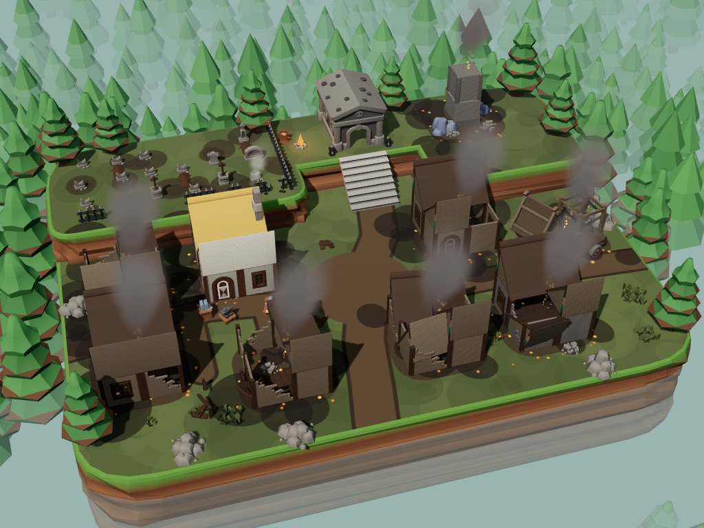 | 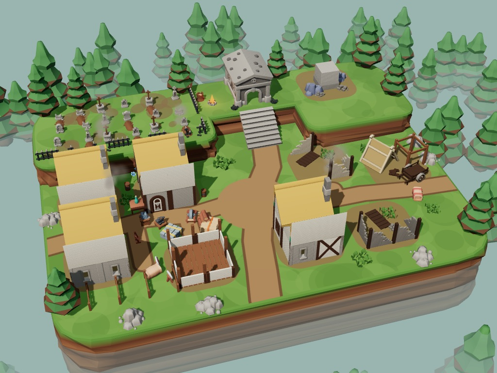 |
| Estágio 0, destruída: só o ferreiro de pé, com telhado de palha; o resto queimado, com fumaça e brasas | Estágio 1, reconstruída: quatro prédios de pé, a curandeira em obra, telhados de palha e caminhos de terra |
| 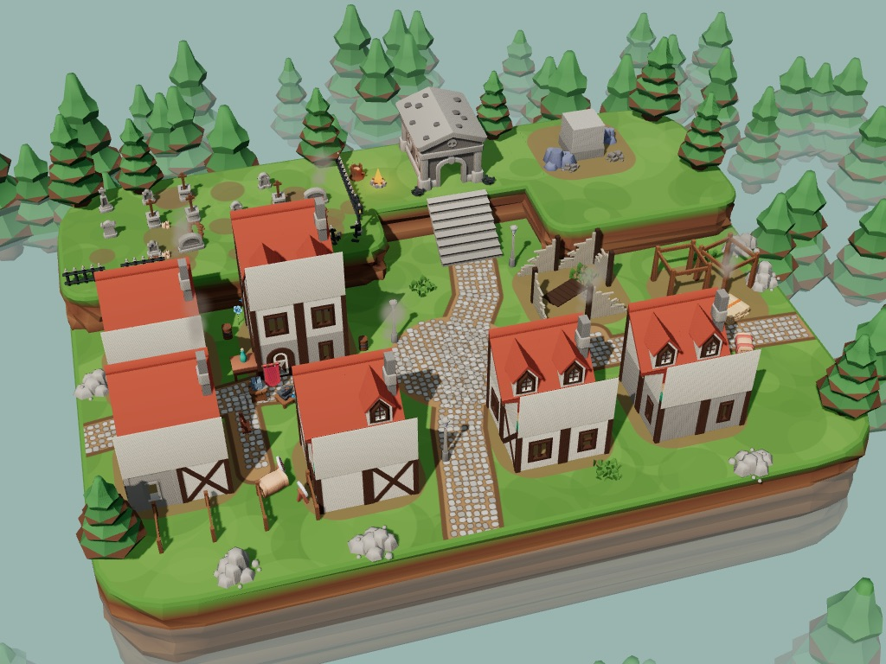 | 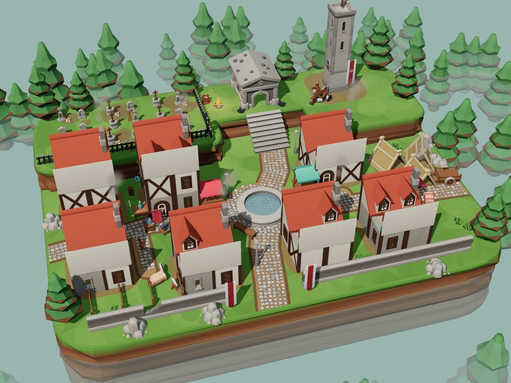 |
| Estágio 2, melhorada: telhas, calçamento e lanternas; a torre ainda em ruína e o carroceiro em obra | Estágio 3, melhorada de novo: a fonte, a feira, a muralha com estandartes, a torre com ameias e as tendas do carroceiro |
| 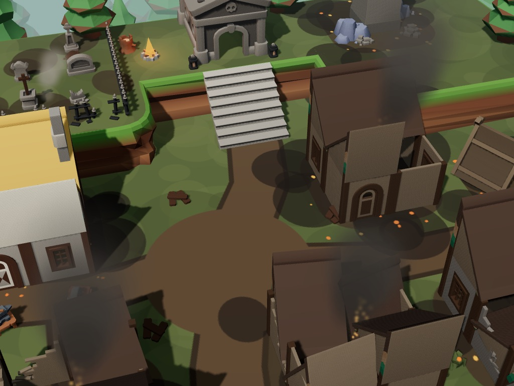 | 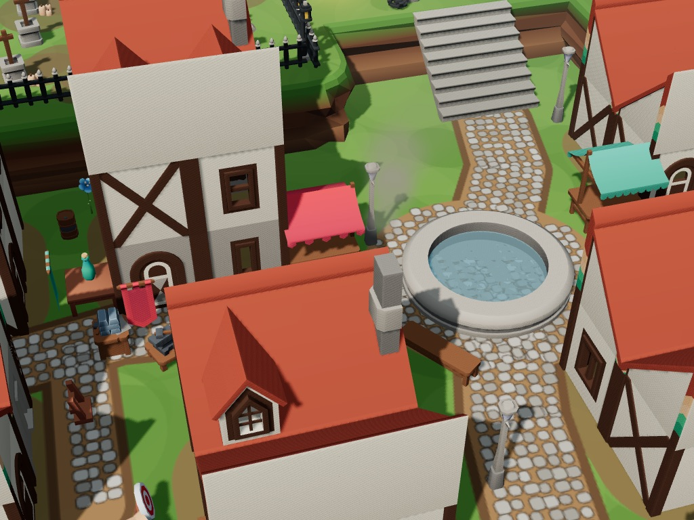 |
| De perto: casas queimadas com o telhado desabado | De perto: enxaimel, janelas de sótão, calçamento e a fonte |
| 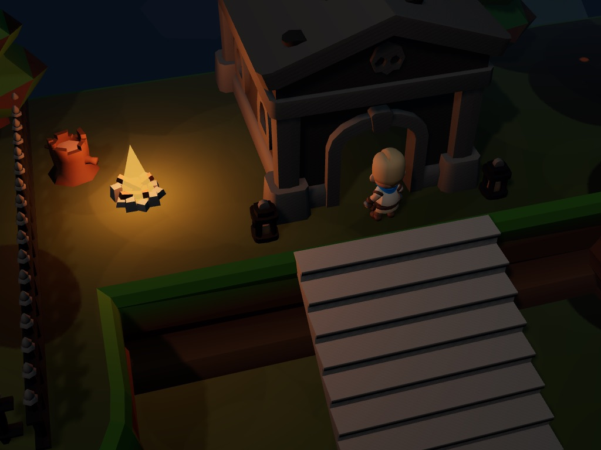 | 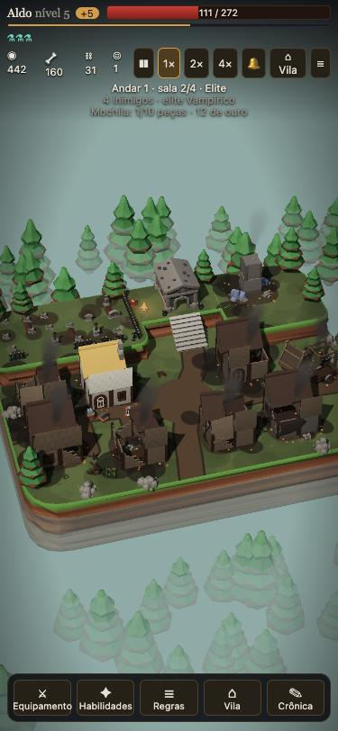 |
| À noite: o herói levanta da fogueira e empurra a porta da capela da Cripta | Celular (375 × 812), estágio 0 |

As imagens de referência ficam em `docs/img/conceito-vila-1-destruida.jpg` a `conceito-vila-4-melhorada-2.jpg`.

**Onde está cada coisa:**

- **`src/game/townPlan.ts` (puro):** a ilha, os platôs, a escada, a capela, a fogueira, os 9 lotes, os caminhos, a altura do chão (`heightAt`), o estágio da vila (`townStage`), o estado de cada lote e a hora do dia. 8 testes conferem que:
  - nada se sobrepõe (lotes, caminhos, escada, fogueira e capela);
  - cada lote cabe num chão só, dentro da ilha;
  - a escada liga a praça à ponte, e a fogueira e a porta ficam no mesmo platô;
  - as regras de estado, de estágio e de dia e noite valem;
  - nada disso entra no save.
- **`src/render/palette.ts`:** recolore a paleta dos packs do Kenney. Cada pack tem uma grade de 16 × 4 faixas, e trocar a cor de uma faixa troca a de tudo que a usa, mantendo o degradê. É assim que o mesmo telhado vira palha, telha ou carvão, a parede vira enxaimel (reboco claro e vigas escuras), o arenito do castelo vira pedra cinza e a cerca verde do cemitério vira ferro.
- **`src/render/town.ts`:**
  - **Ilha e platôs:** extrudados, com o topo pintado numa textura que muda com o estágio (grama ou chão queimado, terra embaixo dos lotes, caminhos de terra ou calçados, cinzas e brasas). As paredes de terra têm camadas de cor e pedrinhas.
  - **Floresta:** densa, a pedido do usuário. Cerca de 500 pinheiros instanciados: os do Kenney (uns 340 triângulos cada) só no anel mais perto da ilha, e mais longe um pinheiro simples de três andares (uns 60). Embaixo da ilha ficam três camadas de névoa.
  - **Lotes:** casas de enxaimel, as tendas do carroceiro e a torre do Salão de Táticas, montadas peça por peça.
  - **Fumaça e brasas:** partículas de um desenho só cada.
- **Depuração:** `portador.stage.town.stageOverride`, `viewOverride` e `hourOverride` forçam o estágio, o estado dos lotes e a hora, só na tela e sem mexer no save. Foi assim que as capturas foram feitas.

**O que mudou em relação à especificação:**

- **Uma ilha em diorama, e não um mapa aberto:** pedido do usuário, com as quatro imagens de referência. A primeira versão, um mapa largo com ruas cinza e telhados verde-água, foi trocada no mesmo dia.
- **A entrada da Cripta é a capela no alto da escada** (Kenney Graveyard), com a fogueira de vigília ao lado. Levantar, andar e empurrar a porta cabem na saída da viagem, de 3,6 s.
- **Três casas, e não doze:** a ilha comporta os 6 prédios e 3 casas. O crescimento da gente vai aparecer nos moradores andando (M2.2).
- **A fonte e as lanternas seguem os estágios:** a fonte vem no estágio 3 e as lanternas no 2, e não mais no marco de 10 moradores sozinho.
- **Câmera:** vem do sul, de cima e com a lente fechada (30°), para parecer maquete, e enquadra a ilha inteira na vista de casa. Arrastar (ou as setas e WASD) a solta, e o ◎ do HUD ou a tecla 0 a traz de volta. Pelo teclado, + e - dão zoom.
- **O acampamento do M0 deixou de existir:** o herói descansa na vila.

**Desempenho no computador** (contando a sombra):

| Estágio | Chamadas de desenho | Triângulos |
|---|---|---|
| 0 | 89 | 104 mil |
| 3 | 93 | 150 mil |

O herói sentado na fogueira acrescenta cerca de 14 chamadas e 16 mil triângulos, o que leva o estágio 3 a uns 166 mil, acima do orçamento de 150 mil. Falta medir no celular.

**Fica para depois:**

- **M2.2:** os moradores (corpo, cor de roupa, nome, ofício e rotina) e os marcos de vida (feira, músico, crianças, a festa do fim do Ato I).
- **M2.3:** as janelas acesas à noite e o portão de caveira de boi das imagens de referência, que não existe nos packs.

**Como ficou a M2.2 (2026-10-22): os moradores**

| | |
|---|---|
| 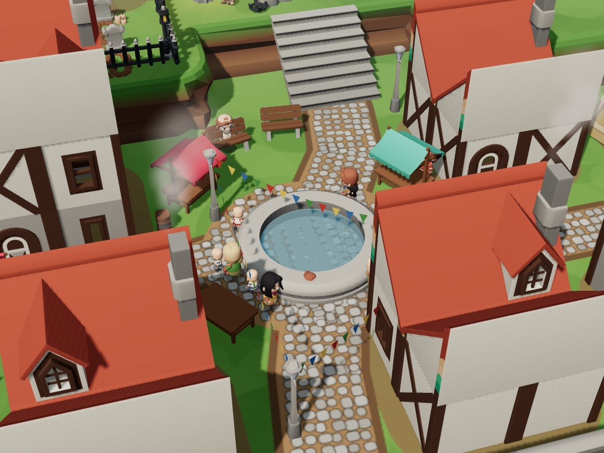 | 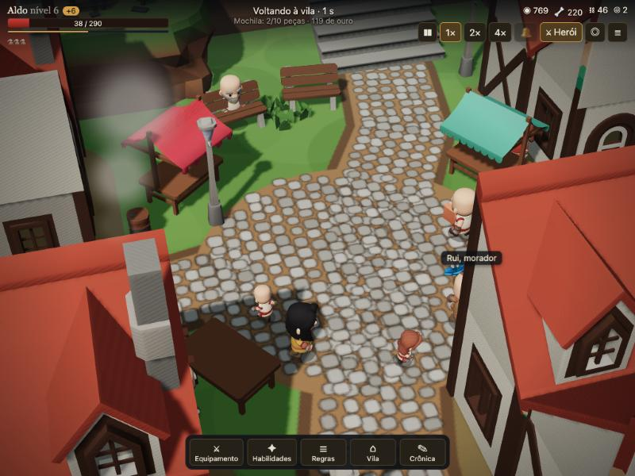 |
| A praça de manhã: gente passeando, crianças em volta da fonte, o avô no banco e a feira | Tocar num morador mostra o nome e o ofício em cima dele ("Rui, morador") |
| 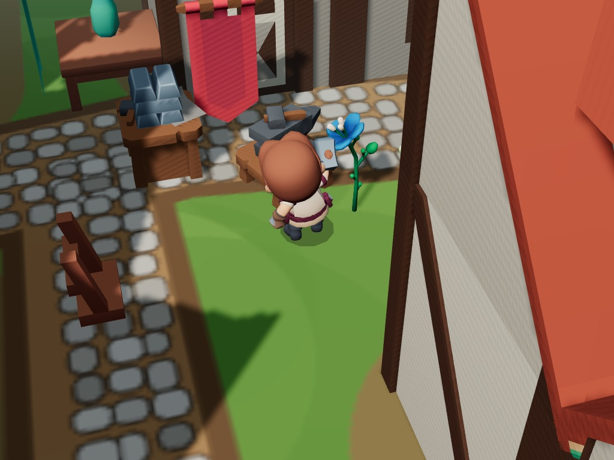 | 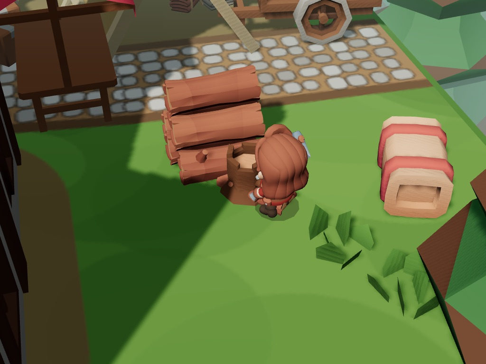 |
| O ferreiro martelando na bigorna, de dia | A lenhadora rachando lenha no toco, com o machado |
| 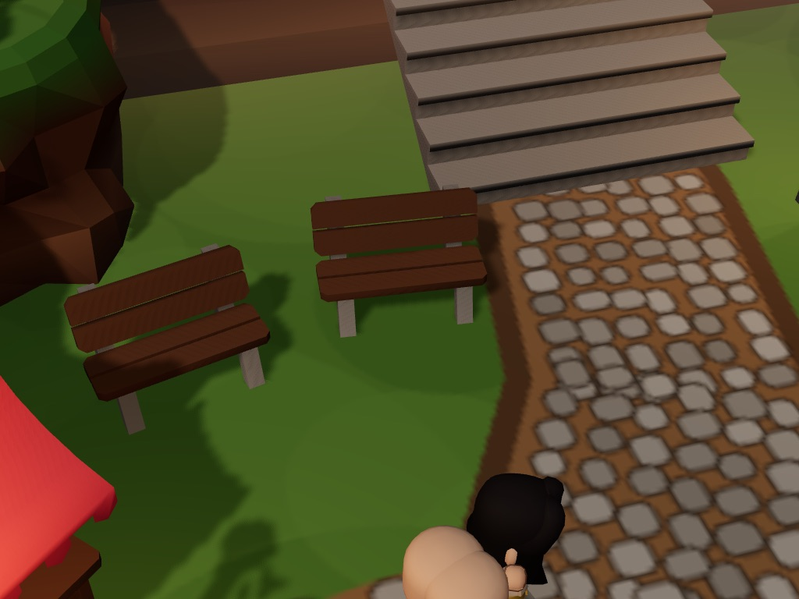 | 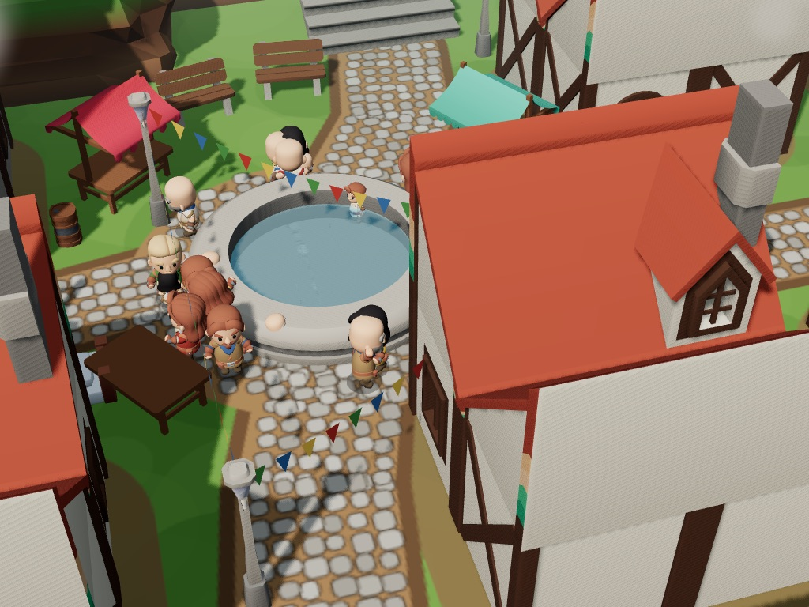 |
| Ao entardecer, a música toca violão no banco ao pé da escada | A festa do Senhor: todo mundo na praça, acenando e comemorando, com as bandeirolas |
| 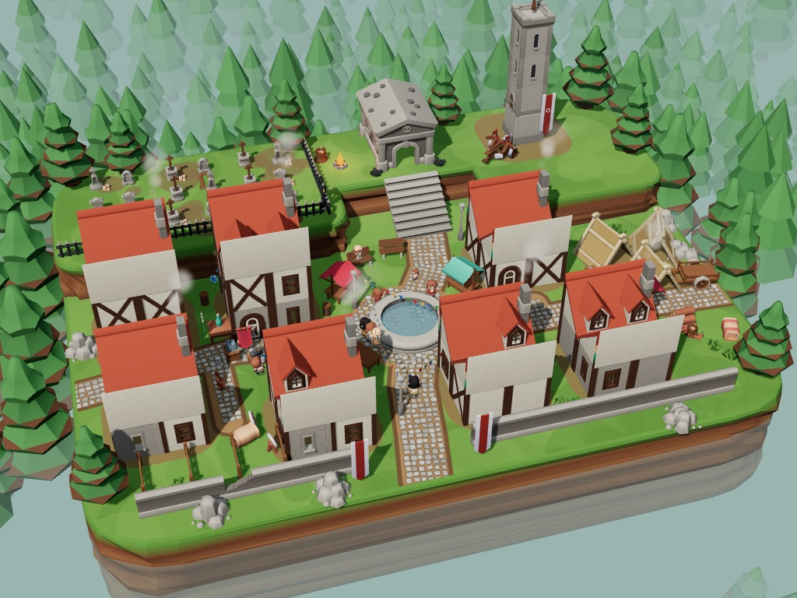 | |
| A ilha inteira com 18 moradores | |

**Onde está cada coisa:**

- **`src/game/townFolk.ts` (puro):**
  - quem mora na vila (nome, rosto, roupa e ofício, sempre os mesmos para a mesma semente, sem repetir nome entre os 24 primeiros);
  - os marcos de vida;
  - o ofício que só começa com o marco dele;
  - a rotina por hora;
  - os pontos de trabalho (bigorna, lenha, barracas, bancos e caixas);
  - a rede de caminhos, com a rota mais curta e sem cortar a fonte.

  9 testes cobrem isso, inclusive que nada entra no save.
- **`src/render/folk.ts`:**
  - **Corpo:** cada morador é montado no esqueleto do herói, com o corpo do Ranger ou do Rogue numa malha só. A túnica, o lenço e a calça são recoloridos nas faixas de tecido do atlas, sem mexer na pele nem no couro.
  - **Cabeça:** vem de um dos cinco rostos.
  - **Mãos:** martelo, machado, violão ou caixa.
  - **Andar:** pela rede, com um empurrão leve para ninguém ficar em cima do outro.
- **Depuração:** `portador.stage.town.worldOverride` troca o mundo que a vila mostra (mais moradores, chefes vencidos, a festa) sem mexer no save.

**Os ofícios e a rotina:**

| Ofício | Quando aparece | O que faz |
|---|---|---|
| Morador (o primeiro) | 1 morador | Passeia pela vila de dia e pela praça ao entardecer |
| Ferreiro | 2 moradores | Martela na bigorna das 7 às 18 h (`Hammering`) |
| Feirante | 4 moradores (a primeira barraca) | Fica atrás da barraca das 8 às 18 h |
| Lenhador | 4 moradores (a pilha de lenha) | Racha lenha no toco das 7 às 17 h (`Chopping`) |
| Carregador | 5 moradores (as caixas) | Leva caixas das tendas do carroceiro até a feira e volta |
| Crianças | 6 moradores | Correm e pulam em volta da fonte das 8 às 19h30 |
| Músico | 8 moradores e o Capitão vencido | Toca violão no banco das 16h30 às 23 h |
| Avô ou avó | 9 moradores | Senta no banco das 9 às 18 h |

Ao meio-dia, quem trabalha almoça na praça. À noite, cada um volta para a porta de uma casa (ou do prédio onde trabalha) e some. Na festa do Senhor, que dura um dia de jogo, todo mundo vai para a praça acenar e comemorar (`Waving`, `Cheering`), e aparece a tenda de circo. As bandeirolas da praça ficam depois da festa.

**O que mudou em relação à especificação:**

- **Os marcos põem coisas na vila,** além de gente:
  - a feira cresce de 1 para 3 barracas com o Capitão;
  - a pilha de lenha chega com o lenhador, e as caixas com o carregador;
  - os bancos ficam no largo ao pé da escada, onde a câmera os vê (encostados nas casas, a parede tapava).
- **Duas malhas por morador:** a completa, de perto, e uma simplificada pelo meshoptimizer do three (uns 22% dos triângulos, cerca de 1 800), usada na vista da ilha. Os pesos dos ossos ficam, porque ele só junta vértices que já existem. A animação de longe anda em meio ritmo.
- **Sombra redonda** embaixo de cada morador, desenhada de uma vez só, em vez da sombra de verdade.
- **Sombra da vila a cada 5 quadros:** o sol fica preso no meio da ilha, e quase nada que projeta sombra se mexe.
- **Teto de 24 moradores na tela do computador e 14 na do celular,** como na especificação.

**Desempenho no computador** (média de 10 quadros; o pico é o quadro em que a sombra é refeita):

| Cena | Chamadas de desenho | Triângulos |
|---|---|---|
| Estágio 0, sem moradores | 62 (pico 91) | 82 mil (pico 108 mil) |
| Estágio 3 com 18 moradores | 109 (pico 144) | 166 mil (pico 213 mil) |
| A festa com 18 moradores | 109 (pico 145) | 166 mil (pico 214 mil) |

O estágio 3 cheio passa do orçamento de 150 mil triângulos. Falta medir no celular, que mostra no máximo 14 moradores.

**Fica para a M2.3:**

- os bichos (a fonte ainda vai ser escolhida);
- as janelas acesas à noite;
- os passarinhos e o portão de caveira de boi.

**Como ficou a M2.3 (2026-10-22): bichos, janelas e passarinhos**

| | |
|---|---|
| 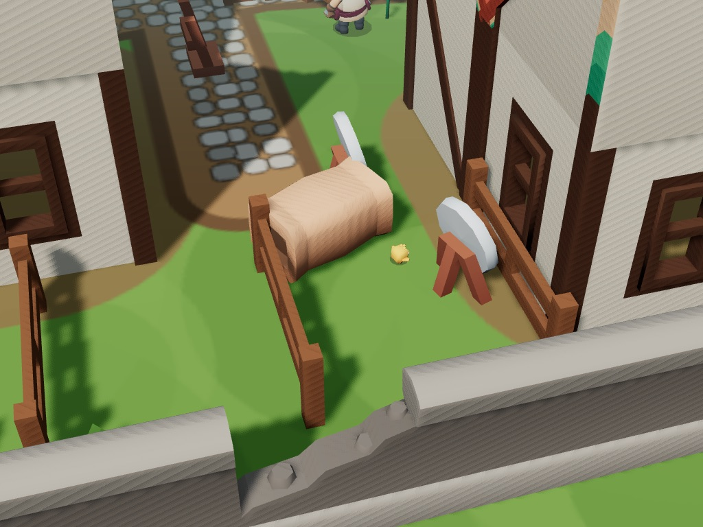 | 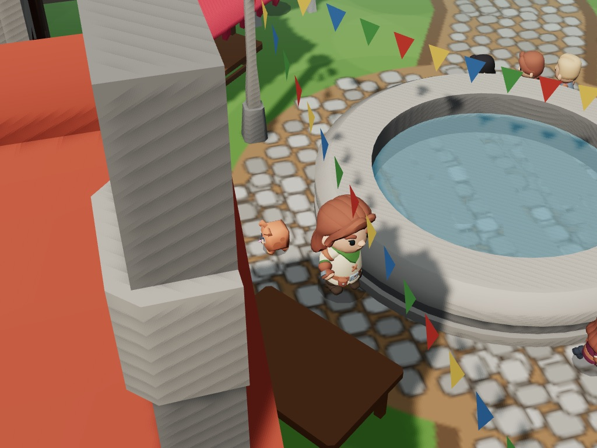 |
| O pintinho ciscando em volta do feno | O cachorro passeando pela praça |
| 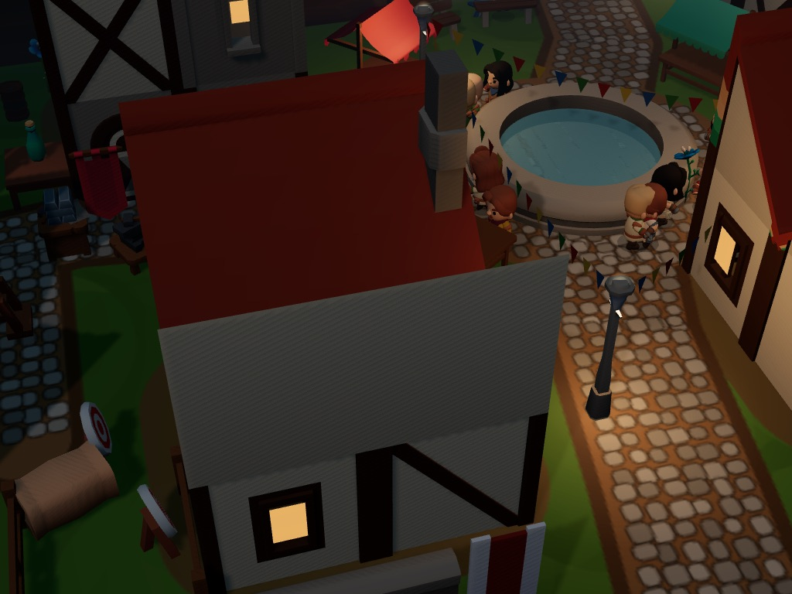 | 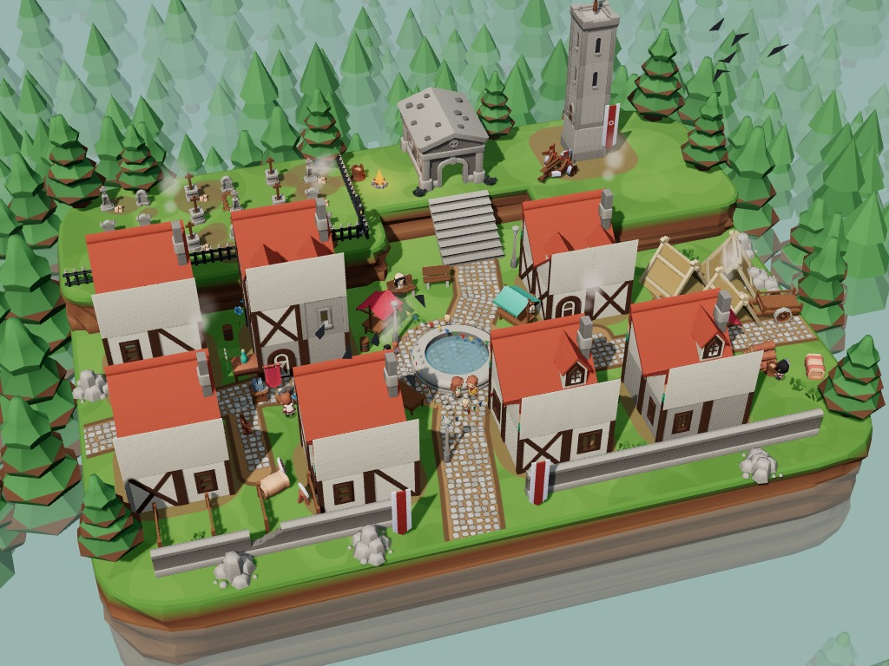 |
| À noite, as janelas das casas acendem | Os passarinhos dando voltas por cima da ilha (no alto, à direita) |

- **Bichos (Kenney Cube Pets 2.0, CC0):** a escolha do usuário foi só bichos de casa ou de fazenda, dentro da vila e no máximo 3.
  - **Quem vem:** o cachorro e o pintinho chegam com 4 moradores, e o gato com 6. Eles se chamam Pipoca, Bigode e Pitoco; tocar num deles mostra o nome.
  - **O dia de cada um:** o cachorro anda pela vila (de vez em quando corre) e dorme na porta do ferreiro. O gato cochila na beira da fonte (ou no degrau da curandeira, antes do estágio 3) e passeia pela praça ao entardecer. O pintinho cisca em volta do feno de dia.
  - **Animações:** as do próprio glb (parado, andar, correr, comer).
  - **Peso:** cada bicho tem uns 500 triângulos, e a sombra é redonda, como a dos moradores.
- **Janelas acesas:** um painel morno colado do lado de fora do vidro, nas casas de pé, do anoitecer à 1 h (nem toda janela acende). As 160 janelas possíveis são desenhadas de uma vez só.
- **Passarinhos:** dois bandos de 5 dando voltas por cima da ilha de dia, batendo as asas. Cada asa é um triângulo, e são duas chamadas de desenho para todos.
- **O portão de caveira de boi** das imagens de referência ficou de fora: não existe nos packs, e o lugar dele virou a capela da Cripta.
- **No celular,** as lanternas não têm luz de verdade: um brilho na lanterna e uma poça morna no chão. A resolução também se ajusta sozinha: abaixo de 45 fps, a densidade de pixels cai 0,25 por vez (até 1). Se baixar não ajudar, como no teto de 30 fps do Safari com o Modo de Pouca Energia, ela volta um passo e para.

O pintinho, o cachorro e o gato aparecem pelo `?demo=vila` do servidor de desenvolvimento, que mostra a vila cheia sem mexer no save. 1 teste novo cobre os bichos (53 no total).

#### 14.4 Especificação do M3: os Atos II e III

> Pedido do usuário (2026-10-22): seguir para o M3. A base é o rascunho do GDD (6 e 8) e os atos do Vigília (Minas Inundadas e Jardim de Fungos), adaptados para um herói só.

**Princípios** (os do M1 continuam):

1. **Cada ato traz um problema novo, resolvido com preparo** (pilar 1). No Ato II, a **couraça** pede perfuração; no Ato III, o **veneno** pede cura e alquimia. O jogador resolve na vila, com arma, habilidade, regra e prédio, e não no meio da luta.
2. **O que ele veste aparece** (pilar 2). As armas novas usam as malhas do Fantasy Weapons Bits, e as peças dos tiers 6 a 15 ganham as cores ferro-negro e ouro (3.3).
3. **A vila segura o ritmo** (pilar 3). Os níveis altos dos prédios pedem o material do ato, que só existe lá embaixo.
4. **O núcleo continua puro e determinístico.** O balanceador ganha as metas dos dois atos, e o save sobe para a v3, com migração.

**Estrutura:**

| | Ato II: as Minas Inundadas | Ato III: o Jardim de Fungos |
|---|---|---|
| Andares | 11 a 20 | 21 a 30 |
| Chefe menor | Andar 15: o Capataz | Andar 25: o Guardião de Micélio |
| Chefe do ato | Andar 20: a Couraça Submersa | Andar 30: a Mãe-Bolor |
| Tier das peças | 6 a 10 | 11 a 15 |
| Material novo | Ferro-negro | Esporos |
| Problema | Couraça: inimigos com armadura própria | Veneno: dano que fica e acumula |
| Resposta | Perfuração (martelo, lança, alabarda), Quebra-Couraça e Golpe de Escudo | Purificar, poção de antídoto do alquimista e o afixo Imune |
| Duração alvo | 2 a 3 h de jogo | 3 a 4 h de jogo |

**Ato II, as Minas Inundadas:**

- **Cenário:**
  - As salas do KayKit Dungeon, com a pedra recolorida para azul-petróleo e ferrugem.
  - Vigas de madeira (as varas e tábuas do Kenney), trilhos de mina (em código), lanternas penduradas (RPG Tools Bits) e pilhas de minério (Resource Bits).
  - Poças de água no chão, com reflexo e luz fria.
- **A couraça:**
  - Os inimigos do ato têm armadura própria, a couraça C, que corta o dano do herói por `C / (C + 18)`. A couraça é fixa por inimigo (não cresce com o andar), então o corte é o mesmo no ato inteiro.
  - A **perfuração** do herói tira uma fração dessa couraça antes do corte (no máximo 80%). Ela vem do martelo, da lança, da alabarda, do afixo Perfurante e de Mão Pesada. Quebra-Couraça corta pela metade o que sobra.
- **Inimigos:**

| Inimigo | Arte | Papel |
|---|---|---|
| Mineiro | Esqueleto lacaio recolorido de ferrugem, com o capacete de mineiro (Mixed Bag) e a picareta (RPG Tools Bits) | Bando; couraça baixa |
| Afogado | Esqueleto ladino recolorido de azul-afogado, pingando | Rápido; puxa o herói (−20% de velocidade de ataque por 3 s) |
| Golem de Ferro-negro | Esqueleto guerreiro em 1,5×, todo de ferro-negro | Lento, couraça alta e ocupa 2 vagas; deixa ferro-negro |
| Lanterneiro | Esqueleto mago com a lanterna no lugar do cajado | De longe; a luz dele dá +15% de dano aos outros |
| O Capataz (andar 15) | Esqueleto guerreiro em 1,6×, com martelo e capacete | Golpe que atordoa 1 s a cada 14 s; chama 2 mineiros |
| A Couraça Submersa (andar 20) | Golem em 2×, de ferro-negro e ferrugem, saindo da água | Couraça alta; na fase 2, endurece (+30% de couraça) e bate duas vezes seguidas |

- **Habilidades** (treinador nível 2):
  - **Golpe de Escudo** (ativa): atordoa todo o anel por 1,5 s. Pede escudo.
  - **Quebra-Couraça** (ativa): o alvo perde metade da couraça por 6 s.
  - **Mão Pesada** (passiva): +15% de perfuração.
  - **Pele Úmida** (passiva): a lentidão dos afogados dura metade.
- **Armas novas** (Fantasy Weapons Bits):
  - **Martelo** (`hammer_A` a `C`), **lança** (`spear_A`) e **alabarda** (`halberd`, 2 mãos) são bases novas, com perfuração própria.
  - As espadas `sword_A` a `E`, os machados `axe_A` a `C`, as adagas `dagger_A` e `B` e os escudos `shield_A` a `C` passam a ser a malha das bases que já existem nos tiers 6 a 15, para a arma também mudar de cara com o tier.
- **Lendárias do ato:**
  - **Picareta do Capataz** (martelo, andar 15): o golpe atordoa 0,5 s.
  - **Âncora Partida** (alabarda, andar 20): ignora toda a couraça a cada quarto golpe.

**Ato III, o Jardim de Fungos:**

- **Cenário:**
  - As salas com a pedra recolorida para verde doente e violeta.
  - Cogumelos gigantes com pintas que brilham, feitos em código (tronco, chapéu e pintas emissivas), e raízes.
  - Névoa violeta no chão e esporos flutuando (as mesmas partículas da fumaça da vila).
- **O veneno:**
  - Os golpes de alguns inimigos deixam uma **dose de veneno**: 2% da vida máxima por segundo durante 6 s. As doses se somam, até 5.
  - A poção não cura o veneno, só a vida. O que cura:
    - Purificar;
    - a poção de antídoto, do alquimista nível 3;
    - o afixo Imune, que corta a duração.
- **Inimigos** (arte a decidir; veja as decisões abaixo):

| Inimigo | Papel |
|---|---|
| Esporento | Cogumelo que anda; cada golpe deixa 1 dose de veneno |
| Brotado | Pequeno e em bando; ao morrer, solta uma nuvem que envenena |
| Aranha-de-Micélio | Rápida, pula no anel; prende o herói (sem Investida por 3 s) |
| Bolor Cuspidor | De longe; cospe veneno |
| O Guardião de Micélio (andar 25) | Grande, cura os outros a cada 10 s |
| A Mãe-Bolor (andar 30) | Fase 1: doses a cada golpe. Fase 2: o veneno vem 2× mais rápido e ela faz brotar dois Brotados |

- **Habilidades** (treinador nível 3):
  - **Purificar** (ativa): tira todo o veneno e cura 10% da vida.
  - **Golpe Giratório** (ativa): 60% do dano em todos do anel, duas vezes.
  - **Sangue Amargo** (passiva): o veneno faz metade do dano.
  - **Fôlego de Mineiro** (passiva): +1 poção.
- **Lendárias do ato:**
  - **Coroa de Micélio** (elmo, andar 25): cada abate cura 2% da vida.
  - **Ferrão da Mãe** (adaga, andar 30): o golpe envenena o inimigo.

**Itens e forja:**

- **Afixos novos:**
  - **Perfurante:** +8% de perfuração, com o material ferro-negro.
  - **Imune:** −15% da duração do veneno, com o material esporos.
  - Os dois entram na forja rara e épica.
- **Teto da forja:** o ferreiro passa de 5 para 8 níveis (teto `2 × n`, até o tier 16). Os níveis 6 a 8 pedem ferro-negro, e o 8 também pede esporos.
- **Os outros prédios:** o treinador vai até o nível 3 dos atos. O alquimista ganha o nível 5, que dá a poção de antídoto. Os níveis novos pedem o material do ato.

**Regras:** entram as condições "envenenado com pelo menos N doses" e "alvo com couraça", para o jogador escrever "SE envenenado 3 ENTÃO Purificar" e "SE alvo com couraça ENTÃO Quebra-Couraça".

**Vila:**

- **Ato II vencido:** um carrinho de mina com ferro-negro na frente do ferreiro.
- **Ato III vencido:** uma horta de cogumelos na porta do alquimista.

O estágio 3 da vila continua sendo o máximo; os atos só põem enfeites.

**Testes do M3:**

- as fórmulas da couraça, da perfuração e do veneno;
- as doses que se somam e somem;
- as fases dos chefes novos;
- as condições novas das regras;
- a migração do save v2 para a v3;
- que os andares 11 a 30 geram as salas e os inimigos certos.

**Metas novas no balanceador** (5 a 8 h por semente, com o jogador automático aprendendo a usar perfuração e Purificar):

| Meta | Alvo |
|---|---|
| Chefe do Ato II (andar 20) | 2 a 3 h depois do Ato I |
| Chefe do Ato III (andar 30) | 3 a 4 h depois do Ato II |
| Perfuração e veneno pesam | Sem perfuração, as salas do Ato II levam ≥ 1,15× mais; sem resposta ao veneno, o herói morre ≥ 2× mais no Ato III |
| Parede | No Ato II, mediana ≤ 45 min e pior semente ≤ 90 min sem o andar mais fundo subir (a proporção do Ato I, num ato que dura o dobro) |

As metas do Ato I continuam valendo.

**Fatias:**

| Fatia | Conteúdo |
|---|---|
| M3.1 | O núcleo do Ato II: andares 11 a 20, couraça e perfuração, inimigos, chefes, habilidades, armas novas, ferro-negro, afixo Perfurante, save v3 e as metas do ato |
| M3.2 | A cara do Ato II: o cenário das minas, os inimigos montados (capacete, picareta, recolor), as armas do Fantasy Weapons Bits no herói e o carrinho na vila |
| M3.3 | O Ato III inteiro: veneno, inimigos, chefes, habilidades, esporos, afixo Imune, antídoto, o cenário dos fungos e a horta na vila |
| M3.4 | Balanceamento dos três atos juntos e polimento |

**Pronto quando:** as quatro fatias funcionam no navegador e no celular, o balanceador passa nas metas dos três atos e há capturas de cada ato em `docs/img/`.

**Decisões do usuário (2026-10-22):**

1. **Arte dos inimigos do Ato III:** os monstros do Quaternius Ultimate Monsters (CC0, glTF animado). São uns 5 (cogumelos, bolhas e o rei-cogumelo para a Mãe-Bolor), baixados na M3.3. No Ato II fica o recolor do KayKit, sem baixar nada.
2. **Duração:** 2 a 3 h para o Ato II e 3 a 4 h para o Ato III.

**Como ficou a M3.1 (2026-10-22): o núcleo do Ato II**

- **Andares 11 a 20** (`config.ts`):
  - Cada ato recomeça a conta. O tier é `⌈n/2⌉ + 5` (n é o andar dentro do ato), de 6 a 10.
  - Cada andar tem `4 + ⌊n/3⌋ + 2` salas, de 6 a 9. As duas salas a mais são do Ato II.
  - O grupo é o do Ato I: `3 + ⌊n/2⌋`, até 8.
  - Além de P(andar), os inimigos do Ato II têm 92% da vida e 74% do dano. A couraça e os truques já pesam.
- **Inimigos** (vida, dano e couraça na base; tudo × P(andar), menos a couraça):

| Inimigo | Vida | Dano | Couraça | O que faz |
|---|---|---|---|---|
| Mineiro | 32 | 5 | 14 | Bando; 10% de chance de deixar 1 ferro-negro |
| Afogado | 40 | 5 | 8 | Golpe rápido (1,1 s); −20% de velocidade de ataque no herói por 3 s |
| Golem de Ferro-negro | 130 | 10 | 40 | Ocupa 2 vagas, golpe lento (2,6 s); deixa 1 a 2 ferro-negro |
| Lanterneiro | 32 | 7 | 4 | De longe; +15% de dano nos outros enquanto vive |
| O Capataz (15) | 1500 | 15 | 24 | 10% de bloqueio; a cada 14 s, golpe duplo que atordoa 1 s e chama 2 mineiros, se a escolta estiver abaixo de 3; deixa 8 a 12 ferro-negro |
| A Couraça Submersa (20) | 850 | 14 | 24 | Na metade da vida, endurece (couraça × 1,3), bate 15 a cada 2,4 s e repete o golpe 0,4 s depois; deixa 15 a 20 ferro-negro |

- **Os grupos** sorteiam cada inimigo de uma tabela (`groupTable`):
  - no começo, 3 mineiros e 1 afogado;
  - mais um afogado a partir do 2º andar do ato, um golem no 3º, um lanterneiro no 4º e outro golem no 7º.

  As elites são mineiros ou afogados.
- **Armas novas,** que só caem e só se forjam a partir do andar indicado:

| Arma | Mãos | Dano | Golpes/s | Perfuração | Desde |
|---|---|---|---|---|---|
| Martelo | 1 | 16 | 0,85 | 30% | andar 11 |
| Lança | 2 | 25 | 0,75 | 25% (e 3% de crítico) | andar 11 |
| Alabarda | 2 | 33 | 0,6 | 40% | andar 13 |

- **Habilidades:**
  - Golpe de Escudo: recarga de 12 s, atordoa o anel por 1,5 s e dá 40% do dano.
  - Quebra-Couraça: recarga de 9 s, metade da couraça por 6 s, 100% do dano.
  - Mão Pesada: +15% de perfuração.
  - Pele Úmida: a lentidão cai para 1,5 s.
- **A "Força"** desconta a couraça média do ato (17) depois da perfuração do herói. Assim, ela continua valendo 1 na fronteira, e a arma que fura sobe a Força nas minas.
- **Vila e itens:**
  - O treinador, a partir do nível 2, pede 15 × nível de ferro-negro.
  - O afixo Perfurante (+8% de perfuração) é forjado com ferro-negro.
  - Os baús do Ato II trazem 2 a 4 ferro-negro.
  - O teto da forja (tier 10 com o ferreiro 5) já cobre o ato. Os níveis 6 a 8 do ferreiro ficam para a M3.3.
- **Lendárias:**
  - A Picareta do Capataz é um martelo que atordoa 0,5 s.
  - A Âncora Partida é uma alabarda que ignora a couraça a cada quarto golpe.
- **No 3D,** a arte é só recolor e encaixe, sem baixar nada:
  - mineiro com o capacete de mineiro e a picareta;
  - afogado azulado;
  - golem cinza-pedra em 1,5×, com martelo;
  - lanterneiro com a lanterna;
  - Capataz com martelo e capacete;
  - Couraça com machado e escudo grande.

  O herói usa `hammer_A`, `spear_A` e `halberd` do Fantasy Weapons Bits.
- **Save v3:** a migração põe o ferro-negro em todo lugar que guarda material, os campos novos do herói e dos inimigos e as regras do Ato II.
- **Testes:** 16 novos em `tests/m3.test.ts`, 69 no total.

**O que mudou em relação ao especificado:**

- **A couraça não cresce com o andar.** A conta é `C / (C + 18)`, com couraça fixa por inimigo. Com `25 × P(andar)`, o corte diminuía andar a andar, e a perfuração perdia o sentido no fim do ato.
- **Números mais brandos:** o lanterneiro dá +15% (não 20%), e a Couraça endurece 30% (não 50%). Com os números do rascunho, as salas com dois lanterneiros e a fase 2 matavam o herói sem chance de resposta.
- **A meta da perfuração ficou em ≥ 1,15×** (não 1,5×). Para chegar a 1,5×, a couraça teria de cortar tanto que o ato viraria parede para quem não fura. Medido: 1,22 a 1,27×.
- **A meta da parede do Ato II** olha a mediana e o pior caso, como no Ato I.
  - As travas que sobram ficam no andar 19 e na Couraça.
  - Com o pior caso em 60 min, nenhuma combinação de salas, vida ou dano passava nas duas faixas ao mesmo tempo.
- **Buscar os restos não desce para um andar "fundo demais."**
  - Quem morria no Capataz deixava os restos na sala dele.
  - Na volta, a regra de fábrica levava o herói direto ao Capataz, e ele morria de novo, até 10 vezes seguidas.
  - Agora a busca só desce se a Força daquele andar for ≥ 0,8 (`fetchMinRatio`). Os restos esperam o herói crescer.
- **O que o balanceador ajustou:**
  - o Capataz caiu de 2000 para 1500 de vida, porque era tão forte quanto a Couraça cinco andares antes;
  - a Couraça caiu de 1200 para 850;
  - o Ato II ganhou 2 salas por andar, e mais salas deram mais saque e menos parede;
  - a "Força" do Ato II deixou de ter desconto (`actDemand` 1). Com o desconto de 0,85, o bot descia fundo demais e morria mais.

**Resultado em 2026-10-22, com a M3.1** (7 h por semente; 20 sementes a partir de 1000 · 30 a partir de 7000):

| Meta (Ato II) | Alvo | Faixa 1000 | Faixa 7000 |
|---|---|---|---|
| Capataz (andar 15) depois do Senhor (mediana) | 45–100 min | 53,2 min | 52,1 min |
| Couraça (andar 20) depois do Senhor (mediana) | 2–3 h | 2,3 h | 2,2 h |
| Sementes que vencem o andar 20 em 7 h | ≥ 80% | 20/20 | 30/30 |
| Mortes por hora | 0,5–2,5 | 1,2 | 1,1 |
| Luta média por sala | 10–35 s | 19,6 s | 20,1 s |
| Luta com a Couraça | 60–150 s | 86,0 s | 85,7 s |
| Sem perfuração, as salas levam | ≥ 1,15× | 1,27× | 1,22× |
| Parede (mediana · pior) | ≤ 45 · ≤ 90 min | 41,0 · 56,8 min | 38,8 · 73,5 min |

As 18 metas do Ato I continuam passando nas duas faixas. O Senhor sai aos 72,3 e aos 74,7 min.

**Como ficou a M3.2 (2026-10-22): a cara do Ato II**

| | |
|---|---|
| 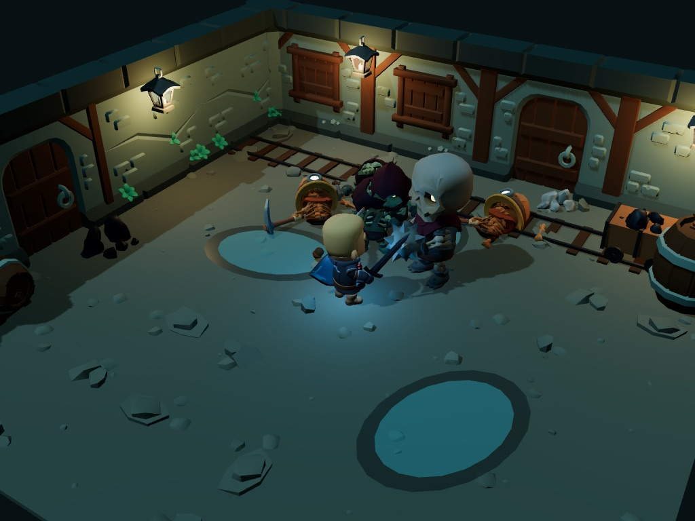 | 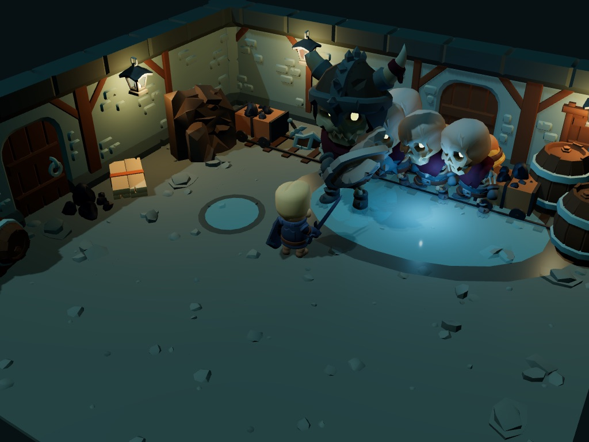 |
| 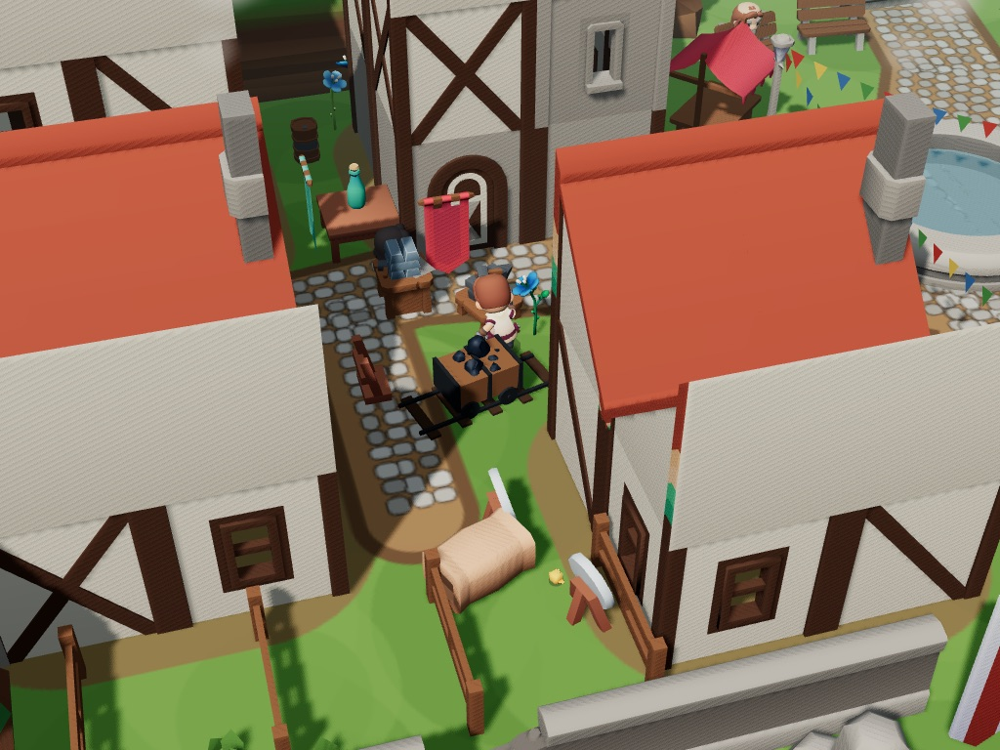 | |

- **A sala das minas** (`buildMine` em `dungeon.ts`):
  - Usa a mesma planta da Cripta: as portas no mesmo lugar e o lado da câmera aberto.
  - O atlas do KayKit Dungeon é recolorido por faixa (grade de 8 × 4, `palette.ts`): a pedra cinza vira azul-petróleo, e a madeira escurece.
  - As paredes alternam a parede escorada (`wall_scaffold`), a rachada e a lisa, e as portas são as escoradas.
  - O chão é de terra, às vezes com pedras.
  - As lanternas do RPG Tools Bits tomam o lugar das tochas, com luz mais amarela.
- **Trilhos e carrinho** (`minecart.ts`, feitos em código, porque nenhum pack da família tem):
  - Os trilhos correm ao longo da parede do fundo, com dormentes a cada 0,8 m.
  - O carrinho fica parado neles, com a caçamba cheia de pepitas tingidas de ferro-negro.
  - Os andares 15 e 20 têm um segundo carrinho.
- **Enfeites:**
  - pilhas de ferro-negro, pedras, tábuas, barril, tonel, balde e a picareta encostada;
  - às vezes, uma armação de escora solta (`wall_open_scaffold`).
- **Poças:**
  - Cada sala tem 2 ou 3, quase espelhadas (as lanternas brilham nelas), com borda de terra molhada.
  - Uma luz fria azul ilumina o meio da sala.
  - Na sala da Couraça Submersa (andar 20), há uma poça grande na frente da porta dos inimigos, com luz própria.
- **Luz do ato:** o escuro das minas puxa para o verde-água, e o céu refletido é mais frio (`lightCrypt`).
- **Armas por tier:**
  - A tabela está em 7.6.
  - Com o ferro-negro cobrindo o Ato II inteiro, a cor clareou para um aço azulado escuro. Antes, as peças viravam silhueta preta.
  - O tier 5 ficou só com o bronze.
- **Vila:**
  - Com a Couraça Submersa vencida, o marco `carrinho` põe o carrinho cheio de ferro-negro num pedaço de trilho, na rua do ferreiro (`MINE_CART`).
  - O carrinho fica fora dos lotes e a 1 m dos caminhos.
- **Testes:** 3 novos, 72 no total:
  - as malhas e as cores por tier;
  - toda malha do herói está no manifesto;
  - o marco e o lugar do carrinho.

**O que mudou em relação ao especificado:**

- **Os inimigos montados** (capacete, picareta e recolor) já tinham entrado na M3.1. Aqui, o golem e a Couraça ficaram mais claros.
- **Poças:** as poças imitam o reflexo com material quase espelhado e luz fria. Não é um reflexo de verdade, que custaria uma renderização a mais por quadro no celular.

**Como ficou a M3.3 (2026-10-22): o Jardim de Fungos**

| | |
|---|---|
| 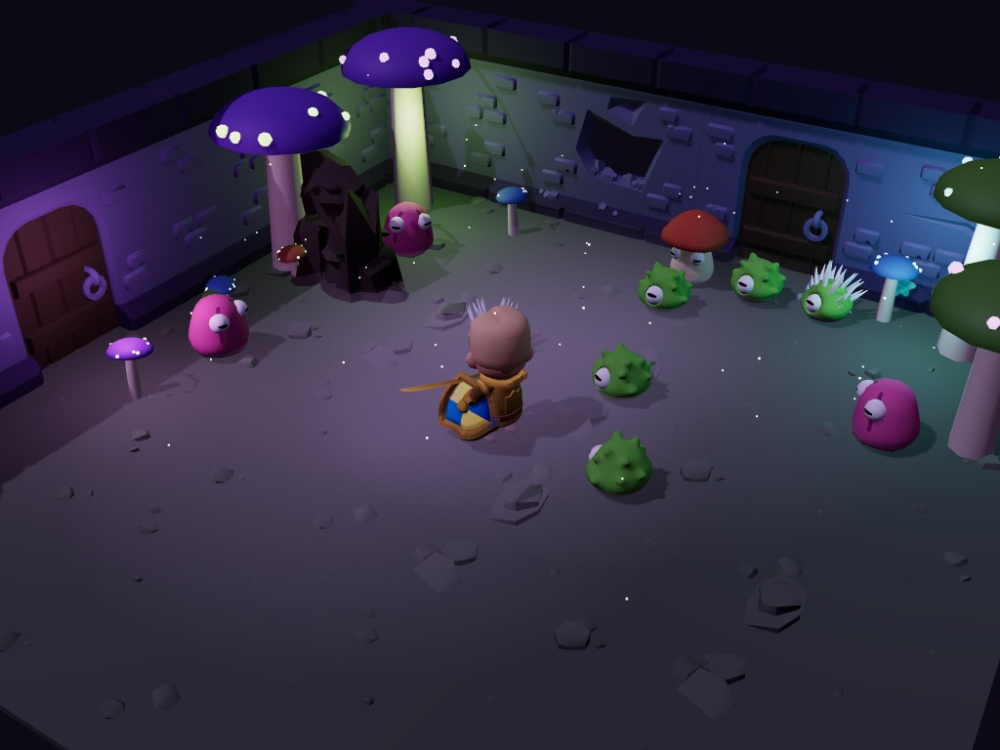 | 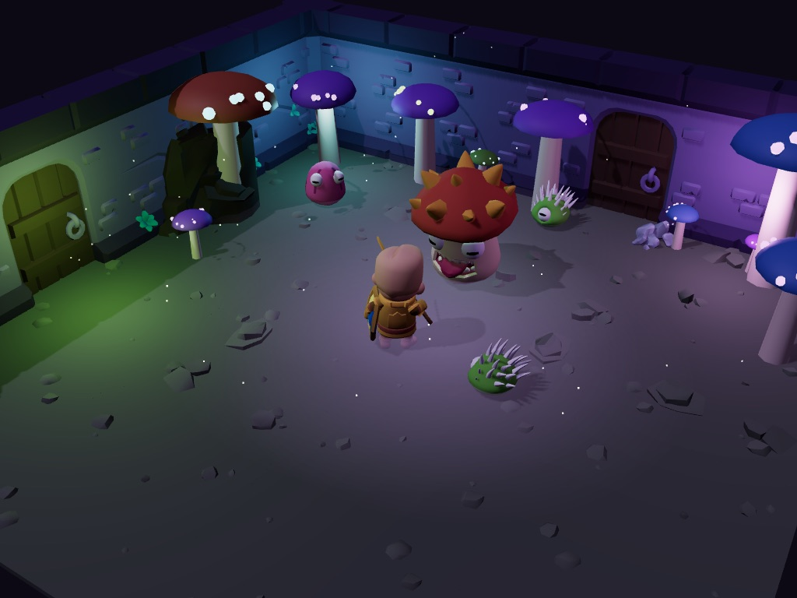 |
| 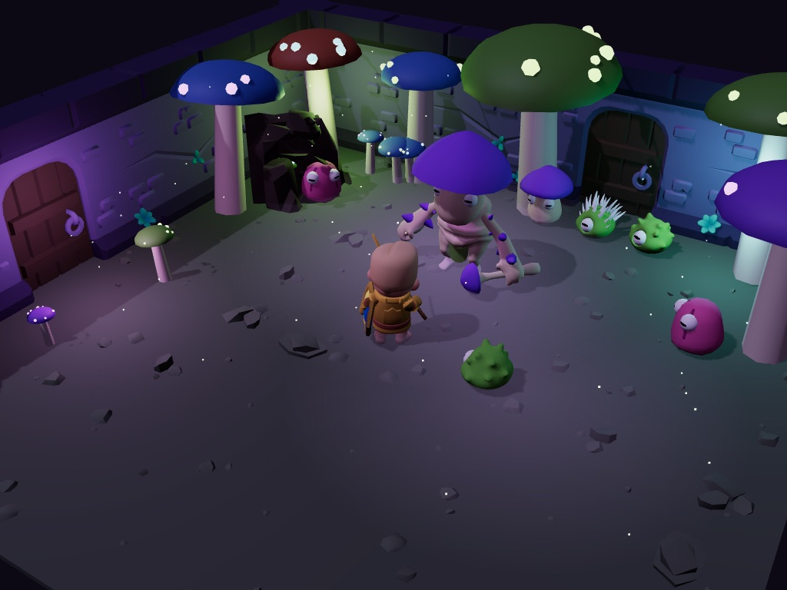 | 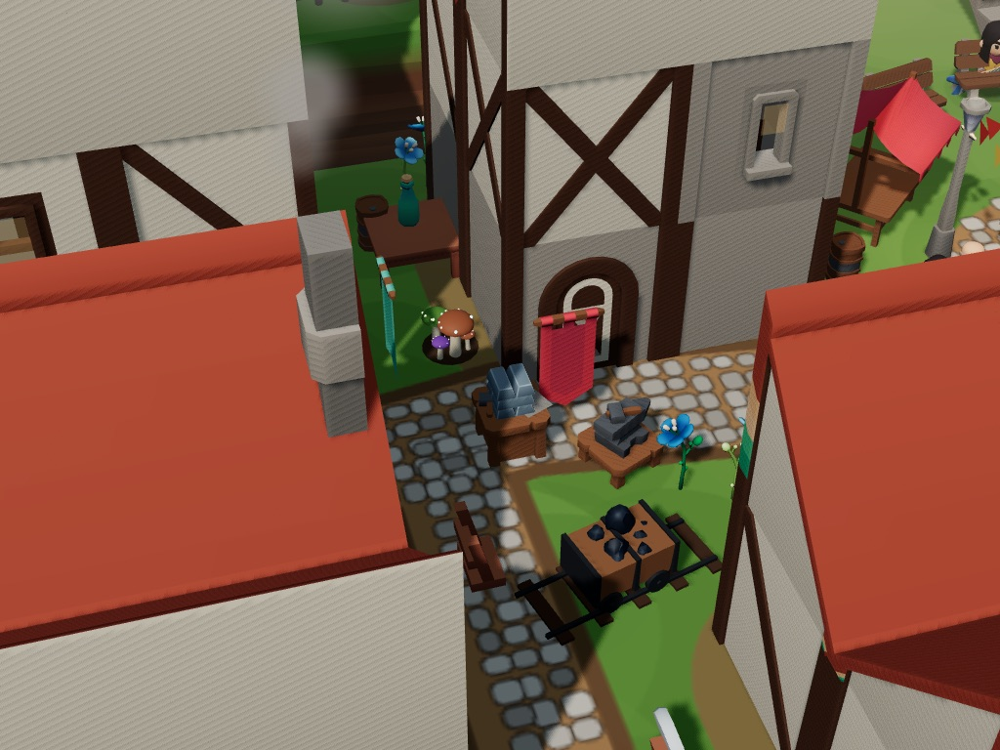 |

- **Andares 21 a 30** (`config.ts`):
  - tier `⌈n/2⌉ + 10`, de 11 a 15;
  - `4 + ⌊n/3⌋ + 5` salas, de 9 a 12;
  - o grupo é o de sempre.
  - Além de P(andar), os inimigos têm 5× a vida e 0,21 do dano. Sem couraça, eles pesam pelo veneno.
- **O veneno** (`combat.ts`):
  - Cada dose tira 2,5% da vida máxima por segundo, por 6 s.
  - As doses se somam até 5, e a quinta renova a mais velha. Elas correm também no saque e na passagem entre as salas.
  - Sangue Amargo corta o dano pela metade.
  - O Imune corta a duração (15% por afixo no tier 1, até 60%).
  - Com a Mãe-Bolor na fase 2, o veneno corre 1,5× mais rápido.
  - Tiram o veneno: Purificar e a poção com o alquimista no nível 5.
- **Inimigos** (vida, dano e intervalo na base):

| Inimigo | Vida | Dano | Golpe | O que faz |
|---|---|---|---|---|
| Esporento | 46 | 4 | 1,8 s | 1 dose por golpe; 30% de chance de deixar 1 a 2 esporos |
| Brotado | 18 | 3 | 1,2 s | Bando; morto no anel, solta uma nuvem com 1 dose |
| Aranha-de-Micélio | 36 | 4 | 1,1 s | Pula no anel (chega em 0,3 s); o golpe prende o herói, sem Investida por 3 s |
| Bolor Cuspidor | 30 | 5 | 2,6 s | De longe; 1 dose por cuspida |
| O Guardião de Micélio (25) | 900 | 15 | 2,4 s | 10% de bloqueio; a cada 10 s, cura os outros em 30% da vida e chama 2 brotados, se a escolta estiver abaixo de 3 |
| A Mãe-Bolor (30) | 850 | 13 | 2,6 s | 1 dose por golpe. Na metade da vida, faz brotar 2 brotados (e mais 2 a cada golpe especial), bate 14 a cada 2,4 s e acelera o veneno |

- **Habilidades** (treinador 3):
  - Purificar: recarga de 15 s, tira todo o veneno e cura 10%.
  - Golpe Giratório: recarga de 11 s, 60% do dano no anel, duas vezes.
  - Sangue Amargo: o veneno faz metade do dano.
  - Fôlego de Mineiro: +1 poção.
- **Regras:** a condição nova é "Doses de veneno, pelo menos N". As regras de fábrica do ato ("envenenado 3 → Purificar" e "2 no anel → Golpe Giratório") ficam no fim da lista e só valem com o Salão de Táticas 5 e 6, ou se o jogador as subir.
- **Lendárias:**
  - Coroa de Micélio: elmo de placas Robusto, Imune e Sereno; cada abate cura 2% da vida.
  - Ferrão da Mãe: adaga Brutal, Veloz e Afiada; o golpe envenena o alvo, que perde mais 12% do dano do golpe por segundo, por 4 s.
- **Vila** (o material de cada ato nos níveis dele):

| Prédio | Níveis novos | Pedem |
|---|---|---|
| Ferreiro | até o 8 (tier 16) | até o 3, ferro; 4 e 5, 20 de ferro e ferro-negro; 6 a 8, também esporos |
| Treinador | o 3 | o 2, 30 de ferro-negro; do 3 em diante, esporos |
| Alquimista | o 5 | 30 esporos; a poção passa a tirar o veneno |
| Salão de Táticas | o 5 e o 6 | esporos; 9 e 10 regras |

- **Esporos:** caem dos fungos (de 12% a 30% de chance), dos baús do ato (3 a 6) e dos chefes (10 a 24). A primeira vitória sobre a Couraça traz 30, o bastante para o treinador 3.
- **Afixos do ato:** o Perfurante só sai sorteado (e só se forja) em peças do tier 6 em diante; o Imune, do 11.
- **A Força** desconta a parte do dano que vem do veneno (40% nos Fungos), e o Imune e o Sangue Amargo cortam essa parte. Por isso o Imune sobe a Força na tela de equipamento. A Força do ato pede 1,4× o grupo médio.
- **No 3D** (`dungeon.ts`, `mushrooms.ts`):
  - a mesma planta, com o atlas recolorido para violeta e musgo e as paredes quebradas;
  - cogumelos gigantes no fundo e tufos junto das paredes, com pintas que brilham e dão a luz da sala;
  - névoa violeta no chão e esporos subindo devagar.

- **Os monstros** (`actors.ts`):
  - São do Quaternius: Mushnub (esporento), Green Blob (brotado), Green Spiky Blob (aranha), Pink Slime (cuspidor), Mushnub Evolved (Guardião) e Mushroom King (Mãe-Bolor).
  - Cada um traz as próprias animações (parado, andar, mordida ou soco, acerto e morte). O visual de cada inimigo diz o clipe de cada papel, e a escala sai da medida do modelo, para a altura pedida (de 0,9 m a 3,6 m).
  - As cores do arquivo vinham escuras e com 40% de metal, que sem mapa de ambiente sai preto. Agora cada material ganha a cor pelo nome, na paleta dos Fungos, e o metal vai a zero. O chapéu do rei-cogumelo ficou violeta.
  - O Drive do pack estava sem cota; os modelos vieram do poly.pizza, publicados pela conta do Quaternius (ver `LICENSES.md`).
- **Vila:** com a Mãe-Bolor vencida, o marco `horta` põe um canteiro de cogumelos ao lado da porta do alquimista. A mesa dele passou para o outro lado da porta, porque o resto da frente fica atrás das casas para a câmera da vila.
- **Save v4:** a migração põe os esporos em todo lugar que guarda material, o veneno e a raiz no herói, o veneno nos inimigos e as duas regras do ato.
- **Testes:** 19 novos em `tests/m3-fungos.test.ts`, mais o marco da horta, 92 no total. Dois deles conferem que os arquivos dos monstros estão no manifesto e que cada clipe pedido existe no arquivo.

**O que mudou em relação ao especificado:**

- **O antídoto não é um item:** com o alquimista 5, a própria poção tira o veneno.
- **Números do veneno:**
  - 2,5% por segundo, em vez de 2%;
  - 1,5× mais rápido na fase 2 da Mãe-Bolor, em vez de 2×. Com o dobro, ela matava em 6 s com 5 doses.
- **O Salão de Táticas ganhou os níveis 5 e 6:** as regras de fábrica já ocupavam as 8 vagas, e as do Ato III nunca valeriam.
- **A meta "sem resposta ao veneno"** compara as mortes no ato inteiro (≥ 2×), não por hora: sem resposta, o ato também dura mais.
- **A parede do Ato III** olha a mediana (≤ 70 min) e o pior caso (≤ 135 min), a proporção do Ato II num ato uma vez e meia mais longo.
- **O que o balanceador mostrou e mudou:**
  - **Ferro:** ele só cai no Ato I, e os níveis altos do ferreiro pediam 15 por nível. O ferreiro ficava parado horas enquanto o ouro passava de 400 mil. Agora os níveis 4 a 8 pedem o material dos atos.
  - **Treinador 3:** pedia ferro-negro, que acaba nos Fungos. Agora pede só esporos.
  - **Os primeiros esporos:** sem Purificar, os primeiros andares dos Fungos matavam sem parar, e os esporos para o treinador se perdiam a cada morte. Daí a Couraça trazer os primeiros 30.
  - **A Força conta o veneno:** sem isso, o bot forjava peitorais Imunes que a Força dizia não valer nada, deixava no baú e repetia a cada visita.
- **Bugs do bot achados no caminho** (e o que eles escondiam no Ato II):
  - **A barra nunca mudava:** Quebra-Couraça, Golpe de Escudo, Purificar e Golpe Giratório nunca eram usados. O Ato II da M3.1 foi balanceado sem as habilidades dele.
  - **A mochila cheia:** voltar a cada 10 peças impedia algumas sementes de terminar um andar de 8 salas. Uma ficava 100 min no andar 18.
  - **A pressa:** uma expedição de sorte abria seis andares de uma vez, com a Força caindo a 0,34, e o herói passava horas alcançando.
  - **A medida da luta com os chefes de ato** misturava as revanches, quando o bot volta ao andar. Agora conta a primeira vitória.
  - **Os "impasses"** contavam a sala antiga durante a volta para a vila.
- **O Ato II, revisto com o bot novo:**
  - os inimigos voltaram para 100% da vida;
  - a Couraça tem 1650 de vida e bate 12 (13 na fase 2), e endurece 20%, não 30%;
  - o pior caso de parede passou para ≤ 100 min, e é sempre na Couraça, a trava do fim do ato.

**Resultado em 2026-10-22, com a M3.3** (12 h por semente; 20 sementes a partir de 1000 · 30 a partir de 7000; as 34 metas passam nas duas faixas):

| Meta | Alvo | Faixa 1000 | Faixa 7000 |
|---|---|---|---|
| Ato I · Senhor (andar 10) | 60–100 min | 75,9 min | 75,0 min |
| Ato II · Capataz depois do Senhor | 45–100 min | 57,4 min | 57,0 min |
| Ato II · Couraça depois do Senhor | 2–3 h | 2,5 h | 2,4 h |
| Ato II · mortes por hora | 0,5–2,5 | 1,5 | 1,5 |
| Ato II · luta com a Couraça (primeira vitória) | 60–150 s | 73,8 s | 62,2 s |
| Ato II · sem perfuração, as salas levam | ≥ 1,15× | 1,25× | 1,22× |
| Ato II · parede (mediana · pior) | ≤ 45 · ≤ 100 min | 36,6 · 96,2 min | 37,2 · 95,8 min |
| Ato III · Guardião depois da Couraça | 70–150 min | 88,1 min | 85,5 min |
| Ato III · Mãe-Bolor depois da Couraça | 3–4 h | 3,5 h | 3,4 h |
| Ato III · sementes que vencem o andar 30 em 12 h | ≥ 80% | 20/20 | 30/30 |
| Ato III · mortes por hora | 0,5–2,5 | 1,1 | 1,0 |
| Ato III · luta média por sala | 10–35 s | 22,4 s | 23,0 s |
| Ato III · luta com a Mãe-Bolor (primeira vitória) | 60–150 s | 101,4 s | 102,9 s |
| Ato III · sem resposta ao veneno, mortes no ato | ≥ 2× | 3,5× | 14,2× |
| Ato III · parede (mediana · pior) | ≤ 70 · ≤ 135 min | 62,6 · 130,7 min | 59,0 · 91,7 min |

As 18 metas do Ato I também passam nas duas faixas. Uma semente em cada faixa chegou a 96 min parada na Couraça; as outras ficaram abaixo de 90.


**Como ficou a M3.4 (2026-10-22): o polimento**

O balanceamento dos três atos juntos já tinha fechado na M3.3: as 34 metas passam nas duas faixas de sementes, e a M3.4 rodou de novo para conferir. O resto foi polimento, olhando o jogo em tamanho de celular (375 × 812) no navegador embutido:

- **HUD:** números curtos (`short` em `format.ts`), materiais sem quebra dentro e a linha dos botões que desce quando não cabe.
- **Veneno:** bolhas verdes no herói, 5 por dose, até 25 (`VenomFx` em `venom.ts`).
- **Festa:** o marco `festa` segue a vitória de ato mais recente (Senhor, Couraça ou Mãe-Bolor).
- **Crônica:** a abertura dos andares 11 e 21 tem frase própria.
- **Tela da vila:** os custos usam `MATERIAL_NAMES`.

**Pronto quando, conferido:** as quatro fatias rodam no navegador. O HUD e as telas foram vistos em tamanho de celular no navegador embutido, mas ainda não num celular de verdade. O balanceador passa nas metas dos três atos, e há capturas de cada ato em `docs/img/`.

### 15. Decisões em aberto

1. **Regra de morte** (2.10): validar os números e a ideia de que a gente resgatada sempre volta.
2. **Armadura no visual** (3.3): aprovar a montagem por partes.
3. **Packs EXTRA:**
   - Skeletons EXTRA (US$ 7,95) traz o Golem e o Necromante, que seriam ótimos chefes.
   - Adventurers EXTRA traz Druida, Engenheiro e Bárbaro grande, mais texturas alternativas.

   Os dois são CC0 também. Comprar é decisão do usuário.
4. **Tom:** o KayKit é colorido e fofo. O protótipo escurece com luz: tochas quentes, névoa fria e vinheta. Falta confirmar se é esse o clima, ou se o jogo assume um tom mais leve que o do Vigília.
5. **Vila manual ou automática** (pedido do usuário, para mais à frente): hoje o tempo na vila é automático. O herói descansa até a vida encher e desce sozinho, e o usuário achou isso bom para o modo automático. Mais tarde ele quer poder escolher entre o modo automático e o manual, em que o herói espera a ordem de descer.
   - O núcleo já tem isso: é a regra da descida "Descer de novo depois de descansar". Desligada, o herói fica na vila até o botão "Descer agora".
   - Falta virar um modo visível, por exemplo um botão Auto/Manual no HUD. Também falta decidir se o modo manual pausa o tempo ou só segura o herói.
   - Hoje as telas de equipamento e de habilidades abertas também seguram o herói; a de regras não.
6. **Medição no celular:** o envio automático do medidor não chegou do aparelho (2.14). Falta saber o modelo e repetir a medição num celular mais fraco, como o Moto G60.

---

## 3. Arte: família, pipeline e licenças

### 3.1 Família escolhida

Personagens, monstros, animações, masmorra e enfeites vêm do **KayKit (Kay Lousberg)**. É uma família coesa: o mesmo atlas de gradiente de 1024 × 1024, o mesmo traço low-poly e o mesmo esqueleto nos personagens.

**Exceções:** os monstros do Jardim de Fungos (M3.3) vêm do **Quaternius Ultimate Monsters** (CC0), escolhidos pelo usuário em vez do recolor dos esqueletos. Eles trazem as próprias animações. Os prédios da vila (M2) vêm do **Kenney Fantasy Town Kit 2.0** (CC0), por decisão do usuário em 2026-10-22, depois de um teste lado a lado. As peças do Kenney ficam em escala de gente: o grid de 1 m dele, ampliado 4×, bate com o grid de 4 m da masmorra, e a paleta conversa com a do KayKit. Os prédios em miniatura do Medieval Hexagon ampliados pareciam maquete ao lado dos moradores. O Kenney usa uma textura de cores numa subpasta (`Textures/colormap.png`), que o importador aceita só para esse pack.

As versões, os tamanhos e o SHA-256 de cada download estão em `LICENSES.md`.

| Uso | Pack (versão Free) | O que tem |
|---|---|---|
| Herói | KayKit Character Pack: Adventurers 2.0 | Barbarian, Knight, Mage, Ranger, Rogue e Rogue_Hooded, em partes, mais 30 acessórios (espadas, machados, adaga, escudos, cajado, varinha, arcos, bestas) |
| Monstros | KayKit Character Pack: Skeletons 1.1 | Skeleton_Minion, Warrior, Rogue e Mage, mais 13 acessórios |
| Animações | KayKit Character Animations 1.1 | 161 animações para `Rig_Medium` e `Rig_Large`, em 8 conjuntos |
| Cenário da masmorra | KayKit Dungeon Pack 1.1 | 200 peças: piso, paredes, portas, escadas, pilares, tochas, baús, barris, mesas, estandartes e entulho |
| Vila (prédios, M2) | Kenney Fantasy Town Kit 2.0 | 160 peças modulares: paredes de pedra e de madeira, portas, janelas, telhados, chaminés, escadas, fonte, barracas, cercas, postes, carroça, moinho e roda d'água |
| Vila (enfeites, M2) | KayKit Forest Nature Pack 1.0, Resource Bits 1.0, RPG Tools Bits 1.0, Furniture Bits 1.0 e Mixed Bag 1 | Árvores, arbustos, grama e pedras; pilhas de madeira, pedra, ferro e tecido; bigorna, rebolo, ferramentas, mapa e lanterna; cadeiras, mesas e bancos; violões, guarda-chuvas e a tenda de circo |
| Vila em diorama (M2) | Kenney Graveyard Kit 5.0, Castle Kit 2.0 e Survival Kit 2.0 | A capela da Cripta, lápides, a cerca de ferro e os pinheiros; a torre do Salão de Táticas, a balista e os estandartes; as tendas do carroceiro, a fogueira, a bancada da forja e o mato |
| Treinador (M2) | KayKit Medieval Hexagon Pack 1.0 | Só o alvo e o suporte de armas, ampliados. Os prédios em miniatura sobre hexágonos ficaram como opção descartada no teste lado a lado |
| Armas de outros atos | KayKit Fantasy Weapons Bits 1.0 | 31 armas e escudos |
| Monstros dos Fungos (M3.3) | Quaternius Ultimate Monsters (6 dos 50, pelo poly.pizza) | Mushnub, Mushnub Evolved, Green Blob, Green Spiky Blob, Pink Slime e Mushroom King, animados |

Não há outro pack de inimigos humanoides grátis do KayKit além do Skeletons. Os "Mystery Monthly Series" são pagos e não foram baixados. Os atos seguintes vão pedir recolor dos esqueletos, o EXTRA (Golem e Necromante) ou um pack novo do autor.

### 3.2 O que foi conferido no próprio glTF

Os arquivos foram lidos só como dados, por scripts próprios (Python com `-I`), fora da pasta do download.

- **Esqueleto único.** O `Rig_Medium` tem 23 ossos: `root, hips, spine, chest, head, upperarm/lowerarm/wrist/hand/handslot (.l/.r), upperleg/lowerleg/foot/toes (.l/.r)`. Os 6 aventureiros, os 4 esqueletos e os arquivos de animação têm **os mesmos nomes**, a **mesma pose de repouso** e as **mesmas inverse bind matrices** (diferença máxima abaixo de 0,001). Só a ordem dos ossos muda nos esqueletos, e o Three liga a animação pelo nome. O manequim do pack de animação não tem `handslot`, mas isso não importa.
- **Encaixes.** Os ossos `handslot.r` e `handslot.l` ficam na palma, girados para a arma. A cabeça é o osso `head`. As armas do Adventurers, do Skeletons e do Fantasy Weapons têm a pega na origem e a lâmina ao longo de +Y (por exemplo, `sword_1handed` vai de y −0,37 a 1,41). Por isso entram no `handslot` sem ajuste.
- **Personagens em partes.** Cada aventureiro é um conjunto de 6 a 9 malhas com skin no mesmo esqueleto:
  - `_Head`, `_Body`, `_ArmLeft`, `_ArmRight`, `_LegLeft` e `_LegRight`;
  - mais as peças próprias de cada um: `Knight_Helmet`, `Knight_HelmetVisor`, `Mage_Hat`, `Barbarian_BearHat`, `RogueHooded_Mask`, `Ranger_Quiver` e as capas.

  Os esqueletos inimigos têm o elmo, o capuz e o chapéu como **peças rígidas** filhas do osso `head`, sem skin. É a prova de que peça rígida presa a osso funciona nesse rig.
- **Animações.** Todas as 161 servem em todos os personagens `Rig_Medium`, porque animam os 23 ossos por nome. Para o protótipo:

| Uso | Clipe | Conjunto |
|---|---|---|
| Parado | Idle_A, Melee_2H_Idle | General, CombatMelee |
| Correr | Running_A | MovementBasic |
| Golpe | Melee_1H_Attack_Chop, Melee_2H_Attack_Chop, Melee_2H_Attack_Spin (golpe amplo) | CombatMelee |
| Acerto | Hit_A, Hit_B | General |
| Bloqueio | Melee_Block_Hit | CombatMelee |
| Poção | Use_Item | General |
| Morte | Death_A, Death_B | General |
| Esqueletos | Skeletons_Idle, Skeletons_Walking, Skeletons_Death, Skeletons_Awaken_Standing | Special |
| Mago e Senhor (M1) | Ranged_Magic_Shoot, Ranged_Magic_Spellcasting, Ranged_Magic_Summon | CombatRanged |
| Fase 2 do Senhor (M1) | Skeletons_Taunt_Longer (o grito), Skeletons_Death_Resurrect (os mortos se erguem) | Special |

- **Escala.** Os personagens têm 2,2 a 2,5 m. As peças da masmorra seguem um grid de 4 m: piso grande de 4 × 4, parede de 4 m de largura por 4 m de altura e pilar de 1,5 m. Os prédios do Medieval Hexagon são miniaturas de cerca de 1 m sobre hexágonos de 2 m. Por isso o M0 mostrava a vila como diorama, e a vila do M2 usa o Kenney, que fica em escala do herói (3.1).
- **Texturas.** Cada personagem tem um PNG de 13 a 17 KB, num atlas de gradiente em grade de 8 × 4 faixas. Os glTF da masmorra e das armas apontam para um PNG compartilhado, como `dungeon_texture.png`.
- **Caminhos.** Todas as 537 URIs dos glTF são nomes de arquivo simples, sem `/`, `..` ou caminho absoluto.
- **Conteúdo dos zips.** Nenhum script nem executável. Só aparecem `.fbx`, `.gltf`, `.bin`, `.glb`, `.obj`, `.mtl`, `.png`, `.jpg`, um `.pdf` (guia do Hexagon), `.txt` e atalhos `.url`, que não foram abertos.

### 3.3 Equipamento no visual: proposta

A pergunta era: os personagens do KayKit são corpos inteiros ou peças por encaixe? A leitura dos arquivos mostrou que o Adventurers 2.0 **já vem em partes**, todas no mesmo esqueleto. Isso muda a resposta.

| Caminho | Como seria | A favor | Contra |
|---|---|---|---|
| A. Trocar o corpo inteiro por classe ou peso | Pesado vira Knight; médio, Ranger; leve, Mage | Simples; sem costura | O rosto muda com a armadura, e o herói deixa de ser ele. Só 6 visuais. Elmo e peitoral não se separam |
| B. Peças rígidas presas a ossos | Elmo, chapéu e ombreira como malha filha do osso | Funciona com qualquer corpo; o KayKit já faz isso nos esqueletos | O Free não tem ombreiras nem braçadeiras; seria preciso modelar ou comprar |
| C. Cor ou textura por tier | Recolorir o atlas | Barato; vale para tudo | Sozinho, não mostra o tipo da peça |
| **D. Montagem por partes (achado)** | Peitoral = `_Body`, `_ArmLeft` e `_ArmRight` de um aventureiro; perneiras = `_LegLeft` e `_LegRight` de outro; elmo e capa = as peças próprias; cabeça fixa (o rosto do herói) | Cada encaixe aparece; o rosto fica; um esqueleto e um mixer só animam tudo; as partes são do mesmo autor | Pode aparecer costura no pescoço e nos punhos entre doadores diferentes, e o cabelo pode atravessar o elmo |

**Recomendação: D como base, B para completar e C para o tier.**

1. **Peitoral, perneiras, elmo e capa por partes (D).** Os doadores:
   - couraça e grevas de placas vêm do Knight;
   - gibão e calças de couro, do Ranger;
   - colete e botas leves, do Rogue;
   - túnica, do Mage;
   - sem peitoral, o tronco é o do Barbarian.

   A cabeça é escolhida no começo do jogo entre as 6 (Knight, Barbarian, Mage, Ranger, Rogue e Rogue_Hooded) e não muda mais. O protótipo usa a do cavaleiro.
2. **Peças rígidas (B)** para o que o pack não tem como skin: o elmo de osso dos esqueletos (`Skeleton_Warrior_Helmet`, que já é rígido) e, nos atos seguintes, ombreiras e coroas modeladas ou de pack novo, presas a `chest` e `head`.
3. **Tier pela cor (C).** O atlas tem faixas de cor. As faixas de metal (cinzas, de saturação baixa) e as de couro são recoloridas em tempo de carga numa textura por faixa de tier:
   - ferro, aço, bronze, ferro-negro e ouro;
   - cada faixa custa uma textura de 1024 × 1024 a mais, gerada uma vez e compartilhada.

   A pele e o tecido colorido ficam como estão.
4. **Lendária:** emissivo modulado (pulsa a 0,8 Hz) e uma luz pontual fraca na arma.
5. **Cabelo e elmo:** um elmo fechado esconde a malha do cabelo quando a cabeça tem cabelo separado. Nas cabeças em que o cabelo faz parte da malha, o protótipo mede se o cabelo atravessa o elmo. Se atravessar, cada elmo diz quais cabeças pedem a versão "sem cabelo", uma cópia da cabeça com os vértices do cabelo encolhidos (passo de importação, não de runtime).

**Plano B:** se a costura entre doadores ficar feia, o caminho A vira o fallback: um corpo por peso de peitoral. Elmo, capa, armas e tier continuam como na proposta.

**Como ficou no protótipo:**

- **Montagem por partes:** funciona.
  - O herói é um `Rig_Medium` clonado do cavaleiro, sem malhas; cada encaixe pendura as malhas do doador, religadas ao mesmo esqueleto por nome de osso.
  - Combinações testadas, sem costura visível no pescoço, nos punhos ou na cintura: cabeça do cavaleiro com tronco e pernas do patrulheiro; placas; túnica do mago; peito nu do bárbaro.
  - **Cabelo sob o elmo (M1):** a grade 6 × 4 ([antes](img/cabelo-elmo-antes.jpg), [depois](img/cabelo-elmo.jpg)) mostrou três problemas: o topo do cabelo do Knight atravessava o elmo de osso e o chapéu de mago, a franja do Ranger e da Rogue saía na frente do elmo de placas, e o capuz do Rogue_Hooded escapava. O ajuste por cabeça (`HELM_FIT` em `visuals.ts`) resolveu sem a cópia "sem cabelo": nos elmos com skin, a geometria é escalada em volta do osso da cabeça na pose de bind (de 4% a 8%, mais 1 a 5 cm de altura); no elmo de osso, que é rígido, a escala e a altura vão no próprio objeto (até 14% no Knight). O cabelo longo que cai por baixo do elmo ficou como está, porque parece natural.
- **Peça rígida:** o elmo de osso dos esqueletos entra no osso `head` com a transformação local do arquivo original e acompanha as animações.
- **Tier pela cor:** recolorir no carregamento os pixels de metal (saturação abaixo de 0,2) dá aço azulado, bronze, ferro-negro e ouro sem tocar na pele. Custa uma textura por atlas e por faixa, criada só quando aparece.
- **Lendária:** emissivo pulsando a 0,8 Hz em cima da própria textura, mais uma luz pontual laranja na arma.
- **Pegadinha:** o GLTFLoader do Three tira o ponto dos nomes dos nós, então `handslot.r` vira `handslotr`. A busca de osso do jogo aceita os dois.
- **Nas capturas:** o machado de duas mãos fica bem na pose de parado, mas não há animação própria de quem carrega arma grande. A pose de luta usa `Melee_2H_Idle` quando a arma é de duas mãos.

### 3.4 Pipeline

1. **Download.** Os zips da versão Free vêm das páginas do itch.io e vão para uma pasta nova e vazia, fora do repositório: `~/Downloads/vigilia-portador-kaykit/zips/`. Cada um é extraído na própria subpasta `packs/<pack>/`, e o SHA-256 de cada zip fica registrado em `LICENSES.md`.
2. **Dados não confiáveis.** Nada que veio no pack é executado. Os scripts de inspeção são próprios e ficam fora da pasta do pack. Os de Python rodam com `-I`, e o caminho do arquivo é passado como argumento. Atalhos `.url` e PDFs não são abertos.
3. **Importação.** `npm run art` (`tools/import-art.ts`, código do projeto) lê um **manifesto** com a lista exata de arquivos de cada pack e copia só esses para `public/assets/kaykit/<pack>/`. As texturas que um `.gltf` cita na mesma pasta vêm junto. O Kenney cita uma subpasta (`Textures/colormap.png`), aceita só para ele. Na cópia, ele valida:
   - extensões permitidas: `.gltf`, `.bin`, `.glb` e `.png`;
   - cada URI interna é um nome simples e existe no mesmo manifesto;
   - nenhum arquivo passa de 4 MB.

   Ele também grava `public/assets/kaykit/manifest.json` com o tamanho e o SHA-256 de cada arquivo copiado.
4. **Otimização no carregamento:**
   - um material por textura, compartilhado entre os glTF que apontam para o mesmo PNG;
   - texturas com `NearestFilter` desligado e mipmaps ligados;
   - as animações vêm de 3 conjuntos (General, MovementBasic e CombatMelee) mais o Special, para os esqueletos, num total de cerca de 3,5 MB.
5. **Mixamo (opcional, ainda sem uso).** O KayKit Character Animations cobre o que o jogo precisa. Se faltar algo (uma dança, uma escalada), o caminho seria:
   - exportar do Mixamo em FBX;
   - converter para GLB com o Blender em modo headless, usando um script do projeto;
   - redirecionar para o `Rig_Medium` com `SkeletonUtils.retargetClip`, porque os nomes dos ossos do Mixamo são outros (`mixamorig:Hips`…).

   O Mixamo **não é CC0**. Os termos da Adobe permitem usar as animações em jogos, mas restringem redistribuir os arquivos soltos. Antes de usar, é preciso conferir os termos daquele dia e registrar em `LICENSES.md`.

**Orçamento para celular:** o medido está em 2.14.

- até 100 mil triângulos na cena, contando a passada de sombra (a primeira meta era 60 mil, mas o celular do teste passou de 130 fps com cerca de 97 mil);
- até 120 chamadas de desenho;
- 1 luz direcional com sombra de 1024 px (desligada no modo econômico);
- até 4 luzes pontuais (tochas);
- `devicePixelRatio` limitado a 2.

O protótipo mede tudo isso (2.14).

### 3.5 Registro de licenças

O registro completo está em [`LICENSES.md`](../LICENSES.md). Ele tem, para cada pack:

- página;
- versão;
- licença conforme a página de download;
- texto do `License.txt`;
- data do download;
- arquivo, tamanho e SHA-256;
- lista do que entrou no jogo.

Todos os packs são **CC0 1.0** e o crédito não é obrigatório. Mesmo assim, o jogo credita "Kay Lousberg, www.kaylousberg.com" no menu e no README. O autor também pede que não se revendam cópias sem modificação; isso é um pedido, não uma condição da licença, e o jogo não faz isso.

---

## 4. Histórico de decisões

- **2026-10-22:**
  - **Projeto:** criado a partir do Vigília. O usuário escolheu primeiro o nome **Regresso** entre três opções (as outras eram Descenso e Brasa). No mesmo dia, mudou o nome para **Vigília: O Portador da Chama**: a pasta virou `others/vigilia-portador` e este documento, `docs/VIGILIA-PORTADOR.md`.
  - **Arte:** família KayKit. O usuário autorizou o download dos 6 packs Free, cerca de 100 MB.
  - **Leitura dos arquivos:** o `Rig_Medium` é idêntico em todos os personagens e animações, e o Adventurers 2.0 vem em partes. Por isso a proposta de armadura passou a ser a montagem por partes (3.3).
  - **Balanceamento do M0:**
    - chefe com 1050 de vida, especial a cada 12 s e reforço só com pouca escolta;
    - antessala-santuário antes do chefe;
    - ferro dos guerreiros;
    - fuga de fábrica a 16% e volta sem poções a 30%;
    - Força calibrada para 1 = fronteira;
    - meta da parede por mediana e pior caso.
  - **Regras:** "recuar" virou fuga na hora; a segunda condição (E) vale desde o começo.
  - **M0 pronto:** protótipo jogável, 19 testes, balanceador com as 15 metas em duas faixas de sementes, medição no celular (133–136 fps).
  - **Primeira conversa sobre o protótipo:**
    - **Morte mais cara, a pedido do usuário:** base de 85% para 55%, 3,5 para 4 pontos por andar, bônus de raridade menores, teto de 75%. Os restos ficam como estavam. A meta de perda passou de 25–55% para 55–80%, e o jogador automático ficou mais cauteloso (Força 1).
    - **Tempo na vila:** está bom no automático; o modo manual fica para depois (15.5).
  - **M2.1 pronta:**
    - a vila como cena própria, com prédios do Kenney por estado, entrada da Cripta e fogueira de vigília;
    - dia e noite, câmera de observar, botão Vila/Herói e toque nos prédios;
    - 5 testes da planta (40 no total).
  - **A vila virou diorama**, a pedido do usuário e com quatro imagens de referência:
    - a ilha com platôs, a escada e a capela da Cripta;
    - quatro estágios (destruída, reconstruída, melhorada e melhorada de novo);
    - recolor das paletas do Kenney;
    - floresta na névoa, fumaça e brasas;
    - três packs CC0 novos do Kenney (Graveyard, Castle e Survival);
    - 8 testes da planta (43 no total).
  - **M2.2 pronta, os moradores:**
    - nome, rosto, roupa e ofício pela semente;
    - rotina por hora;
    - marcos de vida (feira, lenha, caixas, música, crianças e festa);
    - versão leve pelo meshoptimizer para a vista da ilha;
    - sombra da vila a cada 5 quadros;
    - floresta mais densa, a pedido do usuário;
    - 9 testes dos moradores (52 no total).
  - **M2.3 pronta:**
    - os bichos do Kenney Cube Pets (cachorro, gato e pintinho, no máximo 3);
    - as janelas acesas à noite e os passarinhos;
    - no celular, lanternas sem luz de verdade e resolução automática;
    - o `?demo=vila`, que mostra a vila cheia para medir no celular (o iPhone 16e ficou ok com o Modo de Pouca Energia desligado).
  - **Corpos dos inimigos espalhados:** quem morre escorrega um pouco para trás ao cair, para um lugar a pelo menos 1,3 m dos outros corpos e fora dos pés do herói. Antes, o próximo inimigo da mesma vaga caía exatamente em cima do anterior.
  - **M3 especificado (14.4),** a pedido do usuário ("Pode seguir para o M3, os Atos II e III"). O usuário decidiu:
    - os monstros do Quaternius Ultimate Monsters no Ato III, baixados na M3.3;
    - 2 a 3 h para o Ato II e 3 a 4 h para o Ato III.
  - **M3.1 pronta, o núcleo do Ato II:**
    - andares 11 a 20, com couraça e perfuração;
    - mineiros, afogados, golens, lanterneiros, o Capataz e a Couraça Submersa;
    - martelo, lança e alabarda, o ferro-negro e o afixo Perfurante;
    - as habilidades do treinador nível 2 e a condição "alvo com couraça";
    - a busca dos restos só desce com a Força em 0,8 ou mais;
    - save v3;
    - 8 metas do Ato II no balanceador e 16 testes (69 no total).
  - **M3.2 pronta, a cara do Ato II:**
    - salas das minas recoloridas e escoradas, com lanternas, trilhos, carrinho, ferro-negro e poças;
    - a poça grande da Couraça;
    - as armas do Ato I com as malhas do Fantasy Weapons Bits a partir do tier 6;
    - as faixas de cor por ato;
    - o carrinho de mina na vila depois do Ato II;
    - 72 testes.
  - **M3.3, o Ato III no jogo:**
    - andares 21 a 30, com veneno, esporos, quatro fungos, o Guardião de Micélio e a Mãe-Bolor;
    - Purificar, Golpe Giratório, Sangue Amargo e Fôlego de Mineiro; o afixo Imune; a poção que tira o veneno no alquimista 5;
    - ferreiro até o 8 e o Salão de Táticas até o 6, com o material de cada ato;
    - a Força que conta o veneno;
    - o cenário dos fungos e a horta do alquimista;
    - save v4;
    - o balanceador com 12 h e 34 metas; o bot corrigido (barra por ato, mochila, pressa e chefes);
    - os monstros do Quaternius (baixados do poly.pizza, porque o Drive do pack estava sem cota);
    - 92 testes.
  - **M3.4 pronta, o M3 concluído:**
    - o HUD cabe no celular;
    - bolhas de veneno no herói;
    - a festa a cada ato vencido e a crônica na porta de cada ato;
    - os custos da vila com o nome do material;
    - 34 metas nas duas faixas.
  - **M2 especificado (14.3)** com o pedido de uma cidade viva. O usuário decidiu:
    - a vila é uma cena separada;
    - os moradores são aventureiros com roupa simples de cor variável;
    - os prédios vêm do Kenney Fantasy Town, depois do teste lado a lado contra o Medieval Hexagon.

    Foram baixados, com autorização, o Forest, o Resource Bits, o RPG Tools Bits, o Mixed Bag 1, o Furniture Bits e o Kenney Fantasy Town.
  - **Passagem entre salas,** a pedido do usuário, que viu o herói "simplesmente aparecer entre as salas": agora ele sai pela porta do fundo, a tela escurece e ele entra na próxima pela porta da esquerda. Cada sala ganhou 1,8 s, e as 18 metas continuam passando.
  - **Viagem na tela,** a pedido do usuário, que viu o herói "correndo contra a porta enquanto conta segundos". Agora ele sai pela porta, um cartão escuro mostra a viagem e ele entra pela porta do lugar novo (2.1).
  - **M1 (Ato I completo), no mesmo dia, a pedido do usuário ("vamos ao m1"):**
    - especificação em 14.2;
    - novo jogo com nome e rosto, menu e créditos;
    - forja rara, épica e reforja, com material por afixo;
    - Senhor da Cripta em duas fases, com ressurreição dos mortos;
    - lendárias trocadas: a Coroa no andar 5, a Vigia Partida no 10;
    - relatório da ausência completo;
    - ajuste do elmo por cabeça;
    - save v2;
    - ferreiro mais barato;
    - 18 metas no balanceador e 29 testes.
