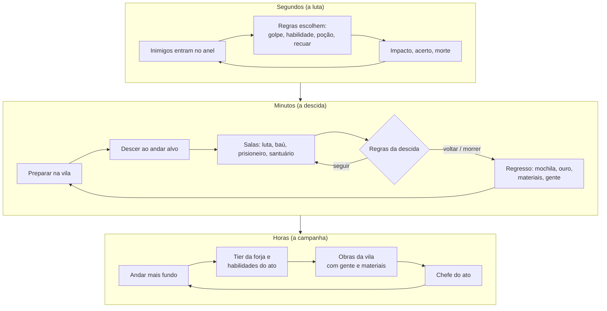

# Vigília: O Portador da Chama — documentação única

Versão do documento: 2026-10-22
Jogo: **Vigília: O Portador da Chama**, RPG idle de um herói só, em 3D, com uma vila que cresce com o que ele traz do abismo.
Stack: TypeScript, Vite, Preact e Three.js.
Arte: família **KayKit** (Kay Lousberg), CC0 1.0. O registro de cada pack está em [`LICENSES.md`](../LICENSES.md).
Parentesco: segue a estrutura do **Vigília**: núcleo puro e determinístico, estado em JSON, ticks, save com migração, progresso offline e restos de quem caiu. A diferença é que aqui há um herói só, e o jogador o acompanha.

Este arquivo reúne o GDD, o estado do projeto e a direção de arte. O README da raiz é só a porta de entrada.

## Índice

1. [Estado, como jogar e arquitetura](#1-estado-como-jogar-e-arquitetura)
2. [Game Design Document](#2-game-design-document)
3. [Arte: família, pipeline e licenças](#3-arte-família-pipeline-e-licenças)
4. [Histórico de decisões](#4-histórico-de-decisões)

---

## 1. Estado, como jogar e arquitetura

**Estado atual: M1, o Ato I completo, pronto** (seção 14.2), sobre o M0, o protótipo vertical (seção 2.14).

O M1 acrescentou:

- **Novo jogo:** escolha de nome e rosto, com o herói 3D trocando de rosto na hora, e um menu com Novo jogo e Créditos.
- **Forja completa:** rara e épica com o afixo escolhido pelo material, e reforja.
- **O Senhor da Cripta,** chefe do andar 10, em duas fases: na segunda, ergue os mortos.
- **Relatório "Enquanto você estava fora"** com peças, níveis, obras, restos e crônica.
- **Cabelo sob o elmo:** ajuste por cabeça.
- **Save v2,** com migração.
- **Balanceador** com 18 metas.

O M0 já trazia:

- um herói montado por partes com os modelos KayKit, com as animações parado, correr, golpe, acerto e morte, e transição suave entre elas;
- troca de arma, escudo, elmo, peitoral, perneiras e capa ao vivo pela tela de equipamento;
- uma sala de masmorra montada com o KayKit Dungeon, com esqueletos;
- combate automático decidido pela simulação;
- telas de equipamento, habilidades, regras e vila;
- a regra de morte funcionando, com rolagem, restos, recuperação e ferimento.

Os andares vão de 1 a 10, com os chefes dos andares 5 e 10. O resto do GDD ainda é proposta.

**Verificado em 2026-10-22 (M1):**

- 29 testes da simulação passam.
- O balanceador passa as 18 metas em duas faixas de sementes (20 sementes a partir de 1000 e 30 a partir de 7000).
- O build sai sem erro.
- O jogo rodou no navegador embutido e, na rede local, num celular a 133–136 fps (2.14).

#### Capturas

| | |
|---|---|
|  |  |
| Elite Vampírica (brilho vermelho), dois lacaios no anel e um esperando na porta | Anel girado: o herói luta de três quartos |
|  |  |
| Tela de equipamento: gibão e calças de couro, elmo de placas e escudo | Couraça e grevas de aço (tier 3, metal azulado), capa e a Vigia Partida brilhando |
|  |  |
| Machado de duas mãos (tira o escudo), elmo de osso em ferro-negro (peça rígida) e túnica tier 9 (detalhes em ouro) | O herói caído; os restos já brilham no chão da sala |
|  |  |
| Relatório da volta: cada peça com a chance e o resultado, o que ficou no chão e o ferimento | Celular (375 × 812): HUD compacto e aviso de restos recuperados |
|  |  |
| M1: novo jogo; ao escolher Marcela, o herói troca de rosto atrás da folha | M1: Senhor da Cripta na fase 1, conjurando ao fundo atrás da escolta |
|  |  |
| M1: fase 2; o Senhor vem para o anel e três esqueletos erguidos esperam na porta | M1: as 6 cabeças com os 4 elmos, já com o ajuste por cabeça ([antes](img/cabelo-elmo-antes.jpg)) |

### Jogar

```bash
npm install
npm run art                 # copia do pack baixado (fora do repositório) as peças do manifesto para public/assets/kaykit
npm run dev                 # abre em http://localhost:5173
npm run dev -- --host       # idem, acessível pelo celular na mesma rede
```

- **Herói:** desce, luta e volta sozinho. Você não controla o combate.
- **Vila (botão ⌂ ou V):** obras, forja, poções e o botão "Descer agora".
- **Equipamento (E) e Habilidades (H):** só mudam com o herói na vila. Enquanto uma dessas telas está aberta, ele espera em vez de descer sozinho. Na de equipamento, a câmera chega perto dele.
- **Regras (R):** a lista de regras de combate (o que ele faz e quando) e as regras da descida (andar alvo, até onde ir, quando voltar).
- **Sino:** chama o herói de volta. Ele atende assim que termina a luta da sala em que está.
- **Tempo:** Espaço pausa; 1, 2 e 3 escolhem 1×, 2× e 4×.
- **Save:** automático no `localStorage`. Ao reabrir, o tempo fora roda pela mesma simulação (até 8 h).

### Ferramentas

```bash
npm test                    # testes da simulação (determinismo, combate, morte, restos, forja, save)
npm run balance             # balanceador: herói automático em várias sementes; confere as metas da seção 2.12
npm run typecheck
npm run build
```

Node 22+ roda os `.ts` das ferramentas direto (type stripping). Para outra faixa de sementes: `npm run balance -- --seeds 30 --from 7000`.

**Atalhos de depuração** (só em `npm run dev`, no console do navegador):

- `portador.frames(n)` roda n quadros na mão. Serve com o painel do navegador oculto, quando o `requestAnimationFrame` para.
- `portador.advance(ticks)` avança a simulação.
- `portador.reset()` começa do zero, sem salvar o mundo atual.
- `?perf` ou `?perf=rótulo` na URL liga o medidor de desempenho; `?q=low` liga o modo econômico (sem sombras, `devicePixelRatio` 1).

### Arquitetura

```
index.html, src/main.tsx   monta a sessão, a cena 3D e a interface (Preact); atalhos e autosave
src/sim/    regras: puro, determinístico, estado 100% JSON, sem DOM nem Three
  config.ts      todos os números de balanceamento (BALANCE)
  data.ts        bases de itens, afixos, inimigos, habilidades, prédios, nomes de lendárias
  rng.ts         mulberry32 dentro do estado
  hero.ts        atributos derivados do nível, do equipamento, das habilidades e do ferimento
  items.ts       geração de itens, nome, valor e o teto da forja
  combat.ts      sala: anel de contato, golpes com preparação e impacto, habilidades, poções e alvo
  rules.ts       avaliação das regras de combate e das regras da descida
  expedition.ts  descida, salas, saque, volta, morte, rolagem do que volta e restos
  village.ts     obras, forja, poções, treinador e moradores
  world.ts       cria o mundo; loop.ts: step() e catchUp(); save.ts: serializar e migrar
  bot.ts         jogador automático (o "jogador médio" do balanceador)
  commands.ts    ações do jogador (vestir, aprender, regras, sino, obras, forja)
src/game/   sessão: acumulador de tick fixo, velocidade, eventos para a tela, save local (storage.ts)
src/render/ Three.js: só lê o estado e os eventos
  assets.ts      carrega o glTF, compartilha materiais por textura, recolore o atlas por tier e faz a lendária pulsar
  visuals.ts     tabela base de item → partes do aventureiro ou peça rígida e osso
  heroRig.ts     herói montado por partes num esqueleto só; arma e escudo no osso da mão; troca em fila
  animator.ts    laço de base mais golpes de uma vez, com crossfade; a morte segura o último quadro
  actors.ts      esqueletos inimigos (modelo, arma, brilho da elite)
  dungeon.ts     sala montada com as peças do KayKit Dungeon, juntadas numa malha por material
  stage.ts       cena, câmera, luzes, posições a partir do estado, números de dano
  perf.ts        medidor de desempenho (?perf), que envia o resumo ao servidor de desenvolvimento
src/ui/     Preact: HUD, equipamento, habilidades, regras, vila e relatório da volta
tools/      import-art.ts + art-manifest.ts (importador da arte com validação) e balance.ts (balanceador)
tests/      vitest
```

A tela fala com o núcleo só por `src/sim/index.ts`. O 3D nunca decide nada: ele lê o estado (onde cada um está, em que fase do golpe) e os eventos do tick (golpe, acerto, morte, poção) e anima. Se o 3D cair, o jogo continua igual.

---

## 2. Game Design Document

> Status: proposta v0.1. A regra de morte (2.10) ainda precisa ser validada pelo usuário, e o mesmo vale para a proposta de armadura no visual (3.3).

### 0. Resumo em uma tela

**Fantasia:** debaixo de uma vila em ruínas há um abismo, e um herói desce sozinho. Lá embaixo, ele decide por conta própria quando bater, quando beber poção e quando fugir, sempre seguindo as regras que você escreveu. Seu papel é prepará-lo: você escolhe o que ele veste, o que aprende, as regras que segue e até onde desce. Cada volta para casa traz ouro, materiais e gente resgatada, e a vila cresce com isso. Quando ele morre, também volta, só que ferido, e parte do que carregava fica no chão lá embaixo.

**O nome:** *Vigília: O Portador da Chama*, escolhido pelo usuário. A regra central continua sendo o regresso: o herói sempre volta, seja vitorioso, ferido ou carregado; o que muda é o que ele traz.

**Do Vigília ficam:**

- atos e andares, corrupção (para depois) e chefes;
- itens com afixos, tiers, lendárias e forja;
- dificuldade;
- crônica;
- save com migração e progresso offline;
- restos de quem caiu.

**O que muda:** em vez de um elenco que o prefeito só influencia, há um herói só, que o jogador equipa e programa por regras. A vila deixa de ser o centro da tela e vira a outra metade da progressão: ela cresce com o que o herói traz e libera o que ele precisa.

**Metas de duração:**

- Ato I: 1 a 1,5 h de jogo ativo, mais o tempo idle.
- Campanha de 6 atos: 20 a 30 h.
- Depois da campanha: profundezas infinitas.

### 1. Pilares

| # | Pilar | Teste de design: toda feature nova precisa… |
|---|---|---|
| 1 | **Você prepara, ele age** | …ser decidida fora do combate: equipamento, habilidade, regra ou andar. Nunca um clique no meio da luta. |
| 2 | **Tudo que ele veste aparece** | …ter um visual no personagem ou um efeito que se vê na luta. |
| 3 | **A vila e o herói crescem juntos** | …depender do outro lado: nada na vila sobe sem o que vem de baixo, e nada lá embaixo fica fácil sem a vila. |
| 4 | **Morrer custa, mas não apaga** | …ter perda parcial e recuperável. O que ele veste nunca se perde. |
| 5 | **Idle honesto** | …continuar valendo com o jogo fechado. O progresso offline é a mesma simulação, sem atalho. |

### 2. Ciclo de jogo



**Regra de ouro do ritmo:** em qualquer momento, o jogador tem pelo menos três objetivos abertos, cada um num horizonte diferente:

- **minutos:** a próxima peça, ou a poção extra do alquimista;
- **uma descida:** o próximo andar, ou buscar os restos;
- **uma hora:** o chefe do ato, ou o próximo nível do ferreiro.

#### 2.1 A descida, passo a passo

1. **Na vila** o jogador ajusta tudo: equipamento (trocado com o baú), habilidades, regras e andar alvo. Enquanto isso, o tempo corre: o herói descansa, a vida enche e o ferimento sara.
2. **Descer.** O herói vai direto ao andar escolhido, desde que já tenha chegado a ele uma vez. A escadaria não tem luta e a viagem leva `5 s + 2 s × andar`.
3. **Salas.** Cada andar é uma fila de `4 + ⌊andar/3⌋` salas. Ele entra numa sala, luta até limpá-la, recolhe o saque (1 s) e segue para a próxima.
4. **Seguir ou voltar.** Ao limpar um andar, ele desce ao seguinte enquanto as regras da descida mandarem.
5. **Voltar.** A volta acontece por uma regra, pelo sino do jogador (ele atende no fim da luta atual) ou carregado, quando morre. Na volta não há luta, e ela leva `10 s + 4 s × andar`.
6. **Chegada.** A mochila esvazia no baú, o ouro e os materiais vão para o tesouro e a gente resgatada vira moradora. Se a regra "descer de novo" estiver ligada, ele descansa e desce outra vez. O descanso dura até a vida encher e, se a regra pedir, até o ferimento sarar.

#### 2.2 O que o jogador decide

| Decisão | Onde | Quando vale |
|---|---|---|
| Equipamento | Tela de equipamento (baú ↔ corpo) | Só com o herói na vila |
| Habilidades | Treinador (aprender) e barra de 3 ativas | Aprender só na vila; a barra vale a partir da próxima luta |
| Regras de combate | Tela de regras | A qualquer momento |
| Regras da descida | Tela de regras (andar alvo, até onde ir, quando voltar, repetir) | A qualquer momento |
| Chamar de volta | Sino no HUD | Durante a descida |
| Obras, forja e poções | Prédios da vila | A qualquer momento (as obras levam tempo) |

O equipamento só muda na vila por dois motivos. O primeiro é a fantasia: é na vila que você prepara o herói. O segundo é a regra de morte: se desse para vestir na hora uma peça achada lá embaixo, ela ficaria protegida da rolagem.

### 3. O herói

| Atributo | De onde vem |
|---|---|
| Vida máxima | `200 + 18 × (nível − 1)`, × (1 + Robusto) |
| Dano do golpe | dano da arma × (1 + 3% × (nível − 1)) × (1 + Brutal) |
| Ataques por segundo | base da arma × (1 + Veloz) × (1 − 3% por peça pesada) |
| Armadura | soma das peças × (1 + Pele de Ferro) |
| Crítico | 5% + Afiado + base da arma (adaga +5%); o crítico dá 1,6× |
| Bloqueio | só com escudo: chance de anular 70% do golpe |
| Roubo de vida | Sanguessuga + Sede de Sangue (cura % do dano causado) |
| Sorte | Afortunado; entra no saque e na rolagem da morte |

- **Nível:** cada abate dá experiência. Para passar do nível `n`, são precisos `40 × n^1,6` pontos. Cada nível dá +18 de vida, +3% de dano e 1 ponto de habilidade.
- **Poções:** ele leva 3, mais 1 por nível do alquimista. Cada uma cura 40% da vida máxima e há 3 s de recarga entre elas. Na volta à vila, o estoque é reposto automaticamente a 15 de ouro cada, enquanto houver ouro.
- **Ferido:** é o estado depois de uma morte (2.10).

### 4. Combate: um contra vários

Cada sala tem um grupo de inimigos. São `3 + ⌊andar/2⌋` (no máximo 8), mais as elites e o chefe. O herói luta com todos, mas nunca todos de uma vez.

**O anel de contato.**

- Em volta do herói há **3 vagas de corpo a corpo**. O chefe ocupa 2 delas.
- Os inimigos de corpo a corpo esperam na porta e entram quando abre uma vaga. A aproximação leva 1 s.
- Os inimigos de longe (o mago) ficam no fundo da sala e atiram.
- O herói só alcança quem está no fundo quando a frente cai, ou com Investida.

Isso dá peso às escolhas:

- dano em área vale mais com o anel cheio;
- escudo e armadura valem mais quando muitos batem ao mesmo tempo;
- Investida resolve o mago que fica atirando lá atrás.

**O golpe.** Cada golpe tem três fases: preparação (40% do intervalo), impacto e recuperação. O dano entra no tick do impacto, e é nesse momento que o 3D mostra o acerto. As habilidades seguem o mesmo esquema, cada uma com sua preparação.

**O alvo.** A regra "alvo" escolhe entre: elite primeiro, o mais fraco, o mais forte ou o mais ferido. O padrão é elite primeiro e, depois, o mais fraco: derrubar alguém abre uma vaga e reduz quem bate.

**Fórmulas** (valores iniciais; o balanceador calibra):

| Conta | Fórmula |
|---|---|
| Poder do andar | `P(andar) = 1,16^(andar − 1)` |
| Vida e dano do inimigo | base × P(andar) × (elite: 2,5 de vida e 1,4 de dano) |
| Redução por armadura | `A / (A + 25 × P(andar))` |
| Crítico | 1,6× o dano |
| Bloqueio (escudo) | anula 70% do golpe |
| Atordoado | não ataca nem se move |

**Inimigos do Ato I: a Cripta.** Todos vêm do KayKit Skeletons.

| Inimigo | Modelo | Vida | Dano | Intervalo | Papel |
|---|---|---|---|---|---|
| Lacaio | Skeleton_Minion | 34 | 5 | 1,6 s | Corpo a corpo, vem em bando |
| Guerreiro | Skeleton_Warrior + Skeleton_Blade e escudo | 70 | 8 | 2,0 s | Corpo a corpo; bloqueia 20% dos golpes; 30% de chance de deixar 1 de ferro velho |
| Ladino | Skeleton_Rogue + adaga | 40 | 5 | 1,0 s | Corpo a corpo, rápido |
| Mago | Skeleton_Mage + Skeleton_Staff | 32 | 9 | 2,4 s | De longe, fica no fundo |
| Capitão da Cripta (chefe do andar 5) | Skeleton_Warrior em 1,5× com Skeleton_Axe, escudo grande e o elmo | 1050 | 16 | 2,2 s | Ocupa 2 vagas. A cada 12 s dá um golpe especial (2× o dano) e, se sobram menos de 3 da escolta, chama 2 lacaios |
| Senhor da Cripta (chefe do andar 10, M1) | Skeleton_Mage em 1,6× com Skeleton_Staff e aura roxa | 1500 | 14 → 18 | 2,6 → 2,0 s | Duas fases (14.2). Na 1, conjura do fundo e chama reforço a cada 15 s. Abaixo de 50%, vem para o anel, bate mais forte e ergue até 3 mortos |

Afixos de elite: **Blindado** (+60% de armadura própria, ou seja, −35% do dano recebido), **Vampírico** (cura 30% do dano que causa), **Furioso** (+50% de dano abaixo de metade da vida) e **Veloz** (intervalo −30%). A elite ganha um brilho na cor do afixo.

### 5. Regras (táticas)

As regras são o coração do idle: o jogador escreve como o herói pensa. Funcionam como uma lista **SE condição ENTÃO ação**, lida de cima para baixo sempre que o herói fica livre (fora de golpe, habilidade ou poção). A primeira regra cuja condição vale e cuja ação está disponível é executada. Se nenhuma servir, ele dá um golpe básico no alvo.

| Condição | Parâmetro |
|---|---|
| Vida abaixo de | % (10–90) |
| Inimigos no anel, pelo menos | 1–3 |
| Inimigos no fundo, pelo menos | 1–4 |
| Alvo é elite ou chefe | — |
| Poções restantes, no máximo | 0–6 |
| Sempre | — |

| Ação | O que faz |
|---|---|
| Beber poção | Se houver poção e a recarga deixar |
| Usar habilidade | Uma das 3 da barra, se estiver pronta |
| Recuar | Foge na hora: são 1,5 s em que os inimigos ainda batem. Se sobreviver, volta à vila com a mochila inteira. O sino, ao contrário, espera a luta acabar |

**Regras de fábrica** (o jogador começa com estas):

1. SE vida abaixo de 35% ENTÃO beber poção
2. SE vida abaixo de 16% E poções no máximo 0 ENTÃO recuar
3. SE inimigos no anel pelo menos 2 ENTÃO Golpe Amplo (quando aprender)
4. SE inimigos no fundo pelo menos 1 ENTÃO Investida (quando aprender)
5. SE vida abaixo de 50% ENTÃO Segundo Fôlego (vale com o Salão de Táticas nível 1)
6. SE inimigos no anel pelo menos 3 ENTÃO Grito de Guerra (vale com o Salão de Táticas nível 2)

Os limiares 16% (fuga) e 30% (voltar sem poções) saíram do balanceador. Com 20% e 50%, o herói fugia demais e morria 0,3 vez por hora; com 12%, morria 2 vezes por hora e empacava.

**Regras da descida.** São separadas das de combate:

| Regra | Opções |
|---|---|
| Andar inicial | 1 até o mais fundo já alcançado |
| Até onde descer | Ficar no andar inicial, descer até o andar N ou descer sem limite |
| Voltar quando | Mochila cheia; poções acabarem com vida abaixo de X% (padrão 30%); terminar o último andar planejado |
| Ao voltar | Descer de novo depois de descansar (liga e desliga); esperar o ferimento sarar (liga e desliga) |

Começam 4 linhas de regra de combate, mais 1 por nível do Salão de Táticas, até 8. A segunda condição (E) vale desde o começo: o Salão só acrescenta linhas.

### 6. Habilidades

O **treinador** ensina as habilidades do ato. No nível `n`, ele libera as do ato `n`. Aprender uma custa 1 ponto de habilidade e ouro. A **barra** tem 3 ativas; as passivas valem sempre depois de aprendidas.

**Ato I (treinador nível 1):**

| Habilidade | Tipo | Efeito | Recarga |
|---|---|---|---|
| Golpe Amplo | Ativa | 80% do dano em todos do anel | 6 s |
| Investida | Ativa | Vai até o inimigo do fundo mais próximo, que entra no anel; dá 130% do dano e atordoa por 1,5 s | 10 s |
| Segundo Fôlego | Ativa | Cura 30% da vida | 40 s |
| Grito de Guerra | Ativa | Quem está no anel causa −35% de dano por 6 s | 20 s |
| Pele de Ferro | Passiva | +20% de armadura | — |
| Sede de Sangue | Passiva | Cura 4% do dano causado | — |

**Atos II a VI** (rascunho): cada ato traz 2 ativas e 2 passivas que conversam com o inimigo novo. Exemplos:

- **Ato II, as Minas:** Golpe de Escudo (atordoa em área).
- **Ato III, os Fungos:** Purificar (tira veneno).
- **Ato IV:** Redemoinho (golpe amplo contínuo).
- **Ato V:** Ira (dano por vida perdida).
- **Ato VI:** Último Bastião (fica com 1 de vida por 5 s, uma vez por sala).

Depois do protótipo vêm os níveis de habilidade: o ponto extra numa habilidade que já sabe.

### 7. Itens

#### 7.1 Encaixes e o que aparece

| Encaixe | Aparece no personagem como |
|---|---|
| Arma | Malha presa ao osso `handslot.r` |
| Mão secundária (escudo; nada com arma de duas mãos) | Malha presa ao osso `handslot.l` |
| Elmo | Peça da cabeça: elmo, chapéu ou capuz (3.3) |
| Peitoral | Tronco e braços de um dos aventureiros (3.3) |
| Perneiras | Pernas e botas de um dos aventureiros (3.3) |
| Capa | Capa de um dos aventureiros |
| Amuleto | Sem malha; só os afixos. Na lendária, um brilho no peito |

Em todos os encaixes, o tier muda a cor do metal (3.3) e a lendária ganha brilho.

#### 7.2 Bases (Ato I)

| Base | Encaixe | Peso | Números no tier 1 | Malha |
|---|---|---|---|---|
| Espada | Arma, 1 mão | — | 14 de dano, 1,0 golpe/s | `sword_1handed` |
| Machado | Arma, 1 mão | — | 18 de dano, 0,8 golpe/s | `axe_1handed` |
| Adaga | Arma, 1 mão | — | 9 de dano, 1,5 golpe/s, +5% de crítico | `dagger` |
| Espadão | Arma, 2 mãos | — | 27 de dano, 0,7 golpe/s | `sword_2handed` |
| Machado grande | Arma, 2 mãos | — | 31 de dano, 0,6 golpe/s | `axe_2handed` |
| Escudo redondo | Mão secundária | Médio | 4 de armadura, 15% de bloqueio | `shield_round` |
| Escudo de torre | Mão secundária | Pesado | 7 de armadura, 22% de bloqueio | `shield_square` |
| Escudo de espinhos | Mão secundária | Médio | 3 de armadura, 12% de bloqueio; devolve 20% do bloqueado | `shield_spikes` |
| Elmo de placas | Elmo | Pesado | 6 de armadura | `Knight_Helmet` |
| Chapéu de urso | Elmo | Médio | 4 de armadura e +3% de dano | `Barbarian_BearHat` |
| Elmo de osso | Elmo | Médio | 4 de armadura; cai do Capitão da Cripta | `Skeleton_Warrior_Helmet` (peça rígida) |
| Chapéu de mago | Elmo | Leve | 2 de armadura e +10% de cura das poções | `Mage_Hat` |
| Couraça de placas | Peitoral | Pesado | 14 de armadura | tronco e braços do `Knight` |
| Gibão de couro | Peitoral | Médio | 9 de armadura | tronco e braços do `Ranger` |
| Colete de ladino | Peitoral | Leve | 5 de armadura e +4% de crítico | tronco e braços do `Rogue` |
| Túnica | Peitoral | Leve | 3 de armadura e +8% de vida | tronco e braços do `Mage` |
| Grevas de placas | Perneiras | Pesado | 7 de armadura | pernas do `Knight` |
| Calças de couro | Perneiras | Médio | 5 de armadura | pernas do `Ranger` |
| Botas leves | Perneiras | Leve | 3 de armadura e +4% de velocidade de ataque | pernas do `Rogue` |
| Capa do cavaleiro | Capa | — | +6% de vida | `Knight_Cape` |
| Capa do patrulheiro | Capa | — | +3% de crítico | `Ranger_Cape` |
| Manto | Capa | — | +12% de cura das poções | `Mage_Cape` |

As armas da KayKit Fantasy Weapons Bits (espadas A–E, machados, martelos, alabarda, lança) entram como bases dos atos seguintes. Elas usam o mesmo encaixe na mão.

#### 7.3 Tier, raridade e afixos

- **Tier:** é a qualidade base. Cada tier multiplica os números da base por `1,32^(tier − 1)`. O tier de um andar é `⌈andar/2⌉ + 5 × (ato − 1)`: o Ato I vai do tier 1 ao 5, e o Ato II, do 6 ao 10.
- **Raridade:** define quantos afixos a peça tem:
  - comum: 0;
  - rara: 1;
  - épica: 2;
  - lendária: 3, mais nome próprio e um efeito único.

  O nome segue o modelo do Vigília: "Espada de aço (tier 3)", "Machado brutal de osso", "Vigia Partida".

| Afixo | Efeito (por afixo, no tier 1; cresce 10% por tier) |
|---|---|
| Afiado | +4% de crítico |
| Brutal | +8% de dano |
| Veloz | +7% de velocidade de ataque |
| Robusto | +8% de vida máxima |
| Guardião | +4 de armadura |
| Sanguessuga | Cura 3% do dano causado (soma no máximo 12%) |
| Afortunado | +5 de sorte |
| Sereno | +15% de cura das poções |

**Lendárias do Ato I.** A primeira vitória sobre o Capitão, no andar 5, deixa a Coroa do Capitão, que é o elmo dele. A primeira sobre o Senhor da Cripta, no andar 10, deixa a Vigia Partida. O Juramento de Ferro tem 3% de chance em cada baú a partir do andar 6, uma vez só.

| Lendária | Efeito único |
|---|---|
| Vigia Partida (espada) | Golpe Amplo atinge também quem está no fundo |
| Coroa do Capitão (elmo de osso) | Ao entrar na sala, os lacaios tremem: −20% de dano por 5 s |
| Juramento de Ferro (couraça) | Abaixo de 30% de vida, +40% de armadura |

#### 7.4 De onde vêm

| Origem | Chance e raridade |
|---|---|
| Inimigo comum | 6% de peça; 80% comum, 20% rara |
| Elite | 40%; rara ou épica |
| Baú (sala de baú) | 1 peça garantida, rara ou melhor, mais ouro |
| Chefe | Épica garantida; o primeiro de cada ato deixa a lendária do ato |
| Restos | As peças que ficaram no chão (2.10) |

- **Tier da peça:** é o do andar, com 20% de chance de vir um abaixo.
- **Destino:** tudo cai na **mochila**, que leva 10 peças. O ouro e os materiais não ocupam espaço.
- **Sorte:** cada ponto dá +1% de chance de peça e +0,5% de chance de subir a raridade.

#### 7.5 Forja (ferreiro)

**O teto:** o ferreiro forja até `min(2 × nível do ferreiro, tier do andar mais fundo alcançado)`. Ele nunca passa do que o herói já viu lá embaixo.

| Ação | Exige | Custo (t = tier) | Prazo |
|---|---|---|---|
| Forjar comum | Ferreiro 1 | `40 + 30t` de ouro e `4t` ossos | 20 s |
| Forjar rara | Ferreiro 2 | Escolhe o afixo; 2× o ouro, `4t` ossos e `5t` do material do afixo | 40 s |
| Forjar épica | Ferreiro 4 | Escolhe o primeiro afixo e o segundo é sorteado; 3× o ouro, `4t` ossos e `10t` do material | 60 s |
| Aprimorar | Ferreiro 1 | Sobe +1 tier e mantém os afixos; custa o mesmo que forjar comum no tier novo | 30 s |
| Reforjar | Ferreiro 3 | Troca o afixo escolhido por outro sorteado; `40 + 30t` de ouro e `6t` de ossos e de ferro | 30 s |

O material de cada afixo está na seção 14.2. O amuleto só se forja raro ou épico, porque não tem números de base. Lendárias não se reforjam.

- **Uma encomenda por vez.** A peça pronta vai para o baú.
- **Aprimorar é o que segura a lendária:** sem isso, ela ficaria velha quando o herói descesse mais.

#### 7.6 Como cada item aparece no personagem

Resumo da proposta da seção 3.3:

- **Arma e escudo:** a malha vai presa ao osso da mão, sem ajuste, porque a pega das armas do KayKit fica na origem.
- **Peitoral, perneiras, elmo e capa:** são partes dos modelos de aventureiro, trocadas no mesmo esqueleto. A couraça de placas é o tronco e os braços do cavaleiro; o gibão de couro é o do patrulheiro.
- **Tier:** muda a cor do metal e do couro. O atlas de gradiente é recolorido por faixa de tier:
  - ferro nos tiers 1–2;
  - aço nos 3–4;
  - bronze nos 5–6;
  - ferro-negro nos 7–8;
  - ouro nos 9–10.
- **Raridade:** a lendária pulsa com brilho próprio (emissivo modulado, mais uma luz pontual na arma). As outras raridades só aparecem na moldura da interface.

### 8. O abismo

- **Atos:** são 6, de 10 andares cada. O chefe do ato fica no andar 10, e há um chefe menor no andar 5. O Ato I, a Cripta, usa o KayKit Dungeon e o Skeletons. Os outros atos são temas a definir, como no Vigília: Minas, Fungos, Cidade Afogada, Forja e Coração.
- **Salas:**

| Sala | Chance | O que tem |
|---|---|---|
| Combate | 62% | Um grupo |
| Elite | 15% | Um grupo com 1 elite |
| Baú | 10% | 1 peça rara ou melhor, ouro e ferro |
| Prisioneiro | 8% | Um grupo guardando 1 pessoa, que vira moradora se ele vencer |
| Santuário | 5% | Cura 50% da vida e devolve 1 poção |
| Antessala | Penúltima sala dos andares 5 e 10 | Sempre um santuário: um fôlego antes do chefe (entrou depois do balanceador, que mostrou o herói chegando ao chefe já sem poções) |
| Chefe | Última sala dos andares 5 e 10 | O chefe e a escolta |

- **Mapa:** as salas são sorteadas pela semente a cada visita, mas a quantidade por andar é fixa. Assim os restos podem ser marcados por andar e sala.
- **Depois do Ato VI:** profundezas infinitas, com `P(andar)` continuando a subir.

### 9. Vila ↔ herói

A vila é a outra metade da progressão. Ela cresce com o que o herói traz e, em troca, libera o que ele precisa. Uma trava de mão dupla impede que um dos lados corra na frente do outro:

- **O herói depende da vila:** o ferreiro só forja até o próprio nível, e o treinador só ensina o ato do próprio nível. Sem obras, o herói desce com o que achar, e o achado é aleatório.
- **A vila depende do herói:** cada nível de prédio pede gente (moradores resgatados) e materiais do ato, que só existem lá embaixo. O teto da forja também é o andar mais fundo que ele alcançou.

**Recursos:**

| Recurso | De onde vem | Para que serve |
|---|---|---|
| Ouro | Abates, baús, venda de peças e imposto dos moradores | Obras, forja, poções e habilidades |
| Ossos (Ato I) | Abates de esqueleto (1–2 cada) | Obras do Ato I e forja |
| Ferro | Baús, chefes e guerreiros esqueletos (30% de chance de 1) | Obras e forja de peças pesadas |
| Gente | Salas de prisioneiro e chefes (o chefe solta 2) | Mão de obra: cada nível de prédio pede um mínimo de moradores; cada morador rende 1 de ouro por minuto |

**Prédios:**

| Prédio | Níveis | O que libera | Pede para subir ao nível n |
|---|---|---|---|
| Ferreiro | 1–5 (começa no 1) | Teto de forja `2 × n`; forjar rara (n 2); reforjar (n 3); forjar épica (n 4) | `150 × n²` de ouro, `15 × n` de ferro e `n + 1` moradores (no M0 eram `20n` de ferro e `2n` moradores) |
| Treinador | 0–6 (começa no 0) | Habilidades do ato n | `200 × n²` de ouro, `30 × n` de ossos e `2n − 2` moradores (o nível 1 não pede gente) |
| Alquimista | 0–4 | +1 poção por nível; a poção cura +5% por nível | `100 × n²` de ouro, `15 × n` de ossos e `n` moradores |
| Carroceiro de resgate | 0–3 | +5% na rolagem da morte; os restos duram +1 dia | `120 × n²` de ouro, `10 × n` de ferro e `n + 1` moradores |
| Curandeira | 0–3 | O ferimento dura 25% menos por nível (no mínimo, 25% do tempo) | `120 × n²` de ouro, `20 × n` de ossos e `n` moradores |
| Salão de Táticas | 0–4 | +1 regra de combate por nível | `150 × n²` de ouro e `2n` moradores |
| Casas | Sobem sozinhas | Abrigam a gente resgatada; cada 4 moradores erguem uma casa nova no diorama | — |

- **As obras levam tempo:** `30 s × n` em 1×. Uma por vez; mais tarde, uma segunda frente.
- **Na tela:** a vila é um diorama montado com o KayKit Medieval Hexagon. O prédio aparece em andaime durante a obra (`building_scaffolding`, `building_stage_A–C`) e pronto quando termina. A vila cresce visivelmente com cada volta do herói.

### 10. Morte e regresso (regra completa)

> **Ajustada com o usuário em 2026-10-22.** Ele achou "fácil demais lutar até cair e ainda conseguir levar muitos itens". As chances de trazer caíram bastante (abaixo), e os restos ficaram como estavam: no chão por um tempo, recuperáveis ou perdidos de vez. Ainda falta ele confirmar que a gente resgatada sempre volta.

**1. Quando acontece.** A vida chega a 0 e nenhum efeito o segura, como Último Bastião ou uma lendária. Ele cai. A luta acaba e a descida também.

**2. Ele volta.** O herói é trazido de volta à vila, ferido. A gente que ele resgatou nessa descida foge na frente e chama o carroceiro. Por isso **a gente resgatada sempre volta**, e não há rolagem para pessoas. A volta carregado leva 1,5× o tempo da volta normal.

**3. O vestido nunca se perde.** Arma, escudo, elmo, peitoral, perneiras, capa e amuleto voltam com ele, sempre.

**4. A mochila é rolada.** Vale para tudo o que ele conquistou nessa descida e ainda não chegou à vila:

- **Peças:** uma rolagem por peça. Ou volta inteira, ou fica.
- **Ouro e cada material:** não têm sorte de tudo ou nada. Volta a fração `chance` da pilha, arredondada para baixo, e o resto fica.

```
chance = clamp( 0,55
              − 0,04 × (andar − 1)                ← cai com a profundidade
              + bônus da raridade                  ← comum 0 · rara +0,03 · épica +0,06 · lendária +0,15
              + 0,005 × sorte                      ← sorte do herói
              + 0,05 × nível do carroceiro,        ← prédio da vila
              0,05, 0,75 )
```

Exemplos, sem sorte e sem carroceiro:

| Andar | Comum | Rara | Épica | Lendária | Ouro e materiais |
|---|---|---|---|---|---|
| 1 | 55% | 58% | 61% | 70% | 55% |
| 5 | 39% | 42% | 45% | 54% | 39% |
| 10 | 19% | 22% | 25% | 34% | 19% |
| 15 (Ato II) | 5% | 5% | 5% | 14% | 5% |

- **A curva:** já no andar 1, a morte leva quase metade da mochila. No fundo do Ato I, leva quatro quintos. A partir do meio do Ato II, leva quase tudo. Lutar até cair deixa de compensar: o certo é voltar antes, pela regra ou pelo sino. Os restos dão a chance de buscar o que ficou.
- **O carroceiro:** no nível 3, devolve +15 pontos, quase quatro andares de folga.
- **Antes do ajuste** (primeira versão): eram 85% no andar 1 e 54% no 10, e o balanceador media 29% de perda por morte. Agora mede 64–65%.

**5. O que não voltou fica no chão.** Vira uma **pilha de restos** marcada no andar e na sala onde ele caiu, com as peças, o ouro e os materiais que ficaram.

- **Duração:** 3 dias, mais 1 por nível do carroceiro. Um dia de jogo são 10 min em 1×, então os restos duram 30 min de jogo.
- **Recuperar:** basta passar de novo por aquela sala daquele andar e vencer a luta dela. Tudo volta para a mochila, inclusive as peças, e fica sujeito à rolagem se ele morrer de novo antes de chegar em casa.
- **Limite:** no máximo 3 pilhas. Uma quarta morte apaga a mais antiga.
- **Na tela:** a tela da descida mostra as pilhas e quanto tempo falta. A regra da descida "buscar restos" põe o andar da pilha mais nova como alvo.
- **Pilha vencida:** some, e a crônica registra: "a cripta engoliu o machado brutal".

**6. Ferido.** O herói chega com um **ferimento**:

- **Duração:** `60 s + 20 s × andar` em 1×, menos 25% por nível da curandeira (no mínimo, 25% do tempo).
- **Penalidade:** −30% de vida máxima e −20% de dano, proporcional ao que falta para sarar. Com metade do tempo, a penalidade também cai pela metade.
- **Onde sara:** só na vila. Se ele descer ferido, a ferida não sara lá embaixo.
- **A decisão:** esperar ou descer ferido é escolha do jogador, pela regra da descida "esperar o ferimento sarar".
- **O que não se perde:** a experiência e os níveis. A morte não tira progresso do herói, só da mochila.

**7. Casos de borda:**

- **Baú cheio:** a peça que chega do resgate fica na mochila, até 10. Se passar disso, a pior derrete em ouro, que também entra na rolagem.
- **Morrer na sala dos próprios restos:** a pilha antiga continua lá, e a nova é criada na mesma sala.
- **Morrer na volta:** não acontece. A volta não tem luta.
- **Lendária que caiu:** fica nos restos e, quando eles vencem, a crônica registra, como qualquer outra peça. Para não ser cruel demais, a lendária tem o bônus de +15%.

**Por que assim:**

- O vestido nunca se perde, então o progresso que o jogador escolheu fica protegido.
- A mochila é o risco, e ela cresce com a ambição: quanto mais fundo, mais ele carrega e mais pode perder.
- Os restos transformam a perda numa missão de volta, que no Vigília era uma das melhores histórias.

### 11. Tempo, idle e progresso offline

| Unidade | Valor |
|---|---|
| Tick | 0,1 s em 1× (10 ticks/s) |
| Velocidades | 1×, 2× e 4× (pausa na vila e na tela de regras é opcional) |
| Dia | 6 000 ticks (10 min em 1×), usado pelos restos e pela crônica |

- **Offline:** ao abrir o jogo, `catchUp()` roda o tempo fora pela mesma `step()`, em blocos, até 8 h. Em 1×, isso dá cerca de 288 mil ticks e leva menos de 2 s.
- **Relatório:** na volta do jogador, um "Enquanto você estava fora" mostra descidas, mortes, peças, gente resgatada e obras concluídas.
- **Determinismo:** o RNG (mulberry32) vive no estado. Salvar no meio de um golpe e carregar continua a mesma partida, como no Vigília.

### 12. Balanceamento: metas que o balanceador confere

`npm run balance -- --seeds 20 --hours 3` roda o jogador automático (`bot.ts`). Ele se comporta como um jogador médio:

- usa as regras de fábrica;
- veste a melhor peça do baú;
- aprende as habilidades assim que dá;
- a cada visita à vila, segue esta ordem:
  1. sobe o ferreiro, se der;
  2. forja a peça rara (com o afixo escolhido) que aumenta a Força em pelo menos 3%;
  3. reforja o afixo fraco da arma;
  4. constrói o prédio mais barato;
  5. aprimora a peça de tier menor;
- desce até o andar mais fundo em que a "Força" da tela de equipamento chega a 1, e volta um andar depois de morrer. Com a morte cara, descer onde a Força ainda é 0,9 fazia uma semente empacar 53 min.

O balanceador sai com código ≠ 0 se alguma meta falhar.

| Meta | Alvo | Como mede |
|---|---|---|
| Chefe do andar 5 | 20–40 min de jogo | Mediana do tick da primeira vitória |
| Chefe do Ato I (andar 10) | 60–100 min | Mediana; ≥ 90% das sementes chegam em 3 h |
| Mortes | 0,5–2,5 por hora | Média nas 3 h |
| Sala comum no andar certo | 10–35 s de luta e 10–35% da vida | Média das salas em que `poder/P(andar)` fica entre 0,8 e 1,2 |
| Chefe | 45–120 s de luta | Média |
| Perda na morte | 55–80% do valor da mochila | Média |
| Restos recuperados | ≥ 50% das pilhas | Pilhas recuperadas ÷ criadas |
| Parede | Mediana ≤ 30 min e pior semente ≤ 50 min sem avanço antes do chefe do andar 10 | Maior intervalo sem o andar mais fundo subir, por semente |
| Vila no compasso | O teto da forja nunca passa do tier do mais fundo; nenhum prédio sem obra possível por mais de 15 min | Checagem a cada minuto |
| Ouro parado | Mediana abaixo de 3× o custo da obra mais barata | Na vitória sobre o chefe do andar 10 (depois dele o Ato I acaba e o ouro só acumula) |
| Impasse | 0 lutas com mais de 300 s | Contagem |
| Determinismo | Mesma semente dá o mesmo resultado; salvar e carregar a cada 10 min dá o mesmo mundo | Hash do estado |
| Desempenho | 3 h de jogo simuladas em menos de 3 s | Relógio |
| Senhor da Cripta (M1) | 60–150 s de luta | Média |
| Fase 2 do Senhor (M1) | Começa entre 25% e 75% do tempo da luta | Média de (início da fase 2 − início da luta) ÷ duração |
| Forja usada (M1) | Mediana ≥ 3 encomendas ao ferreiro (forjar, aprimorar ou reforjar) até vencer o andar 10, e nenhuma semente com 0 | Contagem na primeira vitória sobre o Senhor |

**Resultado em 2026-10-22, com o M1** (20 sementes a partir de 1000 · 30 a partir de 7000):

| Meta | Faixa 1000 | Faixa 7000 |
|---|---|---|
| Chefe do andar 5 (mediana) | 28,3 min | 36,2 min |
| Chefe do andar 10, o Senhor (mediana) | 69,9 min | 72,1 min |
| Sementes que vencem o andar 10 em 3 h | 20/20 | 30/30 |
| Mortes por hora | 0,8 | 0,8 |
| Luta por sala / dano por sala comum | 17,7 s / 15% | 17,1 s / 15% |
| Luta de chefe (os dois) | 66,1 s | 63,0 s |
| Luta com o Senhor · fase 2 começa em | 65,5 s · 53% | 62,6 s · 54% |
| Encomendas ao ferreiro até o andar 10 (mín · mediana) | 1 · 3 | 1 · 3 |
| Perda na morte (valor da mochila) | 62% | 66% |
| Restos recuperados | 99% | 100% |
| Parede (mediana · pior) | 20,0 · 44,5 min | 22,4 · 37,9 min |
| Ouro parado na vitória do andar 10 | 2,0× | 2,0× |
| Impasses · determinismo | 0 · igual | 0 · igual |
| Desempenho | 0,08 s por semente | 0,07 s por semente |

**O que o balanceador mudou em relação à primeira versão deste documento:**

- O chefe passou de 650 para 1050 de vida, e o golpe especial, de 10 para 12 s; o reforço só vem com pouca escolta.
- A antessala do chefe virou santuário.
- O guerreiro solta ferro: antes, o ferreiro ficava no nível 1 por 100 min por falta de ferro.
- A "Força" foi calibrada para que 1 seja o andar da fronteira (`floorDemand = 90 × P(andar)`).
- Os limiares das regras de fábrica mudaram (2.5).
- A meta da parede passou a olhar a mediana e o pior caso: o chefe do ato é uma trava de propósito. Sem o bot ler a Força, uma semente ficava 63 min presa no chefe do andar 5, porque chegava lá fraca demais aos 9 min.

### 13. Save

- **Formato:** o estado é um JSON só, com `version`. As migrações são em cadeia, como no Vigília (`v1 → v2 → …`).
- **Integridade:** o checksum protege contra save corrompido. Se ele não bater, o jogo avisa e oferece o backup anterior.
- **Onde fica:** o save local vai para o `localStorage` a cada 30 s e ao sair da página, sempre com try/catch. O backup do save anterior fica numa segunda chave.

### 14. Roadmap

| Marco | Conteúdo |
|---|---|
| **M0: protótipo vertical** (concluído) | Herói por partes, animações com crossfade, troca de arma e de armadura ao vivo, uma sala com esqueletos, combate pela simulação, telas de equipamento, habilidades e regras, regra de morte, testes e medição no celular |
| **M1: Ato I completo** (concluído, 14.2) | Novo jogo com nome e rosto, forja completa, o Senhor da Cripta em duas fases no andar 10, relatório da ausência, cabelo sob o elmo, save v2 e metas novas no balanceador |
| M2: vila em 3D | O diorama do Medieval Hexagon com obras visíveis e moradores |
| M3: Atos II e III | Inimigos novos (packs KayKit de monstros, se houver, ou recolor dos esqueletos), armas do Fantasy Weapons Bits, habilidades novas e materiais novos |
| M4: polimento | Som, interface de celular, acessibilidade e eventos |
| M5: Atos IV a VI e as profundezas | Conteúdo e Eras |

#### 2.14 O que o M0 entrega

O M0 é o recorte jogável do GDD.

**Herói e visual**

- Herói montado por partes: a cabeça fixa e o resto trocado com o equipamento.
- Arma e escudo presos aos ossos `handslot.r` e `handslot.l`.
- Tier muda a cor; a lendária brilha.

**Animação**

- Animações parado, correr, golpe (1 mão, 2 mãos e golpe amplo), acerto, poção e morte, todas do KayKit Character Animations.
- Crossfade de 0,15 a 0,25 s.

**Masmorra e combate**

- Uma sala montada com o KayKit Dungeon: piso, paredes, porta, pilares, tochas, baú e entulho.
- Esqueletos do pack: lacaio, guerreiro, ladino e mago, mais o Capitão como chefe do andar 5.
- Andares 1 a 6, com o anel de contato, habilidades, poções e alvo pela regra.

**Telas**

- Equipamento: baú ↔ corpo, só na vila, com o herói 3D trocando na hora.
- Habilidades: aprender e montar a barra.
- Regras: as de combate e as da descida.
- Vila: ferreiro (forjar e aprimorar), treinador, alquimista, carroceiro e curandeira.
- Relatório da volta: o que trouxe e o que ficou.

**Regras e sistema**

- Regra de morte completa: rolagem por peça, fração do ouro e dos materiais, restos com prazo, recuperação e ferimento.
- Save local com progresso offline.
- Testes da simulação e balanceador inicial.
- Medidor de desempenho com `?perf`: FPS, tempo de quadro, chamadas de desenho e triângulos. Ele também envia o resultado ao servidor de desenvolvimento.

**Desempenho medido (2026-10-22):**

| Onde | Resultado |
|---|---|
| Mac (M4), navegador embutido, 1024 × 768, sombras ligadas | Antes de juntar a geometria da sala: 151–173 chamadas e 80–97 mil triângulos. Depois: **99 chamadas**, cerca de 97 mil triângulos (contando a passada de sombra) e 2,1–2,5 ms de CPU por quadro. Preso a 60 fps |
| Celular do usuário, rede local (`?perf=celular`, sombras ligadas) | **133–136 fps** no medidor da tela, lido pelo usuário. O aparelho tem tela de alta taxa de atualização; o modelo não foi informado. O envio automático do resumo não chegou ao servidor, embora a mesma rota funcione a partir do Mac pelo mesmo IP; fica para investigar |

As chamadas de desenho que sobram são dos personagens: 41 malhas com skin (9 do herói e 8 por esqueleto) mais a passada de sombra. Se um celular mais fraco pedir, os próximos cortes são:

- sombra só nos personagens, com a sala sem projetar;
- juntar as partes do herói numa malha só ao trocar o equipamento;
- o modo `?q=low`, que já existe.

#### 14.2 Especificação do M1: o Ato I completo

O M0 já tem os 10 andares, os 6 tipos de sala, a antessala e os 6 prédios. O M1 fecha o que faltava para o Ato I ser um jogo inteiro do começo ao chefe final. Ficam de fora o som, a vila em 3D (M2) e o modo manual da vila, que o usuário pediu para mais à frente (15.5).

**1. Novo jogo.** Sem save, o jogo abre numa tela de novo jogo; ela também abre por Menu → Novo jogo, com confirmação ("isso apaga o herói atual").

- **Nome:** até 18 letras. O padrão vem do rosto: Aldo, Bruno, Teodoro, Lívia, Marcela ou Sombra.
- **Rosto:** os 6 aventureiros (Knight, Barbarian, Ranger, Rogue, Mage e Rogue_Hooded). O herói 3D troca de rosto na hora, atrás da tela.
- **Tempo:** a simulação fica parada enquanto a tela está aberta. O herói só desce depois de "Começar".
- **Menu:** um botão ☰ no HUD abre Novo jogo e Créditos (KayKit, Kay Lousberg, CC0).

**2. Forja completa.** Cada afixo passa a ter um material de origem, que é o que a forja gasta para pôr aquele afixo:

| Afixo | Material |
|---|---|
| Afiado, Veloz, Robusto, Sereno | Ossos |
| Brutal, Guardião, Afortunado | Ferro |
| Sanguessuga | Ossos e ferro (metade de cada) |

| Ação | Exige | O jogador escolhe | Custo (t = tier) | Prazo |
|---|---|---|---|---|
| Forjar comum | Ferreiro 1 | Base | `40 + 30t` de ouro e `4t` ossos | 20 s |
| Forjar rara | Ferreiro 2 | Base e o afixo | 2× o ouro, `4t` ossos e `5t` do material do afixo | 40 s |
| Forjar épica | Ferreiro 4 | Base e o primeiro afixo (o segundo é sorteado) | 3× o ouro, `4t` ossos e `10t` do material do afixo | 60 s |
| Aprimorar | Ferreiro 1 | Peça | O mesmo de forjar comum no tier novo | 30 s |
| Reforjar | Ferreiro 3 | Peça e o afixo que sai | `40 + 30t` de ouro e `6t` de ossos e de ferro | 30 s |

- **Reforjar:** troca o afixo escolhido por outro sorteado, que a peça ainda não tem e que não é o que saiu. Lendárias não se reforjam, porque os afixos delas são fixos.
- **Fila:** continua uma encomenda por vez.
- **Nível 5 do ferreiro:** teto de forja 10, que só vale no Ato II.
- **Jogador automático:** forja um amuleto raro (Robusto) quando o ferreiro chega ao nível 2 e o encaixe está vazio. Reforja o afixo mais fraco da arma quando sobra ouro, e continua aprimorando como antes.

**3. O Senhor da Cripta (chefe do andar 10).** O Capitão continua no andar 5. O andar 10 ganha um chefe próprio, em duas fases. Ele usa o modelo `Skeleton_Mage` em 1,6× com o cajado.

| | Fase 1 (100% a 50% da vida) | Fase 2 (abaixo de 50%) |
|---|---|---|
| Onde fica | No fundo da sala, atirando; só entra no anel quando a escolta cai, ou com a Investida | No anel, ocupando 2 vagas |
| Ataque | Chama Fria: 14 de dano a cada 2,6 s (× poder do andar) | Golpe de cajado: 18 a cada 2,0 s, mais um Golpe Sepulcral a cada 12 s (2× o dano) |
| Truque | A cada 15 s, chama 2 lacaios se sobram menos de 3 de escolta | Ao entrar na fase, ergue até 3 esqueletos mortos da sala com metade da vida (uma vez só) |

- **Vida:** base de 1500 (× poder do andar).
- **Na tela:**
  - a troca de fase é um grito (`Skeletons_Taunt_Longer`) e um evento próprio;
  - os mortos se levantam com `Skeletons_Death_Resurrect`;
  - na fase 1, o Senhor conjura com `Ranged_Magic_Spellcasting`.
- **Arte:** o conjunto `Rig_Medium_CombatRanged` (1 MB) entra no manifesto, e o mago esqueleto comum passa a usar `Ranged_Magic_Shoot`.
- **Lendárias:** a primeira vitória no andar 5 deixa a Coroa do Capitão, que é o elmo do próprio Capitão; a primeira no andar 10, a Vigia Partida.

**4. Relatório da ausência.** O "Enquanto você estava fora" ganha:

- peças novas que chegaram ao baú;
- níveis ganhos;
- obras concluídas;
- restos recuperados e perdidos;
- as últimas 8 linhas da crônica do período.

**5. Cabelo sob o elmo.** O M1 confere as 6 cabeças com os 4 elmos (placas, urso, mago e osso).

- **O que se faz com o que atravessa:** cada elmo ganha um ajuste por cabeça: escala e altura pequenas, na tabela de visuais. A cópia da cabeça "sem cabelo" (3.3) só entra se o ajuste não bastar.
- **Captura:** o resultado vai para `docs/img/`, numa grade 6 × 4.

**6. Save v2.** O inimigo ganha `phase` e `revived`, e a encomenda da forja ganha `affixIndex`. A migração 1 → 2 preenche os padrões. Um teste carrega um save v1 de verdade.

**7. Balanceador.** As 15 metas continuam. Entram mais três:

| Meta | Alvo |
|---|---|
| Luta com o Senhor da Cripta | 60–150 s |
| Fase 2 do Senhor | Começa depois de 25% e antes de 75% do tempo da luta (nem relâmpago, nem parede) |
| Forja usada | O jogador automático forja ou reforja pelo menos 3 peças até vencer o andar 10 |

**Pronto quando:**

- tudo acima funciona no navegador;
- os testes cobrem forja, reforja, fases do Senhor, ressurreição, migração do save e relatório;
- o balanceador passa as 18 metas nas duas faixas de sementes.

**Como ficou (2026-10-22):** tudo pronto e conferido no navegador (capturas no topo do documento). São 29 testes, e as 18 metas passam nas duas faixas. A implementação mudou três coisas em relação ao especificado:

- **O ferreiro ficou mais barato:** `15n` de ferro e `n + 1` moradores (eram `20n` e `2n`). Antes, o nível 2 chegava entre 50 e 70 min. Nessa hora, o tier 4 que ele forjava já perdia para as peças de tier 5 achadas no andar 10, e a forja quase não era usada. Agora o nível 2 chega entre 31 e 52 min.
- **O jogador automático ganhou ordem de prioridades** (2.12): ferreiro primeiro, depois a peça rara que rende pelo menos 3% de Força. A primeira regra que pus ("guardar ouro para a próxima obra") barrava as encomendas.
- **A meta da forja virou "mediana ≥ 3 encomendas e nenhuma semente sem usar"** (o especificado era "≥ 3 em toda semente"). A variação do saque faz algumas sementes acharem tudo de que precisam lá embaixo; nas duas faixas, a pior faz 1 encomenda e a mediana, 3. Isso também mostra que, no Ato I, a forja vale mais pela escolha do afixo do que pelo tier.

Ficou para depois:

- **Medidor no celular:** o envio do medidor de desempenho a partir do celular continua sem chegar (15.6).
- **Prévia do novo jogo:** a tela mostra o rosto novo, mas o HUD só troca o nome depois de "Começar".

### 15. Decisões em aberto

1. **Regra de morte** (2.10): validar os números e a ideia de que a gente resgatada sempre volta.
2. **Armadura no visual** (3.3): aprovar a montagem por partes.
3. **Packs EXTRA:**
   - Skeletons EXTRA (US$ 7,95) traz o Golem e o Necromante, que seriam ótimos chefes.
   - Adventurers EXTRA traz Druida, Engenheiro e Bárbaro grande, mais texturas alternativas.

   Os dois são CC0 também. Comprar é decisão do usuário.
4. **Tom:** o KayKit é colorido e fofo. O protótipo escurece com luz: tochas quentes, névoa fria e vinheta. Falta confirmar se é esse o clima, ou se o jogo assume um tom mais leve que o do Vigília.
5. **Vila manual ou automática** (pedido do usuário, para mais à frente): hoje o tempo na vila é automático. O herói descansa até a vida encher e desce sozinho, e o usuário achou isso bom para o modo automático. Mais tarde ele quer poder escolher entre o modo automático e o manual, em que o herói espera a ordem de descer.
   - O núcleo já tem isso: é a regra da descida "Descer de novo depois de descansar". Desligada, o herói fica na vila até o botão "Descer agora".
   - Falta virar um modo visível, por exemplo um botão Auto/Manual no HUD. Também falta decidir se o modo manual pausa o tempo ou só segura o herói.
   - Hoje as telas de equipamento e de habilidades abertas também seguram o herói; a de regras não.
6. **Medição no celular:** o envio automático do medidor não chegou do aparelho (2.14). Falta saber o modelo e repetir a medição num celular mais fraco, como o Moto G60.

---

## 3. Arte: família, pipeline e licenças

### 3.1 Família escolhida

Tudo vem do **KayKit (Kay Lousberg)**, sem misturar com outro autor. É uma família coesa: o mesmo atlas de gradiente de 1024 × 1024, o mesmo traço low-poly e o mesmo esqueleto nos personagens. As versões, os tamanhos e o SHA-256 de cada download estão em `LICENSES.md`.

| Uso | Pack (versão Free) | O que tem |
|---|---|---|
| Herói | KayKit Character Pack: Adventurers 2.0 | Barbarian, Knight, Mage, Ranger, Rogue e Rogue_Hooded, em partes, mais 30 acessórios (espadas, machados, adaga, escudos, cajado, varinha, arcos, bestas) |
| Monstros | KayKit Character Pack: Skeletons 1.1 | Skeleton_Minion, Warrior, Rogue e Mage, mais 13 acessórios |
| Animações | KayKit Character Animations 1.1 | 161 animações para `Rig_Medium` e `Rig_Large`, em 8 conjuntos |
| Cenário da masmorra | KayKit Dungeon Pack 1.1 | 200 peças: piso, paredes, portas, escadas, pilares, tochas, baús, barris, mesas, estandartes e entulho |
| Vila | KayKit Medieval Hexagon Pack 1.0 | Ferreiro, taverna, igreja, casas, poço, moinho, mercado, mina, andaimes e obras em etapas, em 4 cores; terreno hexagonal |
| Armas de outros atos | KayKit Fantasy Weapons Bits 1.0 | 31 armas e escudos |

Não há outro pack de inimigos humanoides grátis do KayKit além do Skeletons. Os "Mystery Monthly Series" são pagos e não foram baixados. Os atos seguintes vão pedir recolor dos esqueletos, o EXTRA (Golem e Necromante) ou um pack novo do autor.

### 3.2 O que foi conferido no próprio glTF

Os arquivos foram lidos só como dados, por scripts próprios (Python com `-I`), fora da pasta do download.

- **Esqueleto único.** O `Rig_Medium` tem 23 ossos: `root, hips, spine, chest, head, upperarm/lowerarm/wrist/hand/handslot (.l/.r), upperleg/lowerleg/foot/toes (.l/.r)`. Os 6 aventureiros, os 4 esqueletos e os arquivos de animação têm **os mesmos nomes**, a **mesma pose de repouso** e as **mesmas inverse bind matrices** (diferença máxima abaixo de 0,001). Só a ordem dos ossos muda nos esqueletos, e o Three liga a animação pelo nome. O manequim do pack de animação não tem `handslot`, mas isso não importa.
- **Encaixes.** Os ossos `handslot.r` e `handslot.l` ficam na palma, girados para a arma. A cabeça é o osso `head`. As armas do Adventurers, do Skeletons e do Fantasy Weapons têm a pega na origem e a lâmina ao longo de +Y (por exemplo, `sword_1handed` vai de y −0,37 a 1,41). Por isso entram no `handslot` sem ajuste.
- **Personagens em partes.** Cada aventureiro é um conjunto de 6 a 9 malhas com skin no mesmo esqueleto:
  - `_Head`, `_Body`, `_ArmLeft`, `_ArmRight`, `_LegLeft` e `_LegRight`;
  - mais as peças próprias de cada um: `Knight_Helmet`, `Knight_HelmetVisor`, `Mage_Hat`, `Barbarian_BearHat`, `RogueHooded_Mask`, `Ranger_Quiver` e as capas.

  Os esqueletos inimigos têm o elmo, o capuz e o chapéu como **peças rígidas** filhas do osso `head`, sem skin. É a prova de que peça rígida presa a osso funciona nesse rig.
- **Animações.** Todas as 161 servem em todos os personagens `Rig_Medium`, porque animam os 23 ossos por nome. Para o protótipo:

| Uso | Clipe | Conjunto |
|---|---|---|
| Parado | Idle_A, Melee_2H_Idle | General, CombatMelee |
| Correr | Running_A | MovementBasic |
| Golpe | Melee_1H_Attack_Chop, Melee_2H_Attack_Chop, Melee_2H_Attack_Spin (golpe amplo) | CombatMelee |
| Acerto | Hit_A, Hit_B | General |
| Bloqueio | Melee_Block_Hit | CombatMelee |
| Poção | Use_Item | General |
| Morte | Death_A, Death_B | General |
| Esqueletos | Skeletons_Idle, Skeletons_Walking, Skeletons_Death, Skeletons_Awaken_Standing | Special |
| Mago e Senhor (M1) | Ranged_Magic_Shoot, Ranged_Magic_Spellcasting, Ranged_Magic_Summon | CombatRanged |
| Fase 2 do Senhor (M1) | Skeletons_Taunt_Longer (o grito), Skeletons_Death_Resurrect (os mortos se erguem) | Special |

- **Escala.** Os personagens têm 2,2 a 2,5 m. As peças da masmorra seguem um grid de 4 m: piso grande de 4 × 4, parede de 4 m de largura por 4 m de altura e pilar de 1,5 m. Os prédios do Medieval Hexagon são miniaturas de cerca de 1 m sobre hexágonos de 2 m. Por isso a vila é um diorama, não um cenário em escala do herói.
- **Texturas.** Cada personagem tem um PNG de 13 a 17 KB, num atlas de gradiente em grade de 8 × 4 faixas. Os glTF da masmorra e das armas apontam para um PNG compartilhado, como `dungeon_texture.png`.
- **Caminhos.** Todas as 537 URIs dos glTF são nomes de arquivo simples, sem `/`, `..` ou caminho absoluto.
- **Conteúdo dos zips.** Nenhum script nem executável. Só aparecem `.fbx`, `.gltf`, `.bin`, `.glb`, `.obj`, `.mtl`, `.png`, `.jpg`, um `.pdf` (guia do Hexagon), `.txt` e atalhos `.url`, que não foram abertos.

### 3.3 Equipamento no visual: proposta

A pergunta era: os personagens do KayKit são corpos inteiros ou peças por encaixe? A leitura dos arquivos mostrou que o Adventurers 2.0 **já vem em partes**, todas no mesmo esqueleto. Isso muda a resposta.

| Caminho | Como seria | A favor | Contra |
|---|---|---|---|
| A. Trocar o corpo inteiro por classe ou peso | Pesado vira Knight; médio, Ranger; leve, Mage | Simples; sem costura | O rosto muda com a armadura, e o herói deixa de ser ele. Só 6 visuais. Elmo e peitoral não se separam |
| B. Peças rígidas presas a ossos | Elmo, chapéu e ombreira como malha filha do osso | Funciona com qualquer corpo; o KayKit já faz isso nos esqueletos | O Free não tem ombreiras nem braçadeiras; seria preciso modelar ou comprar |
| C. Cor ou textura por tier | Recolorir o atlas | Barato; vale para tudo | Sozinho, não mostra o tipo da peça |
| **D. Montagem por partes (achado)** | Peitoral = `_Body`, `_ArmLeft` e `_ArmRight` de um aventureiro; perneiras = `_LegLeft` e `_LegRight` de outro; elmo e capa = as peças próprias; cabeça fixa (o rosto do herói) | Cada encaixe aparece; o rosto fica; um esqueleto e um mixer só animam tudo; as partes são do mesmo autor | Pode aparecer costura no pescoço e nos punhos entre doadores diferentes, e o cabelo pode atravessar o elmo |

**Recomendação: D como base, B para completar e C para o tier.**

1. **Peitoral, perneiras, elmo e capa por partes (D).** Os doadores:
   - couraça e grevas de placas vêm do Knight;
   - gibão e calças de couro, do Ranger;
   - colete e botas leves, do Rogue;
   - túnica, do Mage;
   - sem peitoral, o tronco é o do Barbarian.

   A cabeça é escolhida no começo do jogo entre as 6 (Knight, Barbarian, Mage, Ranger, Rogue e Rogue_Hooded) e não muda mais. O protótipo usa a do cavaleiro.
2. **Peças rígidas (B)** para o que o pack não tem como skin: o elmo de osso dos esqueletos (`Skeleton_Warrior_Helmet`, que já é rígido) e, nos atos seguintes, ombreiras e coroas modeladas ou de pack novo, presas a `chest` e `head`.
3. **Tier pela cor (C).** O atlas tem faixas de cor. As faixas de metal (cinzas, de saturação baixa) e as de couro são recoloridas em tempo de carga numa textura por faixa de tier:
   - ferro, aço, bronze, ferro-negro e ouro;
   - cada faixa custa uma textura de 1024 × 1024 a mais, gerada uma vez e compartilhada.

   A pele e o tecido colorido ficam como estão.
4. **Lendária:** emissivo modulado (pulsa a 0,8 Hz) e uma luz pontual fraca na arma.
5. **Cabelo e elmo:** um elmo fechado esconde a malha do cabelo quando a cabeça tem cabelo separado. Nas cabeças em que o cabelo faz parte da malha, o protótipo mede se o cabelo atravessa o elmo. Se atravessar, cada elmo diz quais cabeças pedem a versão "sem cabelo", uma cópia da cabeça com os vértices do cabelo encolhidos (passo de importação, não de runtime).

**Plano B:** se a costura entre doadores ficar feia, o caminho A vira o fallback: um corpo por peso de peitoral. Elmo, capa, armas e tier continuam como na proposta.

**Como ficou no protótipo:**

- **Montagem por partes:** funciona.
  - O herói é um `Rig_Medium` clonado do cavaleiro, sem malhas; cada encaixe pendura as malhas do doador, religadas ao mesmo esqueleto por nome de osso.
  - Combinações testadas, sem costura visível no pescoço, nos punhos ou na cintura: cabeça do cavaleiro com tronco e pernas do patrulheiro; placas; túnica do mago; peito nu do bárbaro.
  - **Cabelo sob o elmo (M1):** a grade 6 × 4 ([antes](img/cabelo-elmo-antes.jpg), [depois](img/cabelo-elmo.jpg)) mostrou três problemas: o topo do cabelo do Knight atravessava o elmo de osso e o chapéu de mago, a franja do Ranger e da Rogue saía na frente do elmo de placas, e o capuz do Rogue_Hooded escapava. O ajuste por cabeça (`HELM_FIT` em `visuals.ts`) resolveu sem a cópia "sem cabelo": nos elmos com skin, a geometria é escalada em volta do osso da cabeça na pose de bind (de 4% a 8%, mais 1 a 5 cm de altura); no elmo de osso, que é rígido, a escala e a altura vão no próprio objeto (até 14% no Knight). O cabelo longo que cai por baixo do elmo ficou como está, porque parece natural.
- **Peça rígida:** o elmo de osso dos esqueletos entra no osso `head` com a transformação local do arquivo original e acompanha as animações.
- **Tier pela cor:** recolorir no carregamento os pixels de metal (saturação abaixo de 0,2) dá aço azulado, bronze, ferro-negro e ouro sem tocar na pele. Custa uma textura por atlas e por faixa, criada só quando aparece.
- **Lendária:** emissivo pulsando a 0,8 Hz em cima da própria textura, mais uma luz pontual laranja na arma.
- **Pegadinha:** o GLTFLoader do Three tira o ponto dos nomes dos nós, então `handslot.r` vira `handslotr`. A busca de osso do jogo aceita os dois.
- **Nas capturas:** o machado de duas mãos fica bem na pose de parado, mas não há animação própria de quem carrega arma grande. A pose de luta usa `Melee_2H_Idle` quando a arma é de duas mãos.

### 3.4 Pipeline

1. **Download.** Os zips da versão Free vêm das páginas do itch.io e vão para uma pasta nova e vazia, fora do repositório: `~/Downloads/vigilia-portador-kaykit/zips/`. Cada um é extraído na própria subpasta `packs/<pack>/`, e o SHA-256 de cada zip fica registrado em `LICENSES.md`.
2. **Dados não confiáveis.** Nada que veio no pack é executado. Os scripts de inspeção são próprios e ficam fora da pasta do pack. Os de Python rodam com `-I`, e o caminho do arquivo é passado como argumento. Atalhos `.url` e PDFs não são abertos.
3. **Importação.** `npm run art` (`tools/import-art.ts`, código do projeto) lê um **manifesto** com a lista exata de arquivos de cada pack e copia só esses para `public/assets/kaykit/<pack>/`. Na cópia, ele valida:
   - extensões permitidas: `.gltf`, `.bin`, `.glb` e `.png`;
   - cada URI interna é um nome simples e existe no mesmo manifesto;
   - nenhum arquivo passa de 4 MB.

   Ele também grava `public/assets/kaykit/manifest.json` com o tamanho e o SHA-256 de cada arquivo copiado.
4. **Otimização no carregamento:**
   - um material por textura, compartilhado entre os glTF que apontam para o mesmo PNG;
   - texturas com `NearestFilter` desligado e mipmaps ligados;
   - as animações vêm de 3 conjuntos (General, MovementBasic e CombatMelee) mais o Special, para os esqueletos, num total de cerca de 3,5 MB.
5. **Mixamo (opcional, ainda sem uso).** O KayKit Character Animations cobre o que o jogo precisa. Se faltar algo (uma dança, uma escalada), o caminho seria:
   - exportar do Mixamo em FBX;
   - converter para GLB com o Blender em modo headless, usando um script do projeto;
   - redirecionar para o `Rig_Medium` com `SkeletonUtils.retargetClip`, porque os nomes dos ossos do Mixamo são outros (`mixamorig:Hips`…).

   O Mixamo **não é CC0**. Os termos da Adobe permitem usar as animações em jogos, mas restringem redistribuir os arquivos soltos. Antes de usar, é preciso conferir os termos daquele dia e registrar em `LICENSES.md`.

**Orçamento para celular:** o medido está em 2.14.

- até 100 mil triângulos na cena, contando a passada de sombra (a primeira meta era 60 mil, mas o celular do teste passou de 130 fps com cerca de 97 mil);
- até 120 chamadas de desenho;
- 1 luz direcional com sombra de 1024 px (desligada no modo econômico);
- até 4 luzes pontuais (tochas);
- `devicePixelRatio` limitado a 2.

O protótipo mede tudo isso (2.14).

### 3.5 Registro de licenças

O registro completo está em [`LICENSES.md`](../LICENSES.md). Ele tem, para cada pack:

- página;
- versão;
- licença conforme a página de download;
- texto do `License.txt`;
- data do download;
- arquivo, tamanho e SHA-256;
- lista do que entrou no jogo.

Todos os packs são **CC0 1.0** e o crédito não é obrigatório. Mesmo assim, o jogo credita "Kay Lousberg, www.kaylousberg.com" no menu e no README. O autor também pede que não se revendam cópias sem modificação; isso é um pedido, não uma condição da licença, e o jogo não faz isso.

---

## 4. Histórico de decisões

- **2026-10-22:**
  - **Projeto:** criado a partir do Vigília. O usuário escolheu primeiro o nome **Regresso** entre três opções (as outras eram Descenso e Brasa). No mesmo dia, mudou o nome para **Vigília: O Portador da Chama**: a pasta virou `others/vigilia-portador` e este documento, `docs/VIGILIA-PORTADOR.md`.
  - **Arte:** família KayKit. O usuário autorizou o download dos 6 packs Free, cerca de 100 MB.
  - **Leitura dos arquivos:** o `Rig_Medium` é idêntico em todos os personagens e animações, e o Adventurers 2.0 vem em partes. Por isso a proposta de armadura passou a ser a montagem por partes (3.3).
  - **Balanceamento do M0:**
    - chefe com 1050 de vida, especial a cada 12 s e reforço só com pouca escolta;
    - antessala-santuário antes do chefe;
    - ferro dos guerreiros;
    - fuga de fábrica a 16% e volta sem poções a 30%;
    - Força calibrada para 1 = fronteira;
    - meta da parede por mediana e pior caso.
  - **Regras:** "recuar" virou fuga na hora; a segunda condição (E) vale desde o começo.
  - **M0 pronto:** protótipo jogável, 19 testes, balanceador com as 15 metas em duas faixas de sementes, medição no celular (133–136 fps).
  - **Primeira conversa sobre o protótipo:**
    - **Morte mais cara, a pedido do usuário:** base de 85% para 55%, 3,5 para 4 pontos por andar, bônus de raridade menores, teto de 75%. Os restos ficam como estavam. A meta de perda passou de 25–55% para 55–80%, e o jogador automático ficou mais cauteloso (Força 1).
    - **Tempo na vila:** está bom no automático; o modo manual fica para depois (15.5).
  - **M1 (Ato I completo), no mesmo dia, a pedido do usuário ("vamos ao m1"):**
    - especificação em 14.2;
    - novo jogo com nome e rosto, menu e créditos;
    - forja rara, épica e reforja, com material por afixo;
    - Senhor da Cripta em duas fases, com ressurreição dos mortos;
    - lendárias trocadas: a Coroa no andar 5, a Vigia Partida no 10;
    - relatório da ausência completo;
    - ajuste do elmo por cabeça;
    - save v2;
    - ferreiro mais barato;
    - 18 metas no balanceador e 29 testes.
